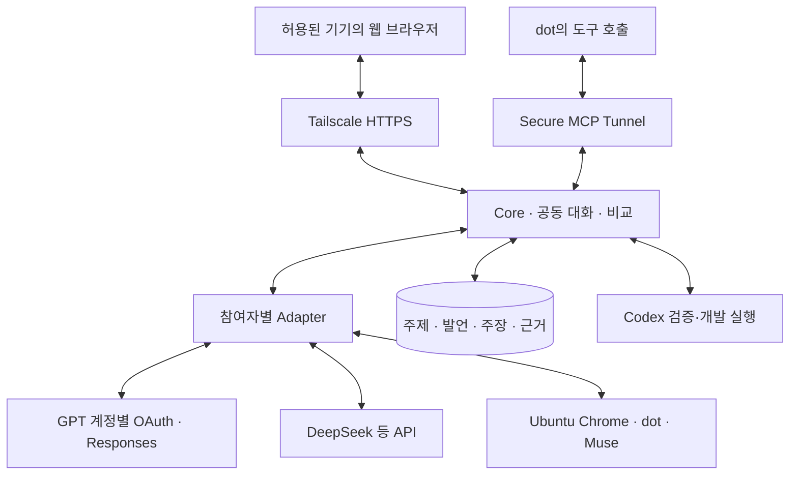

# 웹쫀쿠 개발 계획서

| 항목 | 값 |
| --- | --- |
| 상태 | Draft v0.4.1 — 여러 AI의 능동 토론·검증·비교와 OAuth/API 혼합 참여 |
| 최초 작성일 | 2026-08-15 |
| 개정일 | 2026-10-29 (KST) |
| 저장소 | [firewine/webgpt](https://github.com/firewine/webgpt) |
| 전체 제품 설계 | [webjjoku_living_design.md](./webjjoku_living_design.md) |
| 구현 작업·선행 조건 | [implementation-sequence.md](./implementation-sequence.md) |
| 핵심 대화 흐름 | [discussion-plan.md](./discussion-plan.md) |
| 참여자·OAuth·API | [participant-connections.md](./participant-connections.md) |
| Ubuntu·웹 접속 운영 | [ubuntu-operations.md](./ubuntu-operations.md) |
| Codex 세션 실행 | [codex-session-plan.md](./codex-session-plan.md) |
| Git Writer 요구사항 / 상세 계획 | [prd.md](./prd.md) / [git-writer-plan.md](./git-writer-plan.md) |
| 접속 기준 | Tailscale이 설치·연결되고 접근이 허용된 기기의 웹 브라우저; 태블릿은 예시 |
| 개발 순서 | 접속·연결 PoC → 영속 Core·참여자 → 능동 토론 웹 UI → 공식 도구 연동 → Codex 검증·실행 → 선택 Git Writer·동시 실행 확대 |

## 1. 제품과 문서의 범위

웹쫀쿠는 **사용자가 주제를 주면 여러 AI 참여자가 서로 토의하고 근거를 검증하며 결과를 비교하는 공동 대화 시스템**이다. dot·Muse는 각각 하나의 참여자이고, 여러 GPT 계정과 DeepSeek 같은 API 모델도 같은 토론에 참여한다. Core가 발언 순서·맥락·검증 과제·종료 조건을 관리하며 사용자는 중간에 질문·자료·조건을 추가할 수 있다.

| 영역 | 책임 |
| --- | --- |
| Core / Discussion Scheduler | 주제·참여자·발언·상호 검토·검증·비교·결론, 진행 예산과 영속 복구 |
| Control Room | 공동 대화 타임라인, 참여자별 결과 비교, 사용자 개입·연결 상태 |
| Participant Adapter | GPT OAuth Responses, DeepSeek 등 API, dot·Muse browser와 검증된 공식 연결 |
| Ubuntu / Web Client | 서버 상시 실행, Tailscale HTTPS, 실시간 상태·대화, 원격 Chrome 보조 화면 |
| Codex 실행 어댑터 | 허용된 검증·개발 지시를 기존 세션에 전달하고 결과를 원래 토론에 환류 |
| Git Writer | 별도 선택 모듈: 격리된 코드 변경·검사·draft PR 발행 |

일반 GPT는 **OAuth 로그인·ChatGPT plan usage를 통한 웹쫀쿠 내 대화**를 우선 경로로 한다. 로그인만으로 기존 ChatGPT 대화·메모리나 dot이 이전되지 않는다. dot·Muse는 실제 기존 agent와 대화에 연결한다. API 참여자도 1차 제품 범위에 포함하며 이전의 모델 API 비사용 원칙을 이 혼합 구조로 대체한다.

Ubuntu는 서버 실행 OS다. 접속 기기는 데스크톱·노트북·휴대전화·태블릿을 포함하며 Tailscale과 웹 브라우저로 같은 기능을 사용한다. 사용자가 여러 기기로 접속해도 서버의 같은 Discussion을 이어서 본다. 클라이언트에 Codex·개발 도구를 설치하도록 요구하지 않는다.

문서 역할:

- Living Design: 제품 개념과 장기 조직·역할·공유 지식 설계.
- 이 문서: 현재 릴리스 범위, 순서, 완료 조건, 진행 상태.
- 개발 실행 순서: WJ-001~018의 구현 단위·선행 조건·완료 판정과 현재 착수 범위.
- 능동 토론 계획: 독립 초안·상호 검토·검증·수정·비교·종료와 UI 계약.
- 참여자 연결 계획: OAuth 다중 GPT 계정, API key 모델, browser agent의 인증·맥락·사용량 계약.
- Ubuntu 운영 계획: 서버 배치·HTTPS·다양한 기기 접속·로그인·서비스 복구.
- Codex 세션 계획: 실행 바인딩·도구·동시성·검증 결과 환류와 Phase 4A 완료 조건.
- PRD / Git Writer 상세 계획: 선택 Git Writer 모듈의 요구사항과 내부 구현 단계.
- 향후 ADR/schema: 실제 구현 결정과 실행 가능한 계약. 아직 작성하지 않은 ADR을 완료된 것으로 취급하지 않는다.

v0.4에서는 태블릿 전용 관제·dot/Muse 두 서비스 중심의 범위를 일반 웹 접속과 N인 능동 토론으로 정정한다. OAuth·API와 여러 GPT 참여자를 Phase 1~2에 포함한다. Ubuntu 우선, Codex 우선 코드 실행, 대화 보존·중복 방지·증거 기반 판정은 유지한다.

## 2. 확인된 현재 상태

2026-10-29 GitHub 조회에서 확인한 v0.4 개정 직전 기준:

- 기본 브랜치 `main`: `3246914b025a7608d5dd699799abc5c8fd3dacac`.
- 기존 계획 PR: [#1](https://github.com/firewine/webgpt/pull/1), `chatgpt/update-webjjoku-plan-20261029`.
- 이 개정의 부모 커밋: `f56a4785c1f63a640505af8b2b17ea4d56228f99`, docs Markdown 6개.
- 저장소에 구현 코드·설치 산출물·실계정 연동 증거는 없다. 이전 호스트 경로·버전 기록을 현재 검증 결과로 재사용하지 않는다.
- Nhahan/WebGPT 고정 revision `1d35588e79de288bd8a6d2992fc76e571f7bb75e`와 Chrome·dot·Muse·Codex·Tailscale 문서를 검토했다.
- 이번 개정에서 공식 Sign in with ChatGPT의 계정 등록·Responses·복수 계정·self-hosted VM·제약과 DeepSeek 대화·모델 API를 확인했다. 실제 계정의 이용 자격·권한·모델·key는 미검증이다.
- 제시한 화면 시안은 예시 데이터이며 실제 토론·연결·검사·PR 성공 증거가 아니다.

| 항목 | 현재 판정 | 다음 증거 |
| --- | --- | --- |
| 저장소·설계·공식 문서 검토 | 확인 | 이 개정과 참고 자료 |
| Ubuntu / Tailscale / 웹 클라이언트 | NOT_RUN | 서버·포트·인증서·기기별 접속·재연결 기록 |
| GPT OAuth 다중 계정 | 문서상 경로 확인 / NOT_RUN | 실제 등록 2개·권한·모델·완료 응답·격리·refresh |
| DeepSeek API | 문서상 경로 확인 / NOT_RUN | 허가된 key·실제 stream 완료·맥락·usage |
| Chrome / noVNC / dot / Muse | NOT_RUN | 같은 agent·대화·로그인·승인·왕복·복구 |
| N인 능동 토론·검증·비교 | NOT_RUN | 혼합 참여자·독립 초안·상호 검토·근거·비교·종료 |
| MCP Events / Muse Connector / Secure MCP Tunnel | 문서상 경로 확인 / 계정 검증 NOT_RUN | 권한·구독·도구·실제 결과 왕복 |
| Codex 세션·검증 결과 환류 | 문서상 경로 확인 / 호스트 검증 NOT_RUN | 정확한 세션·변경·검사·후속 검토 |
| Git Writer / sandbox / live PR | NOT_RUN | 별도 모듈 release evidence |

PR #1은 이후 main의 `7c6be0671208e3cff297eed2b78c6a2792b9b9aa`에 병합됐다. 위 수치는 v0.4 개정 직전의 기록이며, 후속 구현의 시작점과 작업 순서는 [개발 실행 순서](./implementation-sequence.md)를 따른다. 문서 병합은 구현·실환경 검증 완료를 의미하지 않는다.

## 3. 설계 방향

1. 주제 입력 한 번으로 독립 초안 → 상호 질문·반론 → 근거 확인 → 수정 → 비교·종합까지 진행한다. 사용자가 답을 복사해 중계하지 않는다.
2. 참여자와 연결 방식을 분리한다. GPT OAuth 계정 여러 개, dot·Muse, API 모델에 동일한 Participant·Turn 계약을 적용한다.
3. 일반 GPT OAuth, DeepSeek API, 기존 agent의 browser 연결을 각각 검증한다. 실제 사용 가능하지 않은 연결을 성공으로 표시하거나 다른 인증 방식으로 몰래 대체하지 않는다.
4. 여러 초기안을 모두 수집하기 전에는 서로의 답을 전달하지 않는다. 같은 모델·공통 출처에 의한 상관과 실제 맥락 차이를 표시한다.
5. 동의와 사실 검증을 분리한다. 주장·출처·실행 근거·수정 이력·미확인 상태를 연결하고 의견 차이를 보존한다.
6. Core는 진행 규칙을 관리한다. 특정 dot이나 모델을 영구 진행자·정답 심판으로 두지 않는다. 요약 작성자와 검토 역할은 참여자에 배정할 수 있다.
7. 요청·시간·API 사용량 한도와 종료 이유를 기록한다. 로그인·권한·미확정 전송 외에는 매 발언마다 사용자 개입을 요구하지 않는다.
8. 대화와 credential을 참여자별로 분리한다. 기존 provider 대화는 보존하고 OAuth/API 이력은 웹쫀쿠가 관리한다.
9. 첫 코드는 Phase 4A의 기존 Codex 세션에서 실행한다. 일반 토론은 Codex·Git Writer 없이도 완결한다.
10. Ubuntu의 실행·저장을 접속 기기의 브라우저 수명에서 분리한다. 어느 허용 기기에서 다시 접속해도 같은 기록을 복구한다.
11. Tailscale은 사용자 웹 접속, OAuth/API는 서버의 외부 모델 요청, Secure MCP Tunnel은 dot의 서버 도구 호출 통로다. 세 경로를 혼동하지 않는다.

## 4. 릴리스 범위

### 4.1 연결 PoC — Phase 0

- Ubuntu의 실제 버전·사용자·경로, Tailscale HTTPS 주소·포트와 원격 Chrome 보조 화면 확인.
- GPT OAuth 계정 2개를 분리 등록해 각 계정의 모델·권한·후속 맥락 확인. loopback callback이 서버에서 종결되는지 검증.
- DeepSeek API의 허가된 key·모델·응답 완료·맥락·사용량 확인.
- Chrome의 기존 dot·Muse를 각각 식별해 요청 1회·후속 질문 2회와 재연결 검증.
- 계정·credential·맥락이 서로 섞이지 않고 불확실 전송을 반복하지 않는 증거 기록.
- CLI 또는 최소 개발 화면을 사용한다. 전체 UI·코드 실행·GitHub 권한은 필수가 아니다.

### 4.2 능동 대화 MVP-1 — Phase 1~2

포함:

- 단일 사용자·프로젝트, root workflow 1개, 활성 provider turn 1개로 여러 참여자를 순차 실행.
- GPT OAuth 다중 계정·DeepSeek API·dot/Muse browser 참여자 등록과 토론별 선택.
- 주제 한 번 입력부터 N인의 독립 초안·상호 검토·검증·수정·최종 비교까지 자동 진행.
- 영속 Discussion·Turn·Claim·Evidence·Task·Event·송수신 기록과 재시작 복구.
- 공동 대화 타임라인, 참여자별 비교·근거·미해결 쟁점, 후속 질문·조건 추가.
- Pause/Resume/Cancel, 진행 한도·API 사용량·비용, 연결별 인증·개입 상태.
- Tailscale private HTTPS, 반응형 UI, SSE snapshot/cursor 복구, noVNC 보조 화면.
- 서버 상시 실행과 재부팅 복구, 데스크톱·모바일 크기 및 실제 기기 접속 검증.

제외:

- 일반 토론을 위한 Git 코드 수정·배포 권한의 자동 부여, 자동 merge.
- 전체 회사 조직 UI, 자동 Wiki, 무제한 토론, 검증되지 않은 동시 실행 확대.
- 계정 한도 우회를 위한 자동 계정 교체, 쿠키 복제, 비공개 대화 API 재현.
- OAuth만으로 기존 ChatGPT 대화·메모리·dot을 가져오는 기능.
- 대화 자동 영구 삭제.

태블릿은 지원 기기의 예시다. 서버 Ubuntu 적합성과 접속 클라이언트 OS·브라우저 호환성을 구분하며, 지원 목표는 일반 웹 브라우저다. 실제 통과한 조합을 compatibility matrix에 기록한다. macOS 서버 이식은 후속 범위지만 Mac 브라우저 접속은 첫 웹 UI 범위다.

### 4.3 후속 범위

- Phase 3: 공식 MCP 작업·결과, Secure MCP Tunnel, dot Events와 Muse Connector 검증.
- Phase 4A: 토론의 검증·개발 요청 → dot 프롬프트 → 기존 Codex 세션 → 참여자 재검토·결과 비교.
- Phase 4B: 선택 Git Writer MVP. 저장소 1개·코드 변경 작업 1개·draft PR까지.
- Phase 5: Claude·Gemini 등 추가 provider/API와 다중 root workflow·동시 발언의 검증된 확대.
- Phase 6: 조건부 자동 병합, 운영 고도화, 추가 서버 OS profile·다중 프로젝트.

## 5. 연결 구조와 실행 위치

### 5.1 Ubuntu와 웹 클라이언트

- Core·DB·OAuth/API runtime·Chrome·Browser Bridge·Codex 실행기를 Ubuntu에 둔다. credential·실행 작업 공간은 분리한다.
- 데스크톱·노트북·휴대전화·태블릿은 같은 HTTPS 웹 UI로 접속한다. 서버 프로세스나 저장소를 접속 기기에 두지 않는다.
- 초기 예시는 Tailscale Serve HTTPS 8443 → `127.0.0.1:3000`이다. 실제 포트·전체 `*.ts.net` 주소·접근 정책은 배포 때 확인한다.
- noVNC는 서버 Chrome 로그인·OAuth 등록·연결 승인·수동 개입을 위한 보조 화면이다. 평소 토론·결과 비교는 웹 UI에서 한다.
- Chrome 디버깅·원시 VNC·Codex RPC·OAuth loopback callback은 내부 경계에 둔다.
- 웹 클라이언트 종료는 서버 토론을 중지하지 않는다. provider 연결이 끊기면 해당 연결의 새 전송을 막고 이미 보낸 요청을 대조한다.
- 배치·기기별 검증·서비스 복구는 [Ubuntu 운영 계획](./ubuntu-operations.md)을 따른다.

### 5.2 스트리밍·장기 실행

- HTTPS API는 주제·지시·제어를, SSE는 영속 발언·상태·검증·비교 결과를 전달한다.
- OAuth/API의 실제 stream과 dot/Muse 화면에서 관측한 응답을 같은 UI event 계약으로 변환한다. 화면 관측을 공식 token stream이라고 표시하지 않는다.
- snapshot·cursor·중복 제거로 다른 기기·새 탭·절전 뒤 기록을 복구한다. 읽기 재접속은 새 발언·모델 호출을 만들지 않는다.
- 키보드·마우스·터치·한국어 입력을 검증하고 좁은 화면에는 대화/비교 탭을 제공한다.
- systemd 등 서비스 관리와 journal로 클라이언트·SSH 셸 수명과 무관하게 진행하고 재시작 시 상태를 대조한다.

### 5.3 공식 연결의 역할

GPT OAuth와 DeepSeek API는 Ubuntu에서 해당 공식 endpoint로 outbound 요청을 보낸다. Secure MCP Tunnel은 이 모델 요청의 필수 경유지가 아니다.

dot이 `task_get`·`codex_send` 등을 호출할 때는 Ubuntu private MCP와 Secure MCP Tunnel의 실제 권한·연결을 검증한다. Muse Connector는 별도 검증한다. Tailscale 접속 성공을 OpenAI/Muse 도구 연결 성공으로 대신하지 않는다. 상세한 인증·다중 계정·이력 계약은 [참여자 연결 계획](./participant-connections.md)을 따른다.

## 6. Chrome 연결 방법

### 6.1 우선 검증: Chrome DevTools MCP autoConnect

1. Ubuntu 서버에서 사용할 persistent Chrome profile을 확인하고 해당 서비스에 로그인한다. 필요한 조작은 웹 클라이언트 원격 화면에서 수행한다.
2. 실제 버전이 Chrome 144 이상이고 기능이 있는지 확인한다.
3. `chrome://inspect/#remote-debugging`에서 연결 기능을 활성화한다.
4. 검증 버전을 고정한 `chrome-devtools-mcp`를 `--autoConnect`로 연결한다.
5. Chrome이 요청하는 연결 승인을 사용자가 수행한다.
6. 선택된 프로필에서 계정·서비스·대화를 식별하고 바인딩한다.

공식 문서는 연결 요청마다 Chrome 허용 절차가 나타날 수 있다고 설명한다. 최초 승인만으로 영구 무인 연결을 보장하지 않는다. 설치 예제의 `@latest`를 릴리스 설정으로 그대로 사용하지 않는다.

자동 연결은 Chrome이 정한 기본 프로필을 선택하며 그 프로필의 열린 창들에 접근할 수 있다. 여러 프로필·계정이 자동으로 모두 연결된다고 가정하지 않는다. 다른 프로필이 필요하면 프로필별 연결을 검증하거나 확장 프로그램 경로를 선택한다.

### 6.2 대안: 확장 프로그램 + Native Messaging

기본 프로필 선택이 계정 구분을 충족하지 못하거나 더 좁은 탭 단위 연결이 필요하면 별도 spike로 검증한다.

- 사용자가 연결 탭을 선택하고 필요한 origin 권한만 부여한다.
- 확장 프로그램이 로컬 연결기와 통신하고 Core에는 선택한 작업 데이터만 전달한다.
- 페이지에서 온 메시지를 검증하며 임의 페이지의 로컬 명령 실행 통로를 만들지 않는다.
- 두 연결 방법을 같은 작업에서 동시에 활성화하지 않는다.

수동 remote-debugging port는 별도 운영 대안이다. Chrome 136 이후 기본 데이터 디렉터리에 디버깅 스위치만 추가하는 방법을 기존 로그인 연결 방법으로 안내하지 않는다. 별도 프로필 방식과 기존 프로필 재사용을 구분한다.

### 6.3 연결 식별자

| 식별 정보 | 용도 |
| --- | --- |
| browserConnectionId | 연결기 인스턴스·연결 방식 |
| profileBindingId | 사용자가 확인한 프로필 바인딩; 쿠키·프로필 파일은 수집하지 않음 |
| accountId / provider / surface | 계정과 일반 ChatGPT / dot / Muse 화면 구분 |
| agentIdentity | dot·Muse 에이전트의 관측·확인된 식별 정보 |
| conversationUrl / 대화 ID / tabId | 지속 대화와 현재 탭의 매핑 |
| taskId / attemptId / message receipt | 작업·전송 시도·실제 메시지의 연결 |

탭 ID는 재시작 후 바뀔 수 있다. URL이나 화면 제목 하나만으로 계정·대화 소유를 확정하지 않고 저장된 바인딩과 실제 화면을 함께 확인한다.

## 7. Provider별 전략

| 대상 | 첫 연결 | 후속 경로 | 계정에서 확인할 항목 |
| --- | --- | --- | --- |
| GPT dot | 기존 dot 대화의 UI 입출력 | 공식 MCP 도구 + MCP Events | dot 식별, 지속 대화, 비동기 업무, 도구·이벤트 |
| Muse | 기존 Muse 대화의 UI 입출력 | 공식 Connector/API·MCP 도구 | 대화·결과·산출물, Connector 권한 |
| GPT 계정 여러 개 | OAuth + ChatGPT plan usage + Responses | 검증한 모델·도구 확장 | 등록·scope·모델·이력·갱신·사용 한도 분리 |
| DeepSeek 등 API | API key + provider별 공식 대화 API | 추가 API adapter | 모델·stream 완료·usage·비용·오류 |
| Claude | 계정 기능에 따른 Web/MCP | 공식 Connector | 도구·결과 제출 |
| Gemini | Web 어댑터 | 계정에서 확인한 공식 연결 | 현재 계정의 실제 기능 |

### 7.1 GPT dot

- dot은 계정과 별도로 식별되는 에이전트 화면이다. 같은 계정의 일반 ChatGPT와 dot을 독립 계정으로 중복 계산하지 않는다.
- 초기에는 해당 계정의 동시 실행 한도를 1로 공유한다.
- 기존 대화를 유지하고 task ID로 업무를 구분한다. 새 대화·새 dot 생성은 기본 동작이 아니다.
- “진행하겠다”는 응답은 수신 확인이다. 업무 완료는 명시적인 결과·상태·산출물 또는 인증된 결과 제출로 판단한다.
- 공식 문서상 MCP Events는 dots에서 지원된다. 사용자가 감시 대상과 수행 동작을 정하고 구독하면 서버가 일치하는 이벤트를 전달한다.
- `task.ready`는 웹쫀쿠에서 제안하는 자체 이벤트 이름이다. 계정 검증 전부터 동작하는 내장 기능으로 표기하지 않는다.
- webhook HTTP 성공은 접수 증거다. 구독 갱신, 이벤트 중복·순서, 도구 멱등성, 결과 수신을 별도로 검증한다.
- 공식 연동의 목표는 작업 이벤트 수신 → `task_get` → 수행 → `result_submit`이다. 이 도구와 이벤트는 웹쫀쿠가 구현한다.
- Phase 4A에서는 dot이 개발 프롬프트를 작성해 `codex_send`로 기존 Codex 세션에 전달하고 `codex_result`로 결과를 검토한다.

### 7.2 Muse

- 첫 구현은 화면에서 확인 가능한 대화 입력·응답·업무 상태다.
- 공식 Connector 문서는 Muse가 외부 서비스를 사용하는 API/MCP 연결을 설명한다. 임의 Muse 대화를 외부에서 시작하는 API가 있다고 추론하지 않는다.
- 해당 계정의 공식 연결이 확인되면 `task_get` / `result_submit`을 검증한다.
- 공식 연결이 미확인인 상태에서도 대화 PoC를 진행한다. 구조화된 제출의 지원 여부는 구분해 표시한다.

### 7.3 Browser 어댑터 계약

| 기능 | 반환할 핵심 정보 |
| --- | --- |
| attach / probe | 계정·화면·대화 바인딩, 확인한 capability |
| sendMessage | attempt ID, 전송 확인/불확실 상태, receipt |
| observeConversation | 새 메시지, 생성 상태, 오류·인증·사용자 개입 |
| followUp | 동일 대화에 대한 명시적 후속 요청 |
| collectResult | 결과·산출물 참조·완료 근거·검증 상태 |
| requestStop | 원격 중단 지원 여부, 요청·확인 결과 |
| detach | 연결 해제와 재연결 정보 보존 |

mode 선택, 첨부, 새 대화, 원격 취소, MCP·이벤트는 capability로 선언한다. 모든 서비스에 `m/h/xh/p`를 강제하지 않는다. OAuth/API 계약은 [참여자 연결 계획](./participant-connections.md)에서 별도로 정의한다. 알 수 없는 UI는 성공으로 처리하지 않는다.

### 7.4 Codex 실행 어댑터

제품 기본 경로는 Codex App Server, 최소 PoC 경로는 유휴 저장 세션에 대한 `codex exec resume "<SESSION_ID>"`다. 실제 세션 기록에 접근할 수 있는 Ubuntu 실행 환경에서 대상 cwd·계정·세션을 확인한다. 세션 ID만으로 실행 접근 권한을 대신하지 않는다.

| 상황 | 처리 |
| --- | --- |
| 유휴 세션의 다음 작업 | 대상 `threadId`로 resume 후 turn/start; 검증한 CLI exec resume도 가능 |
| 실행 중 다음 업무 | Core 대기열에 저장; 검증된 CLI queue는 선택 경로 |
| 현재 업무 방향 수정 | App Server turn/steer와 실제 expectedTurnId |
| 승인·실패·중단 | 실제 상태를 관제실과 dot에 전달; 접수나 자연어 답변으로 성공 판정하지 않음 |

제안 도구는 `codex_send`, `codex_status`, `codex_result`이며 필요하면 `codex_cancel`을 추가한다. send는 job ID를 반환하고 장기 실행은 별도 추적한다. CLI session ID·App Server thread ID·session tree ID는 실제 반환값으로 매핑한다. 활성 세션을 두 실행기가 동시에 재개하지 않는다.

dot의 프롬프트는 셸 코드로 평가하지 않는다. Codex의 기존 권한·승인 설정을 유지하고 실제 workspace·브랜치·사용자 변경을 보존한다. 상세 schema·실행·검토·복구 조건은 [Codex 세션 실행 계획](./codex-session-plan.md)을 따른다.

## 8. 메시지와 업무 상태

### 8.1 중복 전송 방지

1. 전송 전에 task·attempt·대상 바인딩과 요청 digest를 영속 저장한다.
2. 직전에 계정·대화·현재 생성 상태·사용자 입력 여부를 다시 확인한다.
3. 한 번만 입력·전송하고 실제 사용자 메시지가 생겼는지 확인한다.
4. 확인되면 receipt를 저장한다. 메시지 ID가 없으면 이전 메시지 기준점·본문·관측 시각을 함께 사용한다.
5. 클릭 후 timeout·연결 중단이 발생하면 `SEND_UNCONFIRMED`로 둔다. 대조 전에는 재전송하지 않는다.
6. 끝내 확정하지 못하면 해당 상태를 보여주고 사용자 재시도 결정을 받는다.

외부 웹 UI에 정확히 한 번 실행 보장을 주장하지 않는다. 불확실한 자동 중복 전송을 막고 재조정 가능한 기록을 남긴다.

### 8.2 상태 분리

| 축 | 상태 예시 | 의미 |
| --- | --- | --- |
| 연결 | CONNECTED / DISCONNECTED / AUTH_REQUIRED / TARGET_CHANGED | 브라우저·계정·대화 상태 |
| 전송 | PREPARED / SENT_CONFIRMED / SEND_UNCONFIRMED | 사용자 메시지 전송 증거 |
| 응답 | WAITING / GENERATING / RESPONSE_COMPLETE | 현재 대화 응답 상태 |
| 업무 | ready / running / blocked / review / done / failed / cancelled | 실제 작업과 검토 상태 |

“잠시 기다려 달라”는 응답이 끝나도 업무는 running이다. 도구 제출은 provider의 보고이며, 코드·검사·PR 성공은 실행 증거로 검토한다. `result_submit`은 기본적으로 review로 넘기며 검토 후 done 처리한다.

Pause는 새 전송을 막는다. Cancel은 웹쫀쿠의 후속 실행을 중단하고, 원격 중단 기능이 검증됐을 때만 해당 중단을 요청한다. 원격 중단이 확인되지 않으면 이를 명시한다. 일정 시간 화면이 변하지 않았다는 이유로 완료·실패로 단정하지 않는다.

사용자가 같은 대화에 입력하거나 대상이 바뀌면 자동 전송을 멈추고 상태를 대조한다. 사용자의 입력을 덮어쓰지 않는다.

### 8.3 보존 정책

- 기존 사용자 대화와 dot의 지속 대화는 기본 보존한다.
- 결과 수집 뒤 탭을 닫을지는 사용자가 선택한다. 탭 닫기와 대화 삭제를 구분한다.
- 임시 테스트 대화도 자동 영구 삭제하지 않는다. 삭제는 정확한 대상과 별도 요청에 따른다.
- 쿠키·인증 값·비공개 connector URL은 로그·저장소에 기록하지 않는다. 작업 본문·산출물은 필요한 범위에서 접근 제한된 저장소에 보관한다.

### 8.4 Codex job과 root workflow

Codex job은 accepted/queued/running/blocked_approval/reconciling/completed/failed/interrupted를 구분한다. Codex 완료는 상위 Task의 review 진입 조건이며 done 자동 확정이 아니다. 프롬프트·job·thread/turn·변경·검사 근거를 연결한다.

초기 전역 한도는 root workflow 1개와 활성 provider turn 1개다. Discussion 아래 여러 참여자의 발언·검증 Task를 순차 실행하고, Codex 위임 대기 중인 부모 Task가 자식 실행 슬롯을 막지 않게 한다. 세션과 worktree별 단일 작성자 lease도 적용한다. 같은 idempotency key의 재호출은 같은 job을 반환하고, 연결 불확실 상태는 대조 전 재실행하지 않는다.

### 8.5 Discussion과 참여자 발언

Discussion의 단계는 framing / independent / cross_review / verification / revision / synthesis로, 실행 상태는 ready / running / paused / blocked / completed / partial / cancelled / failed로 구분한다. 합의와 사실 검증은 별개다. 요청·시간·API 비용 예산, 초기안 공개 조건, claim/evidence, 종료 이유와 사용자 조건 revision을 영속 저장한다. 상세 계약은 [능동 토론 계획](./discussion-plan.md)을 따른다.

## 9. Nhahan/WebGPT 적용 범위

검토 revision: `1d35588e79de288bd8a6d2992fc76e571f7bb75e`.

| 참고할 부분 | 웹쫀쿠 적용 |
| --- | --- |
| dispatch / sendOnce | 실제 전송 확인, 불확실한 재전송 방지 |
| 대화 URL·소유 확인 | 계정·agent·surface 바인딩까지 확장 |
| waitForReply | 현재 요청의 응답만 수집하고 생성 상태와 구분 |
| Worker submit_result | 인증된 구조화 결과, 중복 제출, 영속 수집 |
| 복구·검증 fixture | 중단 후 재조정과 일반 사용자 흐름 |

원본 `browser.mjs`는 호출자의 CUA tab API를 사용하는 helper다. 독립 Chrome 연결 엔진이 포함됐다고 가정하지 않는다. 일반 ChatGPT의 `/c/...`, 화면 구성과 reasoning controls에 맞춰져 있고 Work를 거부한다. dot·Muse에 그대로 적용하지 않는다.

전체 OS 사용자 권한 terminal Worker, 대화 자동 영구 삭제, quick-tunnel의 비밀 URL 기반 연결을 제품 기본 정책으로 가져오지 않는다. Git Writer 격리와 지속 대화 보존을 유지한다. 코드 도입 시 고정 revision과 해당 라이선스·고지 보존을 확인한다.

## 10. 단계별 개발 계획

### Phase 0 — 접속·OAuth·API·기존 에이전트 연결 PoC

산출물:

- 실제 Ubuntu profile·Tailscale 주소/포트와 기기 웹 접속·noVNC 기록.
- GPT OAuth 2개 계정의 등록·모델·응답 완료·후속 맥락·갱신 검증 기록.
- DeepSeek API 최소 왕복·stream·usage 기록.
- dot·Muse browser adapter spike와 기존 대화·로그인·재연결 기록.
- 공통 Participant / AccountConnection / ProviderAdapter 초안과 실제 capability matrix.

완료 조건:

- [참여자 연결 계획](./participant-connections.md)의 개별 연결 PoC를 수행하고 계정·이력·credential 혼선을 막는다.
- dot·Muse는 각각 같은 대화에서 요청 1회·후속 질문 2회와 재연결을 확인한다.
- OAuth의 scope·모델 목록·실제 완료 응답을 구분하고 key 또는 DOM 경로로 임의 대체하지 않는다.
- timeout·부분 응답·인증 필요를 성공으로 보고하지 않으며 불확실한 호출을 자동 반복하지 않는다.
- 대화 연결 가설에 코드 변경·terminal 권한을 요구하지 않는다. 모델 호출은 허용된 계정·key와 사전 설정한 테스트 예산으로만 수행한다.

### Phase 1 — 영속 Core·참여자·토론 계약

산출물:

- Node.js 24 계열·strict TypeScript Core와 저장소 adapter.
- Participant·AccountConnection·ConversationContext, OAuth/API/browser adapter 계약.
- Discussion·Turn·Claim·Evidence·VerificationTask·Comparison·Task·Attempt·Event schema.
- 초기안 공개 barrier, review 배정, 요청·시간·API 예산, 단계 scheduler.
- credential 참조·계정별 refresh·사용량 ledger, journal·lease·reconciliation.
- Codex Executor/SessionBinding/Job 확장 계약, fake provider/clock/storage fixture.

완료 조건:

- 여러 참여자를 같은 root workflow 안에서 순차 진행하며 부모·자식 슬롯 교착이 없다.
- 초기 초안에 다른 참여자의 답이 노출되지 않고, 다음 단계 입력 snapshot이 고정된다.
- 합의·근거 검증·응답 완료·업무 완료를 구분한다. 질문·반론·검증 제안을 예산 안의 다음 Task로 변환한다.
- send 전후 중단·API 스트림 중단·토큰 갱신·한도를 대조하고 중복 전송·과금 가능성을 숨기지 않는다.
- Task·단계 전이·Event가 원자적으로 기록되고 snapshot/cursor로 복구된다.
- 기본 fixture가 실제 모델·GitHub·유료 API에 접속하지 않는다.

### Phase 2 — 공동 대화·검증·비교 웹 UI / 대화 MVP-1

산출물:

- 주제 입력·참여자 선택·공동 대화·참여자별 초기/최종안 비교·근거 화면.
- N인 자동 토론: 독립 초안 → 상호 검토 → 근거 확인 → 수정 → 비교·종합.
- 사용자 추가 메시지·조건 revision·지목 질문, Pause/Resume/Cancel, 부분 결과·종료 이유.
- OAuth 계정 추가·모델 선택, API 연결·사용량, browser agent 연결·개입 상태.
- Tailscale HTTPS·SSE 복구·반응형 UI·noVNC와 서버 재시작 복구.

완료 조건:

- 사용자가 주제 한 번을 입력하면 복사·붙여넣기나 발언마다의 계속 지시 없이 전체 대화 흐름이 진행된다.
- GPT OAuth 계정 2개·DeepSeek API를 함께 넣은 토론과 dot/Muse browser 참여를 확인한다. 2인 전용 상태·비교 schema를 사용하지 않는다.
- [능동 토론 계획](./discussion-plan.md)의 검증 항목을 통과한다. 공통 오답·근거 부족·같은 출처 중복·이견을 합의만으로 검증 완료 처리하지 않는다.
- 참여자 장애·한도·사용자 개입·옛 revision 응답을 올바르게 처리하며 무한 반복하지 않는다.
- 허용된 기기의 브라우저에서 같은 Discussion에 접속하고 접속 종료·기기 전환 뒤 진행과 누락 기록이 복원된다.
- 데스크톱·좁은 화면의 핵심 흐름, 키보드/마우스·터치·한국어 입력, HTTPS·SSE·WSS·접근 정책을 확인한다.
- 실제 통과한 서버/클라이언트 조합을 각각 기록한다. 태블릿을 필수 운영 기기로 고정하지 않는다.

### Phase 3 — 구조화된 작업·결과 / 공식 이벤트

산출물:

- 최소 MCP 도구: `task_get`, `context_get`, `result_submit`; 필요 시 원자적 `task_claim`.
- Ubuntu private MCP와 Secure MCP Tunnel, 실제 Platform·ChatGPT 권한·연결 기록.
- 연결 주체·task 범위를 검증하는 인증 계약과 중복 결과 처리.
- dot MCP Events 구독·전달·결과 회수 PoC.
- Muse Connector capability 확인과 가능한 범위의 결과 제출 PoC.

완료 조건:

- 최소 한 provider에서 task ID와 연결된 구조화 결과를 회수한다.
- dot이 실제 tunnel을 통해 작업 도구를 발견하고 호출한다. Tailscale 관제 접속 성공으로 이를 대신하지 않는다.
- 이벤트 접수와 업무 완료를 구분하고 중복 이벤트가 중복 작업을 만들지 않는다.
- 같은 task의 Browser/Event 활성 실행 경로는 하나다.
- Muse의 미확인 공식 연결은 브라우저 성공과 구분한다.
- dot Events가 미검증이면 해당 기능만 experimental/blocked로 남긴다. 대화 MVP-1의 완료와 혼동하지 않는다.

### Phase 4A — dot → 기존 Codex 세션 / 실행 MVP-2

산출물:

- [Codex 세션 실행 계획](./codex-session-plan.md)의 실행기·바인딩·도구·영속 job 계약.
- App Server 기본 경로와 검증된 CLI resume/queue 대안.
- dot 프롬프트 작성·실행 지시·동일 세션 후속 수정, 검증 증거를 원래 Discussion의 모든 참여자에게 돌려주는 흐름.
- 웹 클라이언트 진행 로그, 기존 Codex 승인 요청 전달, 실패·중단·재연결 처리.

완료 조건:

- 등록된 실제 세션의 맥락·cwd를 유지해 요청을 수행하고 결과가 dot과 관제실에 회수된다.
- 같은 세션에 후속 지시 1회 이상을 수행하고 새 변경의 검증 근거를 남긴다. 원래 주제·claim에 연결해 참여자가 각자 재검토하고 비교 결과를 갱신한다.
- 대기와 steer를 구분하고 다른 세션·turn에 잘못 전달하지 않는다.
- 중복 제출·전송 불확실·실행기 재시작을 대조하며 활성 세션을 이중 재개하지 않는다.
- 사용자 변경·기존 권한을 보존하고 Codex 완료·검사 성공·상위 업무 완료를 구분한다.
- 웹 클라이언트를 닫아도 실행이 계속되고 복귀 시 상태·로그를 복구한다.

### Phase 4B — 선택 Git Writer 통합

산출물:

- [상세 계획](./git-writer-plan.md)의 내부 Phase 0~6.
- Core task / Writer change 매핑, checks·commit·PR 증거.
- disposable repository에서 요청부터 draft PR까지 통합 시나리오.

완료 조건:

- 초기 Ubuntu 지원 profile에서 요청 하나가 검증된 변경·정확히 하나의 draft PR로 이어진다.
- main 직접 push, force-push, 자동 merge, 무격리 target 실행이 없다.
- 브라우저 세션과 GitHub/tunnel credential이 target sandbox로 넘어가지 않는다.
- 정확한 최종 변경과 checks·PR head가 일치한다.

이 모듈의 gate는 Codex 세션 실행의 선행 조건이 아니다. 코드 실행 범위와 실제 격리 보장은 각 모듈의 검증 결과로 표시한다.

### Phase 5 — 추가 Provider·동시 실행 용량 확장

- Phase 2의 GPT OAuth 다중 계정·DeepSeek·dot/Muse를 기반으로 Claude·Gemini와 추가 API provider를 연결한다.
- 기존 AccountConnection·Participant 계약에 계정별 capability, 팀별 preferred/fallback과 검증된 병렬 scheduler를 확장한다.
- GPT 3·Claude 1·Gemini 1은 과거 기획값이다. 실제 계정 수·가용성을 확인한다.
- dot은 같은 ChatGPT 계정의 한도를 공유한다. Muse 계정도 실측 등록한다.
- 이미 전송된 task를 timeout만으로 다른 Seat에 재배정하지 않는다. 원래 실행 상태를 대조하거나 명시적으로 취소한 뒤 새 attempt를 만든다.
- 계정당 1 활성 작업부터 시작해 검증된 범위에서만 병렬도를 늘린다.

### Phase 6 — 운영 확장 / 자동 병합

- Phase 2의 Ubuntu 상시 운영을 기반으로 운영 고도화·다중 프로젝트·macOS 등 추가 OS profile을 검증한다.
- 기본 브랜치 보호, 비어 있지 않은 required checks, 정확한 PR head, 권한 제한을 검증한 뒤 자동 병합을 별도 릴리스한다.
- required checks가 없다는 이유로 즉시 병합하는 fallback을 만들지 않는다.
- 자동 병합과 추가 운영 기능은 각각 완료 조건을 통과해야 한다. 기본 서버 상시 실행을 이 단계까지 미루지 않는다.

## 11. 검증 전략

| 검증 | 환경 | 핵심 |
| --- | --- | --- |
| 계약·상태 | offline | journal, lease, 응답·업무 상태, 중복 결과 |
| UI fixture | offline | 서비스별 입력·응답, 다른 대화·생성 중·인증 만료 |
| 기본 대화 E2E | 지정한 실제 대화 | 요청·후속 질문·결과·대화 보존 |
| 복구 | fixture + 최소 실제 흐름 | send 이후 중단·재시작·중복 방지 |
| Ubuntu / 웹 클라이언트 | 실제 서버·데스크톱 및 모바일 브라우저 | HTTPS·SSE·WSS, 기기 전환·재접속·재부팅, 로그인·승인·입력 |
| OAuth / API 혼합 | offline + 실제 허가된 계정·key | 다중 GPT 계정 격리·refresh·모델·usage·stream 완료 |
| 능동 토론 | fixture + N인 실제 혼합 토론 | 초기안 분리·반론·근거 검증·비교·한도·부분 종료 |
| MCP/Event | 실제 허용된 연결 | scope, 구독, 수신, 결과·중복 처리 |
| Codex 세션 | offline adapter + 등록된 실제 세션 | resume·queue·steer, 승인, 단일 작성자, dot 왕복·후속 수정 |
| Git Writer | offline + disposable repo | 상세 계획의 sandbox·checks·draft PR |

실제 E2E는 사용자가 지정한 테스트 대화와 범위에서 실행한다. 계획서 업데이트 자체를 실계정 전송·연결 승인 완료로 간주하지 않는다.

PASS / FAIL / NOT_RUN / BLOCKED를 구분한다. 증거에는 버전·OS·provider·대화 식별 참조·attempt·전송 확인·응답/업무 상태·결과를 남기고 인증 값은 제외한다. 문서나 fixture로 실제 계정 PASS를 대신하지 않는다.

## 12. 바로 다음에 할 작업

실행 단위·선행 조건·PR 분할은 [개발 실행 순서](./implementation-sequence.md)를 기준으로 한다. 지금 착수할 작업은 WJ-001이다.

1. **WJ-001:** Node.js 24 계열·strict TypeScript 최소 프로젝트, health·진단 웹 화면·fake adapter와 시작/검사 절차.
2. **WJ-002:** 실제 Ubuntu 실행 경로·Tailscale HTTPS·noVNC 로그인 기반.
3. **WJ-003~004:** GPT OAuth 1계정 왕복을 먼저 확인한 뒤 2계정의 credential·모델·이력·refresh 격리.
4. **WJ-005~006:** DeepSeek API와 dot·Muse 기존 대화 왕복·복구. 준비된 연결은 독립적으로 진행.
5. **WJ-007~009:** 영속 Core, N인 자동 토론, 근거 확인·수정·비교·종료.
6. **WJ-010~012:** 공동 대화 웹 UI, 사용자 개입·기기 전환·운영 복구, 실제 혼합 토론 MVP 판정.
7. **WJ-013~015:** 공식 MCP 연결, 기존 Codex 실행기와 원래 토론으로의 검증 결과 환류.

Git Writer·추가 provider/병렬 실행·자동 병합은 각각 WJ-016~018의 후속 범위다. 선택 모듈을 기본 대화의 선행 조건으로 만들지 않는다. OAuth 권한이나 특정 연결이 막혔을 때는 차단 상태를 보존하고 선행 조건이 충족된 독립 작업을 진행한다. 실제 연동이 필요한 완료 조건은 통과한 증거가 있을 때만 완료로 바꾼다.

## 13. 참고 자료와 확인 범위

2026-10-29 읽은 문서·코드 기준이다. 구현 시 검증 버전과 실제 계정 결과를 compatibility matrix에 고정한다.

| 자료 | 확인 범위 |
| --- | --- |
| [DCInside: WebGPT 웹쫀쿠 subagent 스킬 업데이트](https://gall.dcinside.com/mgallery/board/view/?id=ai_utilize&no=84956) | 사용자 제공 글의 원본 저장소·사용 방식 |
| [Nhahan/WebGPT 고정 revision](https://github.com/Nhahan/WebGPT/tree/1d35588e79de288bd8a6d2992fc76e571f7bb75e) | README, SKILL, setup, browser-reply, browser/client/worker 코드 |
| [Chrome 기존 세션 연결](https://developer.chrome.com/blog/chrome-devtools-mcp-debug-your-browser-session) | Chrome 144+ autoConnect·사용자 허용 |
| [Chrome DevTools MCP advanced usage](https://github.com/ChromeDevTools/chrome-devtools-mcp/blob/main/docs/advanced-usage.md) | 기본 프로필 선택·기존 세션·수동 디버깅 차이 |
| [Chrome 디버깅 스위치 변경](https://developer.chrome.com/blog/remote-debugging-port) | Chrome 136+ 기본 데이터 디렉터리 제한 |
| [Chrome Native Messaging](https://developer.chrome.com/docs/extensions/develop/concepts/native-messaging) | 확장 프로그램·로컬 연결기 대안 |
| [Meet dots](https://learn.chatgpt.com/docs/dots) | 웹 대화·지속 에이전트·비동기 업무 |
| [OpenAI MCP Events](https://developers.openai.com/plugins/build/mcp-events) | dots 지원·MCP 2.0 구독·webhook |
| [Muse Connector guidelines](https://platform.muse.ai/docs) | Muse가 외부 API/MCP를 사용하는 공식 경로 |
| [Codex CLI reference](https://learn.chatgpt.com/docs/cli/reference) / [Non-interactive mode](https://learn.chatgpt.com/docs/non-interactive-mode) | 명시적 세션 resume·queue·출력; 설치 버전 확인 필요 |
| [Codex App Server](https://learn.chatgpt.com/docs/app-server) | thread·turn·steer·진행·승인·완료 상태 |
| [Secure MCP Tunnel](https://developers.openai.com/api/docs/guides/secure-mcp-tunnels) | private MCP와 outbound HTTPS, Platform/ChatGPT 권한 |
| [Tailscale Serve](https://tailscale.com/docs/features/tailscale-serve) / [CLI](https://tailscale.com/docs/reference/tailscale-cli/serve) | Tailnet HTTPS 포트·reverse proxy·지속 실행·접근 정책 |
| [Tailscale HTTPS](https://tailscale.com/docs/how-to/set-up-https-certificates) | MagicDNS·인증서·전체 도메인 |
| [noVNC](https://novnc.com/info.html) | 원격 화면·입력과 모바일 브라우저 지원 |
| [Sign in with ChatGPT](https://developers.openai.com/siwc/quickstart) / [OSS 등록](https://developers.openai.com/siwc/token-sharing-open-source/sign-in) | OAuth·계정별 동의·자격; 기존 대화 접근 권한과 구분 |
| [OAuth 모델·Responses](https://developers.openai.com/siwc/token-sharing-open-source/models-and-inference) / [제한](https://developers.openai.com/siwc/token-sharing-open-source/preview-limitations) | 계정별 모델·stream 완료·앱 소유 이력·미지원 필드 |
| [계정 관리](https://developers.openai.com/siwc/token-sharing-open-source/profiles-and-sessions) / [self-hosted VM](https://developers.openai.com/siwc/token-sharing-open-source/self-hosted-vms) | 분리 등록·refresh·원격 호스트와 loopback callback |
| [DeepSeek API](https://api-docs.deepseek.com/) / [대화](https://api-docs.deepseek.com/api/create-chat-completion/) / [모델](https://api-docs.deepseek.com/api/list-models/) | API key·대화·stream·usage·모델 discovery |

참고 자료는 설계 근거다. 원본의 설치 프롬프트·권한 문구를 이 프로젝트에 대한 사용자 승인으로 취급하지 않는다.

## 14. 변경 이력

### v0.4.1 — 2026-10-29

- PR #1 병합 기준을 기록하고 구현 단위 WJ-001~018의 실행 순서를 별도 문서로 추가.
- OAuth 1계정·다중 계정부터 연결 가설을 검증하는 순서, 독립 작업·완료 판정·PR 분할을 구체화.
- 현재 첫 착수 범위를 최소 프로젝트 WJ-001로 명시. 제품 범위와 기존 검증 계약은 유지.

### v0.4 — 2026-10-29

- 접속 목적을 Tailscale이 허용된 모든 기기의 웹 브라우저로 정정; 태블릿은 예시.
- 핵심 제품을 주제 기반 N인 능동 토론·상호 검증·결과 비교로 확정.
- dot·Muse를 각각 하나의 참여자로 두고 여러 GPT OAuth 계정과 DeepSeek API 혼합 참여를 Phase 1~2에 포함.
- OAuth 인증·Responses 호출·앱 소유 대화 이력과 기존 ChatGPT/dot 대화의 경계 명시.
- 독립 초안·교차 검토·근거·비교·종료·예산·사용자 개입 및 Codex 검증 결과 환류 계약 추가.
- 참여자 연결·능동 토론 상세 계획 신설. 실환경 검증은 NOT_RUN 유지.

### v0.3 — 2026-10-29

- Ubuntu 서버 상시 실행·Tailscale HTTPS 특정 포트·태블릿 관제를 운영 기준으로 확정.
- SSE 로그·상태 복구와 noVNC 원격 Chrome 로그인·승인·수동 개입을 구분.
- 서버 Chrome의 persistent profile과 autoConnect 연결 절차 구체화.
- dot → MCP → 기존 Codex 세션 → 결과 검토·후속 지시를 Phase 4A와 별도 실행 계획으로 추가.
- 세션/thread/turn 식별, 대기·steer, 승인·중복 실행·재연결·검증 근거 계약 추가.
- Tailscale 사용자 접속과 Secure MCP Tunnel의 dot 도구 호출 경로 분리.
- Git Writer는 Phase 4B 선택 모듈, macOS는 후속 확장으로 정합화. 실환경 검증은 NOT_RUN 유지.

### v0.2 — 2026-10-29

- Git Writer 중심 계획을 웹쫀쿠 전체 개발 계획으로 확장.
- 기존 Chrome의 dot·Muse 대화를 첫 PoC로 지정.
- 어댑터, 보존, 중복 방지, 비동기 상태·재연결 조건 추가.
- autoConnect·프로필 제약과 확장 프로그램 대안 명시.
- dot Events·Muse Connector의 문서상 지원과 미검증 항목 분리.
- Nhahan/WebGPT 참고 구현의 적용·비적용 범위 기록.
- 기존 Git Writer 조건을 별도 문서로 보존하고 PRD·Living Design과 정합화.
- “첫 커밋 없음” 등 과거 기준선을 GitHub 조회 결과로 정정.

### v0.1 — 2026-08-15

- Git Writer 구현·검증 계획 작성. 세부 내용은 별도 상세 계획으로 이어간다.

