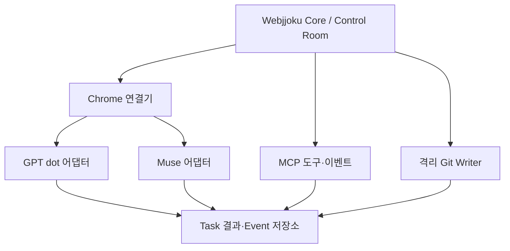

# 웹쫀쿠 개발 계획서

| 항목 | 값 |
| --- | --- |
| 상태 | Draft v0.2 — Chrome 대화 연결 우선 |
| 최초 작성일 | 2026-08-15 |
| 개정일 | 2026-10-29 (KST) |
| 저장소 | [firewine/webgpt](https://github.com/firewine/webgpt) |
| 전체 제품 설계 | [webjjoku_living_design.md](./webjjoku_living_design.md) |
| Git Writer 요구사항 / 상세 계획 | [prd.md](./prd.md) / [git-writer-plan.md](./git-writer-plan.md) |
| 첫 검증 목표 | 기존 로그인 Chrome에서 GPT dot과 Muse에 요청·후속 질문을 보내고 응답 회수 |
| 개발 순서 | 대화 PoC → 작업 Core·최소 Control Room → 구조화된 연동 → Git Writer → 다중 Seat |

## 1. 제품과 문서의 범위

웹쫀쿠는 사용자가 로그인한 웹 LLM과 에이전트에 업무를 배정하고, 결과를 회수해 다음 작업으로 연결하는 관제·오케스트레이션 시스템이다. 모델 API 호출을 기본 실행 방식으로 사용하지 않는다.

| 영역 | 책임 |
| --- | --- |
| Core / Control Room | Task Queue, Role·Account·Seat 배정, 대화·업무 상태, 결과·이벤트, 사용자 개입 |
| Provider / Browser 연결 | 기존 Chrome 연결, 서비스별 대화 입출력, 공식 MCP 도구·이벤트 |
| Git Writer | 승인된 저장소에서 격리된 코드 변경·검사·draft PR 발행 |

Git Writer는 전체 제품의 코드 실행 모듈이다. 기존 기술 조건은 [상세 계획](./git-writer-plan.md)으로 옮겨 보존한다. 전체 Control Room이나 Git Writer를 완성하기 전에 실제 dot·Muse 계정과의 왕복 대화를 검증한다.

문서 역할:

- Living Design: 제품 개념과 조직·역할·공유 지식의 장기 설계.
- 이 문서: 현재 릴리스 범위, 순서, 완료 조건, 진행 상태.
- PRD: Git Writer 모듈의 요구사항.
- Git Writer 상세 계획: 모듈 내부 Phase 0~8과 보안·검증 조건.
- 향후 ADR/schema: 선택한 구현 방법과 실행 가능한 계약. 아직 작성하지 않은 ADR을 완료된 결정으로 취급하지 않는다.

이 개정은 이전의 “Claude MCP부터 시작” 및 “Git Writer부터 구현” 순서를 대체한다. 제품·모듈 문서가 다시 충돌하면 해당 계약을 먼저 정정한다.

## 2. 확인된 현재 상태

2026-10-29 GitHub 조회에서 확인한 개정 전 기준:

- 기본 브랜치: `main`
- 기준 커밋: `3246914b025a7608d5dd699799abc5c8fd3dacac`
- 추적 파일: 개발 계획서, PRD, Living Design의 Markdown 3개.
- 구현 코드, 테스트, 설치 산출물, 실제 계정 연동 증거는 없다.
- 참고 구현은 Nhahan/WebGPT의 `1d35588e79de288bd8a6d2992fc76e571f7bb75e`를 읽었다. 설치·실행 결과가 아니다.
- Chrome·dot·Muse 공식 문서를 확인했지만 사용자 계정의 기능과 UI는 아직 검증하지 않았다.
- 기존 문서의 호스트 경로·Node/Git 버전·sandbox 관측값은 8월 기록이다. 현재 호스트 점검 결과로 재사용하지 않는다.

| 항목 | 현재 판정 | 다음 증거 |
| --- | --- | --- |
| 저장소·설계 문서·참고 코드 검토 | 확인 | 이 개정과 참고 자료 |
| 기존 Chrome 프로필 연결 | NOT_RUN | 실제 버전·프로필·연결 결과 |
| dot / Muse 왕복 대화 | NOT_RUN | 각 서비스의 같은 대화 송수신 기록 |
| dot MCP Events | 문서상 지원 / 계정 검증 NOT_RUN | 구독·이벤트 수신·결과 제출 |
| Muse Connector | 공식 경로 확인 / 계정 검증 NOT_RUN | 계정 접근·도구 발견·호출 |
| Git Writer / sandbox / live PR | NOT_RUN | 모듈 release evidence |

## 3. 설계 방향

1. 이미 로그인된 Chrome에 연결한다. 쿠키·인증 토큰을 웹쫀쿠로 복사하는 흐름을 만들지 않는다.
2. 일반 ChatGPT, GPT dot, Muse는 별도 어댑터로 다룬다. Claude·Gemini도 후속 확장에 유지한다.
3. 첫 PoC는 요청·응답·후속 질문이다. 실제 코드 변경은 Git Writer 단계에서 연결한다.
4. 전송 여부가 불명확하면 재전송하지 않고 기존 사용자 메시지를 대조한다.
5. 대화 응답 완료와 장시간 업무 완료를 별도 상태로 관리한다.
6. 대화는 기본 보존한다. dot의 지속 대화를 작업 하나가 끝났다는 이유로 삭제·초기화하지 않는다.
7. 공식 도구·이벤트 연동은 계정에서 검증한 기능만 사용한다. MCP 도구 제공과 외부 대화 시작 기능을 구분한다.
8. 다중 계정·병렬 작업·전체 조직 UI보다 두 서비스의 실제 왕복 연결을 먼저 완성한다.

## 4. 릴리스 범위

### 4.1 연결 PoC — Phase 0

- 로그인된 Chrome에서 dot·Muse 대화를 명시적으로 선택한다.
- 두 서비스가 다른 프로필에 있으면 연결을 각각 식별하고 순차 검증한다.
- 각 서비스에서 요청 1회와 같은 대화의 후속 질문 2회를 수행한다.
- 연결기 재시작 후 기존 대화를 다시 식별하고 중복 전송 없이 계속한다.
- 계정·대화가 확인되지 않으면 해당 연결을 미확인으로 표시하고 전송을 멈춘다.
- CLI 또는 최소 개발 화면을 사용한다. 전체 Control Room과 Git 명령 실행은 필요하지 않다.

### 4.2 대화 MVP-1 — Phase 1~2

포함:

- 단일 사용자·프로젝트, 전역 활성 작업 1개.
- GPT dot·Muse 어댑터, 지속 대화와 Task 연결.
- 영속 Task/Event/송수신 기록, 재시작 복구, 중복 방지.
- 연결 상태·Task·대화 결과·재로그인 필요 상태를 표시하는 최소 Control Room.
- Pause / Resume / Cancel / 수동 개입. 원격 작업 중단 가능 여부는 별도로 표시.
- macOS arm64와 Linux x86_64의 고정 지원 profile을 각각 검증.

제외:

- Git 코드 수정·검사·PR·병합.
- 전체 회사 조직 UI, 자동 Wiki, 무제한 토론.
- 여러 계정의 동시 실행과 자동 계정 우회 전환.
- 비밀번호 저장, 쿠키 복제, 인증 우회, 비공개 대화 API 재현.
- 대화 자동 영구 삭제.

한 OS의 PoC 성공으로 다른 OS 지원을 선언하지 않는다. 양 OS 검증 전에는 실험 build로 표기한다.

### 4.3 후속 범위

- Phase 3: MCP 작업·결과 교환과 dot 이벤트 실험.
- Phase 4: Git Writer MVP. 저장소 1개·코드 변경 작업 1개·draft PR까지.
- Phase 5: 일반 ChatGPT·Claude·Gemini, 다중 계정과 제한된 병렬 실행.
- Phase 6: 조건을 갖춘 자동 병합, 상시 운영, 추가 OS profile·다중 프로젝트.

## 5. 연결 구조와 실행 위치

- Core는 로컬 또는 서버에서 실행할 수 있다. 서버를 사용할 때도 Chrome이 있는 컴퓨터에 경량 연결기를 둔다.
- 원격 서버가 사용자의 로컬 Chrome 프로필을 직접 연다고 가정하지 않는다.
- 원격 Core와 연결기 사이의 인증·재접속·전송 규약은 ADR로 고정한다. Chrome 디버깅 포트를 일반 네트워크에 직접 노출하지 않는다.
- 연결이 끊기면 새 UI 전송을 멈추고 재접속 대기 상태를 저장한다. 원격 서비스의 기존 업무가 종료됐다고 표시하지 않는다.
- 브라우저 연결기와 Git Writer는 별도 권한 영역이다. 프로필·세션은 Writer sandbox에 전달하지 않는다.

## 6. Chrome 연결 방법

### 6.1 우선 검증: Chrome DevTools MCP autoConnect

1. 평소 사용하는 Chrome에서 해당 서비스에 로그인한다.
2. 실제 버전이 Chrome 144 이상이고 기능이 있는지 확인한다.
3. `chrome://inspect/#remote-debugging`에서 연결 기능을 활성화한다.
4. 검증 버전을 고정한 `chrome-devtools-mcp`를 `--autoConnect`로 연결한다.
5. Chrome이 요청하는 연결 승인을 사용자가 수행한다.
6. 선택된 프로필에서 계정·서비스·대화를 식별하고 바인딩한다.

공식 문서는 연결 요청마다 Chrome 허용 절차가 나타날 수 있다고 설명한다. 최초 승인만으로 영구 무인 연결을 보장하지 않는다. 설치 예제의 `@latest`를 릴리스 설정으로 그대로 사용하지 않는다.

자동 연결은 Chrome이 정한 기본 프로필을 선택하며 그 프로필의 열린 창들에 접근할 수 있다. 여러 프로필·계정이 자동으로 모두 연결된다고 가정하지 않는다. 다른 프로필이 필요하면 프로필별 연결을 검증하거나 확장 프로그램 경로를 선택한다.

### 6.2 대안: 확장 프로그램 + Native Messaging

기본 프로필 선택이 계정 구분을 충족하지 못하거나 더 좁은 탭 단위 연결이 필요하면 별도 spike로 검증한다.

- 사용자가 연결 탭을 선택하고 필요한 origin 권한만 부여한다.
- 확장 프로그램이 로컬 연결기와 통신하고 Core에는 선택한 작업 데이터만 전달한다.
- 페이지에서 온 메시지를 검증하며 임의 페이지의 로컬 명령 실행 통로를 만들지 않는다.
- 두 연결 방법을 같은 작업에서 동시에 활성화하지 않는다.

수동 remote-debugging port는 별도 운영 대안이다. Chrome 136 이후 기본 데이터 디렉터리에 디버깅 스위치만 추가하는 방법을 기존 로그인 연결 방법으로 안내하지 않는다. 별도 프로필 방식과 기존 프로필 재사용을 구분한다.

### 6.3 연결 식별자

| 식별 정보 | 용도 |
| --- | --- |
| browserConnectionId | 연결기 인스턴스·연결 방식 |
| profileBindingId | 사용자가 확인한 프로필 바인딩; 쿠키·프로필 파일은 수집하지 않음 |
| accountId / provider / surface | 계정과 일반 ChatGPT / dot / Muse 화면 구분 |
| agentIdentity | dot·Muse 에이전트의 관측·확인된 식별 정보 |
| conversationUrl / 대화 ID / tabId | 지속 대화와 현재 탭의 매핑 |
| taskId / attemptId / message receipt | 작업·전송 시도·실제 메시지의 연결 |

탭 ID는 재시작 후 바뀔 수 있다. URL이나 화면 제목 하나만으로 계정·대화 소유를 확정하지 않고 저장된 바인딩과 실제 화면을 함께 확인한다.

## 7. Provider별 전략

| 대상 | 첫 연결 | 후속 경로 | 계정에서 확인할 항목 |
| --- | --- | --- | --- |
| GPT dot | 기존 dot 대화의 UI 입출력 | 공식 MCP 도구 + MCP Events | dot 식별, 지속 대화, 비동기 업무, 도구·이벤트 |
| Muse | 기존 Muse 대화의 UI 입출력 | 공식 Connector/API·MCP 도구 | 대화·결과·산출물, Connector 권한 |
| 일반 ChatGPT | Chat 전용 어댑터 | 공식 MCP 도구 | dot/Work와 구분, 대화·모델 컨트롤 |
| Claude | 계정 기능에 따른 Web/MCP | 공식 Connector | 도구·결과 제출 |
| Gemini | Web 어댑터 | 계정에서 확인한 공식 연결 | 현재 계정의 실제 기능 |

### 7.1 GPT dot

- dot은 계정과 별도로 식별되는 에이전트 화면이다. 같은 계정의 일반 ChatGPT와 dot을 독립 계정으로 중복 계산하지 않는다.
- 초기에는 해당 계정의 동시 실행 한도를 1로 공유한다.
- 기존 대화를 유지하고 task ID로 업무를 구분한다. 새 대화·새 dot 생성은 기본 동작이 아니다.
- “진행하겠다”는 응답은 수신 확인이다. 업무 완료는 명시적인 결과·상태·산출물 또는 인증된 결과 제출로 판단한다.
- 공식 문서상 MCP Events는 dots에서 지원된다. 사용자가 감시 대상과 수행 동작을 정하고 구독하면 서버가 일치하는 이벤트를 전달한다.
- `task.ready`는 웹쫀쿠에서 제안하는 자체 이벤트 이름이다. 계정 검증 전부터 동작하는 내장 기능으로 표기하지 않는다.
- webhook HTTP 성공은 접수 증거다. 구독 갱신, 이벤트 중복·순서, 도구 멱등성, 결과 수신을 별도로 검증한다.

### 7.2 Muse

- 첫 구현은 화면에서 확인 가능한 대화 입력·응답·업무 상태다.
- 공식 Connector 문서는 Muse가 외부 서비스를 사용하는 API/MCP 연결을 설명한다. 임의 Muse 대화를 외부에서 시작하는 API가 있다고 추론하지 않는다.
- 해당 계정의 공식 연결이 확인되면 `task_get` / `result_submit`을 검증한다.
- 공식 연결이 미확인인 상태에서도 대화 PoC를 진행한다. 구조화된 제출의 지원 여부는 구분해 표시한다.

### 7.3 공통 어댑터 계약

| 기능 | 반환할 핵심 정보 |
| --- | --- |
| attach / probe | 계정·화면·대화 바인딩, 확인한 capability |
| sendMessage | attempt ID, 전송 확인/불확실 상태, receipt |
| observeConversation | 새 메시지, 생성 상태, 오류·인증·사용자 개입 |
| followUp | 동일 대화에 대한 명시적 후속 요청 |
| collectResult | 결과·산출물 참조·완료 근거·검증 상태 |
| requestStop | 원격 중단 지원 여부, 요청·확인 결과 |
| detach | 연결 해제와 재연결 정보 보존 |

mode 선택, 첨부, 새 대화, 원격 취소, MCP·이벤트는 capability로 선언한다. 모든 서비스에 `m/h/xh/p`를 강제하지 않는다. 알 수 없는 UI는 성공으로 처리하지 않는다.

## 8. 메시지와 업무 상태

### 8.1 중복 전송 방지

1. 전송 전에 task·attempt·대상 바인딩과 요청 digest를 영속 저장한다.
2. 직전에 계정·대화·현재 생성 상태·사용자 입력 여부를 다시 확인한다.
3. 한 번만 입력·전송하고 실제 사용자 메시지가 생겼는지 확인한다.
4. 확인되면 receipt를 저장한다. 메시지 ID가 없으면 이전 메시지 기준점·본문·관측 시각을 함께 사용한다.
5. 클릭 후 timeout·연결 중단이 발생하면 `SEND_UNCONFIRMED`로 둔다. 대조 전에는 재전송하지 않는다.
6. 끝내 확정하지 못하면 해당 상태를 보여주고 사용자 재시도 결정을 받는다.

외부 웹 UI에 정확히 한 번 실행 보장을 주장하지 않는다. 불확실한 자동 중복 전송을 막고 재조정 가능한 기록을 남긴다.

### 8.2 상태 분리

| 축 | 상태 예시 | 의미 |
| --- | --- | --- |
| 연결 | CONNECTED / DISCONNECTED / AUTH_REQUIRED / TARGET_CHANGED | 브라우저·계정·대화 상태 |
| 전송 | PREPARED / SENT_CONFIRMED / SEND_UNCONFIRMED | 사용자 메시지 전송 증거 |
| 응답 | WAITING / GENERATING / RESPONSE_COMPLETE | 현재 대화 응답 상태 |
| 업무 | ready / running / blocked / review / done / failed / cancelled | 실제 작업과 검토 상태 |

“잠시 기다려 달라”는 응답이 끝나도 업무는 running이다. 도구 제출은 provider의 보고이며, 코드·검사·PR 성공은 실행 증거로 검토한다. `result_submit`은 기본적으로 review로 넘기며 검토 후 done 처리한다.

Pause는 새 전송을 막는다. Cancel은 웹쫀쿠의 후속 실행을 중단하고, 원격 중단 기능이 검증됐을 때만 해당 중단을 요청한다. 원격 중단이 확인되지 않으면 이를 명시한다. 일정 시간 화면이 변하지 않았다는 이유로 완료·실패로 단정하지 않는다.

사용자가 같은 대화에 입력하거나 대상이 바뀌면 자동 전송을 멈추고 상태를 대조한다. 사용자의 입력을 덮어쓰지 않는다.

### 8.3 보존 정책

- 기존 사용자 대화와 dot의 지속 대화는 기본 보존한다.
- 결과 수집 뒤 탭을 닫을지는 사용자가 선택한다. 탭 닫기와 대화 삭제를 구분한다.
- 임시 테스트 대화도 자동 영구 삭제하지 않는다. 삭제는 정확한 대상과 별도 요청에 따른다.
- 쿠키·인증 값·비공개 connector URL은 로그·저장소에 기록하지 않는다. 작업 본문·산출물은 필요한 범위에서 접근 제한된 저장소에 보관한다.

## 9. Nhahan/WebGPT 적용 범위

검토 revision: `1d35588e79de288bd8a6d2992fc76e571f7bb75e`.

| 참고할 부분 | 웹쫀쿠 적용 |
| --- | --- |
| dispatch / sendOnce | 실제 전송 확인, 불확실한 재전송 방지 |
| 대화 URL·소유 확인 | 계정·agent·surface 바인딩까지 확장 |
| waitForReply | 현재 요청의 응답만 수집하고 생성 상태와 구분 |
| Worker submit_result | 인증된 구조화 결과, 중복 제출, 영속 수집 |
| 복구·검증 fixture | 중단 후 재조정과 일반 사용자 흐름 |

원본 `browser.mjs`는 호출자의 CUA tab API를 사용하는 helper다. 독립 Chrome 연결 엔진이 포함됐다고 가정하지 않는다. 일반 ChatGPT의 `/c/...`, 화면 구성과 reasoning controls에 맞춰져 있고 Work를 거부한다. dot·Muse에 그대로 적용하지 않는다.

전체 OS 사용자 권한 terminal Worker, 대화 자동 영구 삭제, quick-tunnel의 비밀 URL 기반 연결을 제품 기본 정책으로 가져오지 않는다. Git Writer 격리와 지속 대화 보존을 유지한다. 코드 도입 시 고정 revision과 해당 라이선스·고지 보존을 확인한다.

## 10. 단계별 개발 계획

### Phase 0 — 기존 Chrome 왕복 대화 PoC

산출물:

- 제품·문서 범위 정리, 최소 BrowserConnection / ProviderAdapter 초안.
- Chrome 방식·버전·프로필 바인딩과 dot·Muse adapter spike.
- 송수신·대화 보존·재연결 실행 기록.

완료 조건:

- 각 서비스에서 요청 1회·후속 질문 2회가 같은 대화에 연결된다.
- 재시작 뒤 대화를 다시 식별하고 이미 보낸 요청을 중복 전송하지 않는다.
- 전송 불확실·인증 필요·대상 변경을 성공으로 보고하지 않는다.
- dot의 초기 응답과 실제 업무 결과를 구분할 관측 방법을 확인한다. 관측 불가능한 capability는 미확인으로 남긴다.
- 코드 변경·terminal 권한 없이 대화 연결 가설을 검증한다.

### Phase 1 — 영속 Core와 계약

산출물:

- Node.js 24 계열·strict TypeScript Core와 선택한 저장소 adapter.
- Account·AgentIdentity·Seat·BrowserConnection·ConversationBinding·Task·Attempt·Event·Result schema.
- task lease, 전송 journal, 재시작 reconciliation, bounded 오류·redacted log.
- fake provider/clock/storage를 사용하는 offline fixture.

완료 조건:

- 동일 task의 실행 주체가 하나로 고정된다.
- send 직전·직후 중단을 구분하고 불확실한 전송을 자동 반복하지 않는다.
- provider 보고와 검증 상태를 구분한다.
- 기본 테스트가 실제 LLM·GitHub·유료 API에 접속하지 않는다.

### Phase 2 — 최소 Control Room / 대화 MVP-1

산출물:

- 연결 선택·상태, Task·대화 로그·결과 화면.
- follow-up, Pause/Resume/Cancel, 사용자 개입·재로그인 안내.
- macOS arm64 / Linux x86_64 profile별 적합성 기록.

완료 조건:

- UI에서 dot·Muse를 선택해 요청·결과·후속 대화를 확인한다.
- 재시작 후 미완료 task와 대화가 복원된다.
- 대화 보존이 기본이며 응답을 업무 완료로 오분류하지 않는다.
- 두 OS의 기본 흐름이 통과한다. 실패한 profile을 지원 목록에 올리지 않는다.

### Phase 3 — 구조화된 작업·결과 / 공식 이벤트

산출물:

- 최소 MCP 도구: `task_get`, `context_get`, `result_submit`; 필요 시 원자적 `task_claim`.
- 연결 주체·task 범위를 검증하는 인증 계약과 중복 결과 처리.
- dot MCP Events 구독·전달·결과 회수 PoC.
- Muse Connector capability 확인과 가능한 범위의 결과 제출 PoC.

완료 조건:

- 최소 한 provider에서 task ID와 연결된 구조화 결과를 회수한다.
- 이벤트 접수와 업무 완료를 구분하고 중복 이벤트가 중복 작업을 만들지 않는다.
- 같은 task의 Browser/Event 활성 실행 경로는 하나다.
- Muse의 미확인 공식 연결은 브라우저 성공과 구분한다.
- dot Events가 미검증이면 해당 기능만 experimental/blocked로 남긴다. 대화 MVP-1의 완료와 혼동하지 않는다.

### Phase 4 — Git Writer 통합

산출물:

- [상세 계획](./git-writer-plan.md)의 내부 Phase 0~6.
- Core task / Writer change 매핑, checks·commit·PR 증거.
- disposable repository에서 요청부터 draft PR까지 통합 시나리오.

완료 조건:

- 각 지원 OS에서 요청 하나가 검증된 변경·정확히 하나의 draft PR로 이어진다.
- main 직접 push, force-push, 자동 merge, 무격리 target 실행이 없다.
- 브라우저 세션과 GitHub/tunnel credential이 target sandbox로 넘어가지 않는다.
- 정확한 최종 변경과 checks·PR head가 일치한다.

### Phase 5 — Provider·계정·Seat 확장

- 일반 ChatGPT·Claude·Gemini를 같은 계약으로 연결한다.
- 계정별 profile·capability와 팀별 preferred/fallback을 등록한다.
- GPT 3·Claude 1·Gemini 1은 과거 기획값이다. 실제 계정 수·가용성을 확인한다.
- dot은 같은 ChatGPT 계정의 한도를 공유한다. Muse 계정도 실측 등록한다.
- 이미 전송된 task를 timeout만으로 다른 Seat에 재배정하지 않는다. 원래 실행 상태를 대조하거나 명시적으로 취소한 뒤 새 attempt를 만든다.
- 계정당 1 활성 작업부터 시작해 검증된 범위에서만 병렬도를 늘린다.

### Phase 6 — 운영 확장 / 자동 병합

- 상시 Core/bridge, 프로필별 연결·재승인 복구, 추가 OS profile·다중 프로젝트.
- 기본 브랜치 보호, 비어 있지 않은 required checks, 정확한 PR head, 권한 제한을 검증한 뒤 자동 병합을 별도 릴리스한다.
- required checks가 없다는 이유로 즉시 병합하는 fallback을 만들지 않는다.
- 자동 병합과 상시 운영은 각각 완료 조건을 통과해야 한다.

## 11. 검증 전략

| 검증 | 환경 | 핵심 |
| --- | --- | --- |
| 계약·상태 | offline | journal, lease, 응답·업무 상태, 중복 결과 |
| UI fixture | offline | 서비스별 입력·응답, 다른 대화·생성 중·인증 만료 |
| 기본 대화 E2E | 지정한 실제 대화 | 요청·후속 질문·결과·대화 보존 |
| 복구 | fixture + 최소 실제 흐름 | send 이후 중단·재시작·중복 방지 |
| MCP/Event | 실제 허용된 연결 | scope, 구독, 수신, 결과·중복 처리 |
| Git Writer | offline + disposable repo | 상세 계획의 sandbox·checks·draft PR |

실제 E2E는 사용자가 지정한 테스트 대화와 범위에서 실행한다. 계획서 업데이트 자체를 실계정 전송·연결 승인 완료로 간주하지 않는다.

PASS / FAIL / NOT_RUN / BLOCKED를 구분한다. 증거에는 버전·OS·provider·대화 식별 참조·attempt·전송 확인·응답/업무 상태·결과를 남기고 인증 값은 제외한다. 문서나 fixture로 실제 계정 PASS를 대신하지 않는다.

## 12. 바로 다음에 할 작업

- [ ] 첫 PoC의 Chrome 호스트와 dot·Muse 대화를 식별한다.
- [ ] 버전·autoConnect·프로필 선택을 검증하고 연결 방식을 ADR로 고정한다.
- [ ] 일반 ChatGPT와 dot의 실제 화면·대화 차이를 관측한다.
- [ ] dot 요청 1회 + 후속 질문 2회와 증거를 남긴다.
- [ ] Muse에서 같은 흐름을 검증한다.
- [ ] 연결기 재시작 후 대화 복원·중복 방지를 확인한다.
- [ ] Phase 0 결과에 따라 저장소·schema와 Phase 1 구현을 시작한다.

첫 PoC에 GitHub token·merge 권한·sandbox·tunnel 계정을 일괄 요구하지 않는다. 필요한 사용자 조작은 실제 기능·승인 화면에서 확인하고 불필요한 재로그인을 요구하지 않는다.

## 13. 참고 자료와 확인 범위

2026-10-29 읽은 문서·코드 기준이다. 구현 시 검증 버전과 실제 계정 결과를 compatibility matrix에 고정한다.

| 자료 | 확인 범위 |
| --- | --- |
| [DCInside: WebGPT 웹쫀쿠 subagent 스킬 업데이트](https://gall.dcinside.com/mgallery/board/view/?id=ai_utilize&no=84956) | 사용자 제공 글의 원본 저장소·사용 방식 |
| [Nhahan/WebGPT 고정 revision](https://github.com/Nhahan/WebGPT/tree/1d35588e79de288bd8a6d2992fc76e571f7bb75e) | README, SKILL, setup, browser-reply, browser/client/worker 코드 |
| [Chrome 기존 세션 연결](https://developer.chrome.com/blog/chrome-devtools-mcp-debug-your-browser-session) | Chrome 144+ autoConnect·사용자 허용 |
| [Chrome DevTools MCP advanced usage](https://github.com/ChromeDevTools/chrome-devtools-mcp/blob/main/docs/advanced-usage.md) | 기본 프로필 선택·기존 세션·수동 디버깅 차이 |
| [Chrome 디버깅 스위치 변경](https://developer.chrome.com/blog/remote-debugging-port) | Chrome 136+ 기본 데이터 디렉터리 제한 |
| [Chrome Native Messaging](https://developer.chrome.com/docs/extensions/develop/concepts/native-messaging) | 확장 프로그램·로컬 연결기 대안 |
| [Meet dots](https://learn.chatgpt.com/docs/dots) | 웹 대화·지속 에이전트·비동기 업무 |
| [OpenAI MCP Events](https://developers.openai.com/plugins/build/mcp-events) | dots 지원·MCP 2.0 구독·webhook |
| [Muse Connector guidelines](https://platform.muse.ai/docs) | Muse가 외부 API/MCP를 사용하는 공식 경로 |

참고 자료는 설계 근거다. 원본의 설치 프롬프트·권한 문구를 이 프로젝트에 대한 사용자 승인으로 취급하지 않는다.

## 14. 변경 이력

### v0.2 — 2026-10-29

- Git Writer 중심 계획을 웹쫀쿠 전체 개발 계획으로 확장.
- 기존 Chrome의 dot·Muse 대화를 첫 PoC로 지정.
- 어댑터, 보존, 중복 방지, 비동기 상태·재연결 조건 추가.
- autoConnect·프로필 제약과 확장 프로그램 대안 명시.
- dot Events·Muse Connector의 문서상 지원과 미검증 항목 분리.
- Nhahan/WebGPT 참고 구현의 적용·비적용 범위 기록.
- 기존 Git Writer 조건을 별도 문서로 보존하고 PRD·Living Design과 정합화.
- “첫 커밋 없음” 등 과거 기준선을 GitHub 조회 결과로 정정.

### v0.1 — 2026-08-15

- Git Writer 구현·검증 계획 작성. 세부 내용은 별도 상세 계획으로 이어간다.

