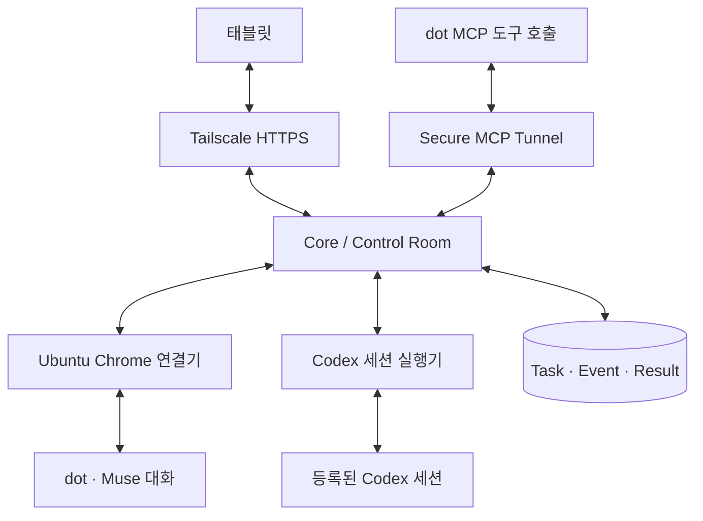

# 웹쫀쿠 개발 계획서

| 항목 | 값 |
| --- | --- |
| 상태 | Draft v0.3 — Ubuntu·태블릿 관제와 Codex 세션 위임 |
| 최초 작성일 | 2026-08-15 |
| 개정일 | 2026-10-29 (KST) |
| 저장소 | [firewine/webgpt](https://github.com/firewine/webgpt) |
| 전체 제품 설계 | [webjjoku_living_design.md](./webjjoku_living_design.md) |
| Ubuntu·태블릿 운영 | [ubuntu-operations.md](./ubuntu-operations.md) |
| Codex 세션 실행 | [codex-session-plan.md](./codex-session-plan.md) |
| Git Writer 요구사항 / 상세 계획 | [prd.md](./prd.md) / [git-writer-plan.md](./git-writer-plan.md) |
| 첫 검증 목표 | Ubuntu Chrome의 dot·Muse 왕복 대화, Tailscale HTTPS를 통한 태블릿 접속·원격 로그인 |
| 개발 순서 | 서버·대화 PoC → 영속 Core → 태블릿 Control Room → 공식 MCP 연동 → Codex 세션 실행 → 선택 Git Writer·다중 Seat |

## 1. 제품과 문서의 범위

웹쫀쿠는 사용자가 로그인한 웹 LLM과 에이전트에 업무를 배정하고, 결과를 회수해 다음 작업으로 연결하는 관제·오케스트레이션 시스템이다. 모델 API 호출을 기본 실행 방식으로 사용하지 않는다.

| 영역 | 책임 |
| --- | --- |
| Core / Control Room | Task Queue, Role·Account·Seat 배정, 대화·업무 상태, 결과·이벤트, 사용자 개입 |
| Provider / Browser 연결 | 기존 Chrome 연결, 서비스별 대화 입출력, 공식 MCP 도구·이벤트 |
| Ubuntu / Tablet 운영 | 서버 상시 실행, Tailscale HTTPS, 상태·로그 스트림, 원격 Chrome 조작 |
| Codex 실행 어댑터 | dot의 프롬프트를 등록된 기존 Codex 세션에 전달하고 실행·검토·후속 지시 연결 |
| Git Writer | 별도 선택 모듈: 승인된 저장소에서 격리된 코드 변경·검사·draft PR 발행 |

사용자 확정 운영 환경은 Ubuntu 서버이며 태블릿은 HTTPS 관제 단말이다. 첫 코드 실행 경로는 사용자의 기존 Codex 세션이다. Git Writer의 독립 sandbox·Git broker 기술 조건은 [상세 계획](./git-writer-plan.md)에 보존하고 Codex 실행 MVP의 선행 조건으로 두지 않는다. 실제 dot·Muse 왕복 대화는 코드 실행 연동보다 먼저 검증한다.

문서 역할:

- Living Design: 제품 개념과 조직·역할·공유 지식의 장기 설계.
- 이 문서: 현재 릴리스 범위, 순서, 완료 조건, 진행 상태.
- Ubuntu 운영 계획: 서버 배치·HTTPS·태블릿 스트리밍·로그인·서비스 복구.
- Codex 세션 계획: 실행 바인딩·도구·동시성·결과 검토와 Phase 4A 완료 조건.
- PRD: Git Writer 모듈의 요구사항.
- Git Writer 상세 계획: 모듈 내부 Phase 0~8과 보안·검증 조건.
- 향후 ADR/schema: 선택한 구현 방법과 실행 가능한 계약. 아직 작성하지 않은 ADR을 완료된 결정으로 취급하지 않는다.

이 개정은 v0.2의 macOS/Linux 동시 릴리스 조건과 Git Writer 우선 코드 실행 순서를 Ubuntu 우선·Codex 세션 우선으로 변경한다. 대화 연결 우선, 보존·중복 방지·실제 증거 원칙은 유지한다. 제품·모듈 문서가 충돌하면 현재 상위 계획의 범위와 해당 모듈의 계약을 함께 정정한다.

## 2. 확인된 현재 상태

2026-10-29 GitHub 조회에서 확인한 v0.3 개정 직전 기준:

- 기본 브랜치: `main`
- main 기준 커밋: `3246914b025a7608d5dd699799abc5c8fd3dacac`, Markdown 3개.
- 기존 계획 PR: [#1](https://github.com/firewine/webgpt/pull/1), `chatgpt/update-webjjoku-plan-20261029`.
- 이 개정의 부모 커밋: `8007d9703e454b0a19e014282fb32d77ca7688cc`, docs Markdown 4개.
- 구현 코드, 테스트, 설치 산출물, 실제 계정 연동 증거는 없다.
- 참고 구현은 Nhahan/WebGPT의 `1d35588e79de288bd8a6d2992fc76e571f7bb75e`를 읽었다. 설치·실행 결과가 아니다.
- Chrome·dot·Muse 공식 문서를 확인했지만 사용자 계정의 기능과 UI는 아직 검증하지 않았다.
- 기존 문서의 호스트 경로·Node/Git 버전·sandbox 관측값은 8월 기록이다. 현재 호스트 점검 결과로 재사용하지 않는다.
- Ubuntu 서버 운영·Tailscale 특정 HTTPS 포트·태블릿 관제와 dot → 기존 Codex 세션 지시는 사용자 요구로 반영했다. 서버 설정·로그인·실행을 완료한 것은 아니다.
- 제시한 완성형 Control Room 시안은 예시 데이터다. 실제 연결·검사·PR 성공 증거가 아니다.

| 항목 | 현재 판정 | 다음 증거 |
| --- | --- | --- |
| 저장소·설계 문서·참고 코드 검토 | 확인 | 이 개정과 참고 자료 |
| Ubuntu / Tailscale HTTPS / 태블릿 | NOT_RUN | 서버·포트·인증서·실기기 접속·재연결 기록 |
| 가상 데스크톱 / noVNC | NOT_RUN | 동일 Chrome 화면·로그인·승인·터치 입력 |
| 기존 Chrome 프로필 연결 | NOT_RUN | 실제 버전·프로필·연결 결과 |
| dot / Muse 왕복 대화 | NOT_RUN | 각 서비스의 같은 대화 송수신 기록 |
| dot MCP Events | 문서상 지원 / 계정 검증 NOT_RUN | 구독·이벤트 수신·결과 제출 |
| Muse Connector | 공식 경로 확인 / 계정 검증 NOT_RUN | 계정 접근·도구 발견·호출 |
| Secure MCP Tunnel | 문서상 지원 / 계정 검증 NOT_RUN | tunnel·workspace 권한·도구 호출 |
| Codex 세션 실행·dot 왕복 | 문서상 지원 / 호스트 검증 NOT_RUN | 정확한 세션·thread·turn·변경·검사·후속 지시 |
| Git Writer / sandbox / live PR | NOT_RUN | 모듈 release evidence |

## 3. 설계 방향

1. Ubuntu 서버의 로그인된 Chrome에 연결한다. 새 서버라면 원격 화면에서 사용자가 로그인하고 해당 profile을 보존한다. 다른 기기의 쿠키·인증 토큰을 복사하지 않는다.
2. 일반 ChatGPT, GPT dot, Muse는 별도 어댑터로 다룬다. Claude·Gemini도 후속 확장에 유지한다.
3. 첫 PoC는 요청·응답·후속 질문이다. 실제 코드 변경은 Phase 4A의 기존 Codex 세션 실행으로 연결하고 Git Writer는 Phase 4B의 선택 모듈로 둔다.
4. 전송 여부가 불명확하면 재전송하지 않고 기존 사용자 메시지를 대조한다.
5. 대화 응답 완료와 장시간 업무 완료를 별도 상태로 관리한다.
6. 대화는 기본 보존한다. dot의 지속 대화를 작업 하나가 끝났다는 이유로 삭제·초기화하지 않는다.
7. 공식 도구·이벤트 연동은 계정에서 검증한 기능만 사용한다. MCP 도구 제공과 외부 대화 시작 기능을 구분한다.
8. 다중 계정·병렬 작업·전체 조직 UI보다 두 서비스의 실제 왕복 연결을 먼저 완성한다.
9. Ubuntu의 Core·Chrome·Codex와 상태 저장을 태블릿 연결 수명에서 분리한다. 태블릿을 닫아도 작업을 계속하고 재접속 시 기록을 복구한다.
10. 사용자 관제는 Tailscale HTTPS, dot의 MCP 도구 호출은 Secure MCP Tunnel로 구분한다. OpenAI가 사용자의 Tailnet에 직접 접근한다고 가정하지 않는다.

## 4. 릴리스 범위

### 4.1 연결 PoC — Phase 0

- Ubuntu 서버의 버전·실행 사용자·경로와 Tailscale HTTPS 접속 포트를 확인한다.
- 태블릿에서 같은 서버 Chrome을 보고 로그인·연결 승인을 수행할 원격 화면을 마련한다.
- 서버의 로그인된 Chrome에서 dot·Muse 대화를 명시적으로 선택한다.
- 두 서비스가 다른 프로필에 있으면 연결을 각각 식별하고 순차 검증한다.
- 각 서비스에서 요청 1회와 같은 대화의 후속 질문 2회를 수행한다.
- 연결기 재시작 후 기존 대화를 다시 식별하고 중복 전송 없이 계속한다.
- 계정·대화가 확인되지 않으면 해당 연결을 미확인으로 표시하고 전송을 멈춘다.
- CLI 또는 최소 개발 화면을 사용한다. 전체 Control Room과 Git 명령 실행은 필요하지 않다.

### 4.2 대화 MVP-1 — Phase 1~2

포함:

- 단일 사용자·프로젝트, 전역 활성 작업 1개.
- GPT dot·Muse 어댑터, 지속 대화와 Task 연결.
- 영속 Task/Event/송수신 기록, 재시작 복구, 중복 방지.
- 연결 상태·Task·대화 결과·재로그인 필요 상태를 표시하는 최소 Control Room.
- Pause / Resume / Cancel / 수동 개입. 원격 작업 중단 가능 여부는 별도로 표시.
- Ubuntu의 고정 지원 profile과 실제 사용자 태블릿 검증.
- Tailscale Serve의 private HTTPS, 반응형 화면과 SSE 로그·상태 복구.
- noVNC를 통한 서버 Chrome 로그인·승인·수동 개입과 자동 입력 잠금.
- 서버 서비스 상시 실행과 재부팅 후 상태·연결 복구.

제외:

- Git 코드 수정·검사·PR·병합.
- 전체 회사 조직 UI, 자동 Wiki, 무제한 토론.
- 여러 계정의 동시 실행과 자동 계정 우회 전환.
- 비밀번호 저장, 쿠키 복제, 인증 우회, 비공개 대화 API 재현.
- 대화 자동 영구 삭제.

Ubuntu profile의 실제 완료 조건으로 MVP를 판정한다. macOS 및 다른 태블릿 OS·브라우저는 검증된 경우에만 후속 지원 목록에 추가한다.

### 4.3 후속 범위

- Phase 3: Secure MCP Tunnel, MCP 작업·결과 교환과 dot 이벤트 실험.
- Phase 4A: dot 프롬프트 → 기존 Codex 세션 → 결과 회수·검토 → 같은 세션 후속 지시.
- Phase 4B: 선택 Git Writer MVP. 저장소 1개·코드 변경 작업 1개·draft PR까지.
- Phase 5: 일반 ChatGPT·Claude·Gemini, 다중 계정과 제한된 병렬 실행.
- Phase 6: 조건을 갖춘 자동 병합, 운영 고도화, macOS 등 추가 OS profile·다중 프로젝트. 기본 Ubuntu 상시 운영은 Phase 2에 포함.

## 5. 연결 구조와 실행 위치

### 5.1 Ubuntu와 태블릿

- Core·DB·Chrome·Browser Bridge·Codex 실행기를 Ubuntu에 둔다. 실행 사용자·작업 공간·인증 저장소의 경계는 구분한다.
- 태블릿은 HTTPS 관제 단말이며 서버의 실행 프로세스나 저장소를 대신 보유하지 않는다.
- 초기 접속 예시는 Tailscale Serve의 HTTPS 8443 → `127.0.0.1:3000`이다. 실제 포트와 전체 `*.ts.net` 주소는 서버 설정에서 확인한다.
- noVNC는 같은 서버 Chrome을 보여주는 보조 화면이다. 가상 데스크톱·VNC·WebSocket proxy를 구성하고 서비스의 로그인·연결 승인·수동 개입에 사용한다.
- 평소 요청·로그·대화·결과 검토는 태블릿용 Control Room에서 처리한다. 세부 배치·명령·운영 gate는 [Ubuntu 운영 계획](./ubuntu-operations.md)을 따른다.
- Chrome 디버깅, VNC 원시 포트, Codex RPC는 로컬에 두고 직접 Tailnet에 노출하지 않는다.
- 연결이 끊기면 새 UI 전송을 멈추고 재접속 대기 상태를 저장한다. 원격 서비스의 기존 업무가 종료됐다고 표시하지 않는다.
- 브라우저 프로필·tunnel credential은 Codex 작업 입력과 Writer sandbox에 전달하지 않는다.

### 5.2 스트리밍·장기 실행

- HTTPS API는 지시·검토·제어를, SSE는 영속 이벤트·상태·로그 전달을 담당한다.
- dot·Muse는 실제 화면에서 관측한 응답을 전달한다. Codex는 검증한 실행 이벤트를 수집한다. 전 서비스의 공식 token streaming을 확보했다고 표시하지 않는다.
- snapshot·event cursor·중복 제거로 태블릿 절전/네트워크 전환 뒤 누락된 기록을 복구한다. 재접속이 작업을 다시 실행하지 않는다.
- noVNC는 별도 WSS 경로로 실제 화면과 입력을 전달한다. 한국어·터치·승인 창을 실기기로 검증한다.
- systemd 등으로 서버 서비스를 관리한다. 태블릿·SSH 셸 종료와 무관하게 진행 중인 작업을 유지하고 서버 재시작 시 실행 상태를 대조한다.

### 5.3 공식 MCP 통신

dot이 서버의 `task_get`·`codex_send` 등을 호출하는 경로는 Secure MCP Tunnel을 사용한다. Ubuntu의 `tunnel-client`가 outbound HTTPS를 만들고 private MCP에 요청을 전달한다. 태블릿의 Tailscale 주소와 구분하며 Platform tunnel 권한·runtime key·ChatGPT workspace 연결을 실제 검증한다.

브라우저 대화 PoC에는 tunnel이 필수가 아니다. dot 도구 호출·결과 회수 단계의 선행 조건이다. Muse Connector의 연결 가능 여부는 별도 검증하며 OpenAI 터널 지원을 Muse에 전용하지 않는다.

## 6. Chrome 연결 방법

### 6.1 우선 검증: Chrome DevTools MCP autoConnect

1. Ubuntu 서버에서 사용할 persistent Chrome profile을 확인하고 해당 서비스에 로그인한다. 필요한 조작은 태블릿 원격 화면에서 수행한다.
2. 실제 버전이 Chrome 144 이상이고 기능이 있는지 확인한다.
3. `chrome://inspect/#remote-debugging`에서 연결 기능을 활성화한다.
4. 검증 버전을 고정한 `chrome-devtools-mcp`를 `--autoConnect`로 연결한다.
5. Chrome이 요청하는 연결 승인을 사용자가 수행한다.
6. 선택된 프로필에서 계정·서비스·대화를 식별하고 바인딩한다.

공식 문서는 연결 요청마다 Chrome 허용 절차가 나타날 수 있다고 설명한다. 최초 승인만으로 영구 무인 연결을 보장하지 않는다. 설치 예제의 `@latest`를 릴리스 설정으로 그대로 사용하지 않는다.

자동 연결은 Chrome이 정한 기본 프로필을 선택하며 그 프로필의 열린 창들에 접근할 수 있다. 여러 프로필·계정이 자동으로 모두 연결된다고 가정하지 않는다. 다른 프로필이 필요하면 프로필별 연결을 검증하거나 확장 프로그램 경로를 선택한다.

### 6.2 대안: 확장 프로그램 + Native Messaging

기본 프로필 선택이 계정 구분을 충족하지 못하거나 더 좁은 탭 단위 연결이 필요하면 별도 spike로 검증한다.

- 사용자가 연결 탭을 선택하고 필요한 origin 권한만 부여한다.
- 확장 프로그램이 로컬 연결기와 통신하고 Core에는 선택한 작업 데이터만 전달한다.
- 페이지에서 온 메시지를 검증하며 임의 페이지의 로컬 명령 실행 통로를 만들지 않는다.
- 두 연결 방법을 같은 작업에서 동시에 활성화하지 않는다.

수동 remote-debugging port는 별도 운영 대안이다. Chrome 136 이후 기본 데이터 디렉터리에 디버깅 스위치만 추가하는 방법을 기존 로그인 연결 방법으로 안내하지 않는다. 별도 프로필 방식과 기존 프로필 재사용을 구분한다.

### 6.3 연결 식별자

| 식별 정보 | 용도 |
| --- | --- |
| browserConnectionId | 연결기 인스턴스·연결 방식 |
| profileBindingId | 사용자가 확인한 프로필 바인딩; 쿠키·프로필 파일은 수집하지 않음 |
| accountId / provider / surface | 계정과 일반 ChatGPT / dot / Muse 화면 구분 |
| agentIdentity | dot·Muse 에이전트의 관측·확인된 식별 정보 |
| conversationUrl / 대화 ID / tabId | 지속 대화와 현재 탭의 매핑 |
| taskId / attemptId / message receipt | 작업·전송 시도·실제 메시지의 연결 |

탭 ID는 재시작 후 바뀔 수 있다. URL이나 화면 제목 하나만으로 계정·대화 소유를 확정하지 않고 저장된 바인딩과 실제 화면을 함께 확인한다.

## 7. Provider별 전략

| 대상 | 첫 연결 | 후속 경로 | 계정에서 확인할 항목 |
| --- | --- | --- | --- |
| GPT dot | 기존 dot 대화의 UI 입출력 | 공식 MCP 도구 + MCP Events | dot 식별, 지속 대화, 비동기 업무, 도구·이벤트 |
| Muse | 기존 Muse 대화의 UI 입출력 | 공식 Connector/API·MCP 도구 | 대화·결과·산출물, Connector 권한 |
| 일반 ChatGPT | Chat 전용 어댑터 | 공식 MCP 도구 | dot/Work와 구분, 대화·모델 컨트롤 |
| Claude | 계정 기능에 따른 Web/MCP | 공식 Connector | 도구·결과 제출 |
| Gemini | Web 어댑터 | 계정에서 확인한 공식 연결 | 현재 계정의 실제 기능 |

### 7.1 GPT dot

- dot은 계정과 별도로 식별되는 에이전트 화면이다. 같은 계정의 일반 ChatGPT와 dot을 독립 계정으로 중복 계산하지 않는다.
- 초기에는 해당 계정의 동시 실행 한도를 1로 공유한다.
- 기존 대화를 유지하고 task ID로 업무를 구분한다. 새 대화·새 dot 생성은 기본 동작이 아니다.
- “진행하겠다”는 응답은 수신 확인이다. 업무 완료는 명시적인 결과·상태·산출물 또는 인증된 결과 제출로 판단한다.
- 공식 문서상 MCP Events는 dots에서 지원된다. 사용자가 감시 대상과 수행 동작을 정하고 구독하면 서버가 일치하는 이벤트를 전달한다.
- `task.ready`는 웹쫀쿠에서 제안하는 자체 이벤트 이름이다. 계정 검증 전부터 동작하는 내장 기능으로 표기하지 않는다.
- webhook HTTP 성공은 접수 증거다. 구독 갱신, 이벤트 중복·순서, 도구 멱등성, 결과 수신을 별도로 검증한다.
- 공식 연동의 목표는 작업 이벤트 수신 → `task_get` → 수행 → `result_submit`이다. 이 도구와 이벤트는 웹쫀쿠가 구현한다.
- Phase 4A에서는 dot이 개발 프롬프트를 작성해 `codex_send`로 기존 Codex 세션에 전달하고 `codex_result`로 결과를 검토한다.

### 7.2 Muse

- 첫 구현은 화면에서 확인 가능한 대화 입력·응답·업무 상태다.
- 공식 Connector 문서는 Muse가 외부 서비스를 사용하는 API/MCP 연결을 설명한다. 임의 Muse 대화를 외부에서 시작하는 API가 있다고 추론하지 않는다.
- 해당 계정의 공식 연결이 확인되면 `task_get` / `result_submit`을 검증한다.
- 공식 연결이 미확인인 상태에서도 대화 PoC를 진행한다. 구조화된 제출의 지원 여부는 구분해 표시한다.

### 7.3 공통 어댑터 계약

| 기능 | 반환할 핵심 정보 |
| --- | --- |
| attach / probe | 계정·화면·대화 바인딩, 확인한 capability |
| sendMessage | attempt ID, 전송 확인/불확실 상태, receipt |
| observeConversation | 새 메시지, 생성 상태, 오류·인증·사용자 개입 |
| followUp | 동일 대화에 대한 명시적 후속 요청 |
| collectResult | 결과·산출물 참조·완료 근거·검증 상태 |
| requestStop | 원격 중단 지원 여부, 요청·확인 결과 |
| detach | 연결 해제와 재연결 정보 보존 |

mode 선택, 첨부, 새 대화, 원격 취소, MCP·이벤트는 capability로 선언한다. 모든 서비스에 `m/h/xh/p`를 강제하지 않는다. 알 수 없는 UI는 성공으로 처리하지 않는다.

### 7.4 Codex 실행 어댑터

제품 기본 경로는 Codex App Server, 최소 PoC 경로는 유휴 저장 세션에 대한 `codex exec resume "<SESSION_ID>"`다. 실제 세션 기록에 접근할 수 있는 Ubuntu 실행 환경에서 대상 cwd·계정·세션을 확인한다. 세션 ID만으로 실행 접근 권한을 대신하지 않는다.

| 상황 | 처리 |
| --- | --- |
| 유휴 세션의 다음 작업 | 대상 `threadId`로 resume 후 turn/start; 검증한 CLI exec resume도 가능 |
| 실행 중 다음 업무 | Core 대기열에 저장; 검증된 CLI queue는 선택 경로 |
| 현재 업무 방향 수정 | App Server turn/steer와 실제 expectedTurnId |
| 승인·실패·중단 | 실제 상태를 관제실과 dot에 전달; 접수나 자연어 답변으로 성공 판정하지 않음 |

제안 도구는 `codex_send`, `codex_status`, `codex_result`이며 필요하면 `codex_cancel`을 추가한다. send는 job ID를 반환하고 장기 실행은 별도 추적한다. CLI session ID·App Server thread ID·session tree ID는 실제 반환값으로 매핑한다. 활성 세션을 두 실행기가 동시에 재개하지 않는다.

dot의 프롬프트는 셸 코드로 평가하지 않는다. Codex의 기존 권한·승인 설정을 유지하고 실제 workspace·브랜치·사용자 변경을 보존한다. 상세 schema·실행·검토·복구 조건은 [Codex 세션 실행 계획](./codex-session-plan.md)을 따른다.

## 8. 메시지와 업무 상태

### 8.1 중복 전송 방지

1. 전송 전에 task·attempt·대상 바인딩과 요청 digest를 영속 저장한다.
2. 직전에 계정·대화·현재 생성 상태·사용자 입력 여부를 다시 확인한다.
3. 한 번만 입력·전송하고 실제 사용자 메시지가 생겼는지 확인한다.
4. 확인되면 receipt를 저장한다. 메시지 ID가 없으면 이전 메시지 기준점·본문·관측 시각을 함께 사용한다.
5. 클릭 후 timeout·연결 중단이 발생하면 `SEND_UNCONFIRMED`로 둔다. 대조 전에는 재전송하지 않는다.
6. 끝내 확정하지 못하면 해당 상태를 보여주고 사용자 재시도 결정을 받는다.

외부 웹 UI에 정확히 한 번 실행 보장을 주장하지 않는다. 불확실한 자동 중복 전송을 막고 재조정 가능한 기록을 남긴다.

### 8.2 상태 분리

| 축 | 상태 예시 | 의미 |
| --- | --- | --- |
| 연결 | CONNECTED / DISCONNECTED / AUTH_REQUIRED / TARGET_CHANGED | 브라우저·계정·대화 상태 |
| 전송 | PREPARED / SENT_CONFIRMED / SEND_UNCONFIRMED | 사용자 메시지 전송 증거 |
| 응답 | WAITING / GENERATING / RESPONSE_COMPLETE | 현재 대화 응답 상태 |
| 업무 | ready / running / blocked / review / done / failed / cancelled | 실제 작업과 검토 상태 |

“잠시 기다려 달라”는 응답이 끝나도 업무는 running이다. 도구 제출은 provider의 보고이며, 코드·검사·PR 성공은 실행 증거로 검토한다. `result_submit`은 기본적으로 review로 넘기며 검토 후 done 처리한다.

Pause는 새 전송을 막는다. Cancel은 웹쫀쿠의 후속 실행을 중단하고, 원격 중단 기능이 검증됐을 때만 해당 중단을 요청한다. 원격 중단이 확인되지 않으면 이를 명시한다. 일정 시간 화면이 변하지 않았다는 이유로 완료·실패로 단정하지 않는다.

사용자가 같은 대화에 입력하거나 대상이 바뀌면 자동 전송을 멈추고 상태를 대조한다. 사용자의 입력을 덮어쓰지 않는다.

### 8.3 보존 정책

- 기존 사용자 대화와 dot의 지속 대화는 기본 보존한다.
- 결과 수집 뒤 탭을 닫을지는 사용자가 선택한다. 탭 닫기와 대화 삭제를 구분한다.
- 임시 테스트 대화도 자동 영구 삭제하지 않는다. 삭제는 정확한 대상과 별도 요청에 따른다.
- 쿠키·인증 값·비공개 connector URL은 로그·저장소에 기록하지 않는다. 작업 본문·산출물은 필요한 범위에서 접근 제한된 저장소에 보관한다.

### 8.4 Codex job과 root workflow

Codex job은 accepted/queued/running/blocked_approval/reconciling/completed/failed/interrupted를 구분한다. Codex 완료는 상위 Task의 review 진입 조건이며 done 자동 확정이 아니다. 프롬프트·job·thread/turn·변경·검사 근거를 연결한다.

초기 전역 한도는 root workflow 1개다. dot 지시 → Codex 실행 → dot 검토를 순차 단계로 관리하고 위임 대기 중인 부모 Task가 자식 실행 슬롯을 막지 않게 한다. 세션과 worktree별 단일 작성자 lease도 적용한다. 같은 idempotency key의 재호출은 같은 job을 반환하고, 연결 불확실 상태는 대조 전 재실행하지 않는다.

## 9. Nhahan/WebGPT 적용 범위

검토 revision: `1d35588e79de288bd8a6d2992fc76e571f7bb75e`.

| 참고할 부분 | 웹쫀쿠 적용 |
| --- | --- |
| dispatch / sendOnce | 실제 전송 확인, 불확실한 재전송 방지 |
| 대화 URL·소유 확인 | 계정·agent·surface 바인딩까지 확장 |
| waitForReply | 현재 요청의 응답만 수집하고 생성 상태와 구분 |
| Worker submit_result | 인증된 구조화 결과, 중복 제출, 영속 수집 |
| 복구·검증 fixture | 중단 후 재조정과 일반 사용자 흐름 |

원본 `browser.mjs`는 호출자의 CUA tab API를 사용하는 helper다. 독립 Chrome 연결 엔진이 포함됐다고 가정하지 않는다. 일반 ChatGPT의 `/c/...`, 화면 구성과 reasoning controls에 맞춰져 있고 Work를 거부한다. dot·Muse에 그대로 적용하지 않는다.

전체 OS 사용자 권한 terminal Worker, 대화 자동 영구 삭제, quick-tunnel의 비밀 URL 기반 연결을 제품 기본 정책으로 가져오지 않는다. Git Writer 격리와 지속 대화 보존을 유지한다. 코드 도입 시 고정 revision과 해당 라이선스·고지 보존을 확인한다.

## 10. 단계별 개발 계획

### Phase 0 — Ubuntu 접속·기존 Chrome 왕복 대화 PoC

산출물:

- 제품·문서 범위 정리, 최소 BrowserConnection / ProviderAdapter 초안.
- 실제 Ubuntu·architecture·실행 사용자·Chrome·Tailscale 버전과 profile, 포트 기록.
- 태블릿 HTTPS 접속과 동일 Chrome의 noVNC 로그인·허용 창 조작.
- Chrome 방식·버전·프로필 바인딩과 dot·Muse adapter spike.
- 송수신·대화 보존·재연결 실행 기록.

완료 조건:

- 각 서비스에서 요청 1회·후속 질문 2회가 같은 대화에 연결된다.
- 재시작 뒤 대화를 다시 식별하고 이미 보낸 요청을 중복 전송하지 않는다.
- 전송 불확실·인증 필요·대상 변경을 성공으로 보고하지 않는다.
- dot의 초기 응답과 실제 업무 결과를 구분할 관측 방법을 확인한다. 관측 불가능한 capability는 미확인으로 남긴다.
- 브라우저 대화 어댑터에 코드 변경·terminal 실행 도구를 부여하지 않고 대화 연결 가설을 검증한다. 서버 설치·운영 권한과 구분한다.
- Ubuntu의 실제 Chrome과 태블릿 HTTPS·원격 화면 연결을 확인한다. 노트북 로그인 세션이 서버에 이전됐다고 가정하지 않는다.

### Phase 1 — 영속 Core와 계약

산출물:

- Node.js 24 계열·strict TypeScript Core와 선택한 저장소 adapter.
- Account·AgentIdentity·Seat·BrowserConnection·ConversationBinding·Task·Attempt·Event·Result schema.
- Executor/SessionBinding/Job의 확장 계약과 root workflow·작업 공간 lease 경계.
- task lease, 전송 journal, 재시작 reconciliation, bounded 오류·redacted log.
- fake provider/clock/storage를 사용하는 offline fixture.

완료 조건:

- 동일 task의 실행 주체가 하나로 고정된다.
- send 직전·직후 중단을 구분하고 불확실한 전송을 자동 반복하지 않는다.
- provider 보고와 검증 상태를 구분한다.
- 기본 테스트가 실제 LLM·GitHub·유료 API에 접속하지 않는다.
- Task 상태와 전달 이벤트가 일관되게 영속화되고 snapshot/cursor로 누락 없이 복구할 수 있다.

### Phase 2 — 태블릿 Control Room / 대화 MVP-1

산출물:

- 연결 선택·상태, Task·대화 로그·결과 화면.
- follow-up, Pause/Resume/Cancel, 사용자 개입·재로그인 안내.
- Tailscale HTTPS·반응형 UI·SSE 상태/로그·snapshot/cursor 재연결.
- noVNC 수동 개입, 자동 입력 잠금·대상 재확인.
- Ubuntu 서비스 상시 실행·재부팅 복구와 실제 태블릿 적합성 기록.

완료 조건:

- UI에서 dot·Muse를 선택해 요청·결과·후속 대화를 확인한다.
- 재시작 후 미완료 task와 대화가 복원된다.
- 대화 보존이 기본이며 응답을 업무 완료로 오분류하지 않는다.
- 태블릿 종료·절전·네트워크 전환에도 서버 작업이 유지되고 누락 로그가 복구된다.
- 실제 HTTPS·SSE·WSS 경로, 허용/거부 접근 정책, 터치·한국어 입력을 검증한다.
- 고정 Ubuntu profile과 사용자 태블릿의 기본 흐름이 통과한다. 미검증 OS를 지원 목록에 올리지 않는다.

### Phase 3 — 구조화된 작업·결과 / 공식 이벤트

산출물:

- 최소 MCP 도구: `task_get`, `context_get`, `result_submit`; 필요 시 원자적 `task_claim`.
- Ubuntu private MCP와 Secure MCP Tunnel, 실제 Platform·ChatGPT 권한·연결 기록.
- 연결 주체·task 범위를 검증하는 인증 계약과 중복 결과 처리.
- dot MCP Events 구독·전달·결과 회수 PoC.
- Muse Connector capability 확인과 가능한 범위의 결과 제출 PoC.

완료 조건:

- 최소 한 provider에서 task ID와 연결된 구조화 결과를 회수한다.
- dot이 실제 tunnel을 통해 작업 도구를 발견하고 호출한다. Tailscale 관제 접속 성공으로 이를 대신하지 않는다.
- 이벤트 접수와 업무 완료를 구분하고 중복 이벤트가 중복 작업을 만들지 않는다.
- 같은 task의 Browser/Event 활성 실행 경로는 하나다.
- Muse의 미확인 공식 연결은 브라우저 성공과 구분한다.
- dot Events가 미검증이면 해당 기능만 experimental/blocked로 남긴다. 대화 MVP-1의 완료와 혼동하지 않는다.

### Phase 4A — dot → 기존 Codex 세션 / 실행 MVP-2

산출물:

- [Codex 세션 실행 계획](./codex-session-plan.md)의 실행기·바인딩·도구·영속 job 계약.
- App Server 기본 경로와 검증된 CLI resume/queue 대안.
- dot 프롬프트 작성·실행 지시·결과 검토·동일 세션 후속 수정 흐름.
- 태블릿 진행 로그, 기존 Codex 승인 요청 전달, 실패·중단·재연결 처리.

완료 조건:

- 등록된 실제 세션의 맥락·cwd를 유지해 요청을 수행하고 결과가 dot과 관제실에 회수된다.
- 같은 세션에 후속 지시 1회 이상을 수행하고 새 변경의 검증 근거를 남긴다.
- 대기와 steer를 구분하고 다른 세션·turn에 잘못 전달하지 않는다.
- 중복 제출·전송 불확실·실행기 재시작을 대조하며 활성 세션을 이중 재개하지 않는다.
- 사용자 변경·기존 권한을 보존하고 Codex 완료·검사 성공·상위 업무 완료를 구분한다.
- 태블릿을 닫아도 실행이 계속되고 복귀 시 상태·로그를 복구한다.

### Phase 4B — 선택 Git Writer 통합

산출물:

- [상세 계획](./git-writer-plan.md)의 내부 Phase 0~6.
- Core task / Writer change 매핑, checks·commit·PR 증거.
- disposable repository에서 요청부터 draft PR까지 통합 시나리오.

완료 조건:

- 초기 Ubuntu 지원 profile에서 요청 하나가 검증된 변경·정확히 하나의 draft PR로 이어진다.
- main 직접 push, force-push, 자동 merge, 무격리 target 실행이 없다.
- 브라우저 세션과 GitHub/tunnel credential이 target sandbox로 넘어가지 않는다.
- 정확한 최종 변경과 checks·PR head가 일치한다.

이 모듈의 gate는 Codex 세션 실행의 선행 조건이 아니다. 코드 실행 범위와 실제 격리 보장은 각 모듈의 검증 결과로 표시한다.

### Phase 5 — Provider·계정·Seat 확장

- 일반 ChatGPT·Claude·Gemini를 같은 계약으로 연결한다.
- 계정별 profile·capability와 팀별 preferred/fallback을 등록한다.
- GPT 3·Claude 1·Gemini 1은 과거 기획값이다. 실제 계정 수·가용성을 확인한다.
- dot은 같은 ChatGPT 계정의 한도를 공유한다. Muse 계정도 실측 등록한다.
- 이미 전송된 task를 timeout만으로 다른 Seat에 재배정하지 않는다. 원래 실행 상태를 대조하거나 명시적으로 취소한 뒤 새 attempt를 만든다.
- 계정당 1 활성 작업부터 시작해 검증된 범위에서만 병렬도를 늘린다.

### Phase 6 — 운영 확장 / 자동 병합

- Phase 2의 Ubuntu 상시 운영을 기반으로 운영 고도화·다중 프로젝트·macOS 등 추가 OS profile을 검증한다.
- 기본 브랜치 보호, 비어 있지 않은 required checks, 정확한 PR head, 권한 제한을 검증한 뒤 자동 병합을 별도 릴리스한다.
- required checks가 없다는 이유로 즉시 병합하는 fallback을 만들지 않는다.
- 자동 병합과 추가 운영 기능은 각각 완료 조건을 통과해야 한다. 기본 서버 상시 실행을 이 단계까지 미루지 않는다.

## 11. 검증 전략

| 검증 | 환경 | 핵심 |
| --- | --- | --- |
| 계약·상태 | offline | journal, lease, 응답·업무 상태, 중복 결과 |
| UI fixture | offline | 서비스별 입력·응답, 다른 대화·생성 중·인증 만료 |
| 기본 대화 E2E | 지정한 실제 대화 | 요청·후속 질문·결과·대화 보존 |
| 복구 | fixture + 최소 실제 흐름 | send 이후 중단·재시작·중복 방지 |
| Ubuntu / 태블릿 | 실제 서버·사용자 태블릿 | HTTPS·SSE·WSS, 절전·재접속·재부팅, 로그인·승인·입력 |
| MCP/Event | 실제 허용된 연결 | scope, 구독, 수신, 결과·중복 처리 |
| Codex 세션 | offline adapter + 등록된 실제 세션 | resume·queue·steer, 승인, 단일 작성자, dot 왕복·후속 수정 |
| Git Writer | offline + disposable repo | 상세 계획의 sandbox·checks·draft PR |

실제 E2E는 사용자가 지정한 테스트 대화와 범위에서 실행한다. 계획서 업데이트 자체를 실계정 전송·연결 승인 완료로 간주하지 않는다.

PASS / FAIL / NOT_RUN / BLOCKED를 구분한다. 증거에는 버전·OS·provider·대화 식별 참조·attempt·전송 확인·응답/업무 상태·결과를 남기고 인증 값은 제외한다. 문서나 fixture로 실제 계정 PASS를 대신하지 않는다.

## 12. 바로 다음에 할 작업

- [ ] Ubuntu 서버·architecture·실행 사용자·경로·Tailscale 주소와 포트를 확인한다.
- [ ] 태블릿 HTTPS와 noVNC에서 서버 Chrome 로그인·허용 창을 확인한다.
- [ ] Ubuntu Chrome의 dot·Muse 계정과 기존 대화를 식별한다.
- [ ] 버전·autoConnect·프로필 선택을 검증하고 연결 방식을 ADR로 고정한다.
- [ ] 일반 ChatGPT와 dot의 실제 화면·대화 차이를 관측한다.
- [ ] dot 요청 1회 + 후속 질문 2회와 증거를 남긴다.
- [ ] Muse에서 같은 흐름을 검증한다.
- [ ] 연결기 재시작 후 대화 복원·중복 방지를 확인한다.
- [ ] Phase 0 결과에 따라 저장소·schema와 Phase 1 구현을 시작한다.
- [ ] Phase 2에서 서버 작업 유지·태블릿 재접속·SSE/WSS와 재부팅 복구를 검증한다.
- [ ] Phase 3에서 tunnel·custom MCP 권한과 dot의 실제 도구 호출을 확인한다.
- [ ] Phase 4A에서 Codex 버전·대상 세션·cwd·활성 turn을 등록하고 dot 지시·결과·후속 수정 왕복을 검증한다.

첫 PoC에 GitHub token·merge 권한·sandbox·tunnel 계정을 일괄 요구하지 않는다. 필요한 사용자 조작은 실제 기능·승인 화면에서 확인하고 불필요한 재로그인을 요구하지 않는다.

## 13. 참고 자료와 확인 범위

2026-10-29 읽은 문서·코드 기준이다. 구현 시 검증 버전과 실제 계정 결과를 compatibility matrix에 고정한다.

| 자료 | 확인 범위 |
| --- | --- |
| [DCInside: WebGPT 웹쫀쿠 subagent 스킬 업데이트](https://gall.dcinside.com/mgallery/board/view/?id=ai_utilize&no=84956) | 사용자 제공 글의 원본 저장소·사용 방식 |
| [Nhahan/WebGPT 고정 revision](https://github.com/Nhahan/WebGPT/tree/1d35588e79de288bd8a6d2992fc76e571f7bb75e) | README, SKILL, setup, browser-reply, browser/client/worker 코드 |
| [Chrome 기존 세션 연결](https://developer.chrome.com/blog/chrome-devtools-mcp-debug-your-browser-session) | Chrome 144+ autoConnect·사용자 허용 |
| [Chrome DevTools MCP advanced usage](https://github.com/ChromeDevTools/chrome-devtools-mcp/blob/main/docs/advanced-usage.md) | 기본 프로필 선택·기존 세션·수동 디버깅 차이 |
| [Chrome 디버깅 스위치 변경](https://developer.chrome.com/blog/remote-debugging-port) | Chrome 136+ 기본 데이터 디렉터리 제한 |
| [Chrome Native Messaging](https://developer.chrome.com/docs/extensions/develop/concepts/native-messaging) | 확장 프로그램·로컬 연결기 대안 |
| [Meet dots](https://learn.chatgpt.com/docs/dots) | 웹 대화·지속 에이전트·비동기 업무 |
| [OpenAI MCP Events](https://developers.openai.com/plugins/build/mcp-events) | dots 지원·MCP 2.0 구독·webhook |
| [Muse Connector guidelines](https://platform.muse.ai/docs) | Muse가 외부 API/MCP를 사용하는 공식 경로 |
| [Codex CLI reference](https://learn.chatgpt.com/docs/cli/reference) / [Non-interactive mode](https://learn.chatgpt.com/docs/non-interactive-mode) | 명시적 세션 resume·queue·출력; 설치 버전 확인 필요 |
| [Codex App Server](https://learn.chatgpt.com/docs/app-server) | thread·turn·steer·진행·승인·완료 상태 |
| [Secure MCP Tunnel](https://developers.openai.com/api/docs/guides/secure-mcp-tunnels) | private MCP와 outbound HTTPS, Platform/ChatGPT 권한 |
| [Tailscale Serve](https://tailscale.com/docs/features/tailscale-serve) / [CLI](https://tailscale.com/docs/reference/tailscale-cli/serve) | Tailnet HTTPS 포트·reverse proxy·지속 실행·접근 정책 |
| [Tailscale HTTPS](https://tailscale.com/docs/how-to/set-up-https-certificates) | MagicDNS·인증서·전체 도메인 |
| [noVNC](https://novnc.com/info.html) | 원격 화면·입력과 모바일 브라우저 지원 |

참고 자료는 설계 근거다. 원본의 설치 프롬프트·권한 문구를 이 프로젝트에 대한 사용자 승인으로 취급하지 않는다.

## 14. 변경 이력

### v0.3 — 2026-10-29

- Ubuntu 서버 상시 실행·Tailscale HTTPS 특정 포트·태블릿 관제를 운영 기준으로 확정.
- SSE 로그·상태 복구와 noVNC 원격 Chrome 로그인·승인·수동 개입을 구분.
- 서버 Chrome의 persistent profile과 autoConnect 연결 절차 구체화.
- dot → MCP → 기존 Codex 세션 → 결과 검토·후속 지시를 Phase 4A와 별도 실행 계획으로 추가.
- 세션/thread/turn 식별, 대기·steer, 승인·중복 실행·재연결·검증 근거 계약 추가.
- Tailscale 사용자 접속과 Secure MCP Tunnel의 dot 도구 호출 경로 분리.
- Git Writer는 Phase 4B 선택 모듈, macOS는 후속 확장으로 정합화. 실환경 검증은 NOT_RUN 유지.

### v0.2 — 2026-10-29

- Git Writer 중심 계획을 웹쫀쿠 전체 개발 계획으로 확장.
- 기존 Chrome의 dot·Muse 대화를 첫 PoC로 지정.
- 어댑터, 보존, 중복 방지, 비동기 상태·재연결 조건 추가.
- autoConnect·프로필 제약과 확장 프로그램 대안 명시.
- dot Events·Muse Connector의 문서상 지원과 미검증 항목 분리.
- Nhahan/WebGPT 참고 구현의 적용·비적용 범위 기록.
- 기존 Git Writer 조건을 별도 문서로 보존하고 PRD·Living Design과 정합화.
- “첫 커밋 없음” 등 과거 기준선을 GitHub 조회 결과로 정정.

### v0.1 — 2026-08-15

- Git Writer 구현·검증 계획 작성. 세부 내용은 별도 상세 계획으로 이어간다.

