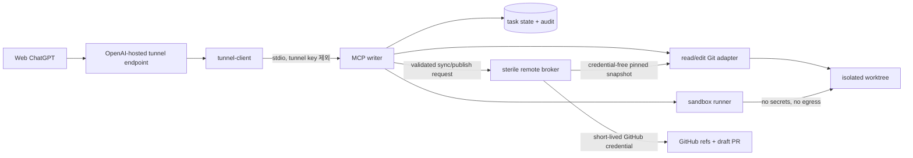

# 웹쫀쿠 Git Writer 상세 개발 계획

| 항목 | 값 |
| --- | --- |
| 상태 | Draft v0.2 — 웹쫀쿠 하위 모듈 계획 |
| 최초 작성일 | 2026-08-15 |
| 개정일 | 2026-10-29 (KST) |
| 상위 계획 | [development-plan.md](./development-plan.md) |
| 모듈 요구사항 | [prd.md](./prd.md) |
| 대상 릴리스 | macOS arm64 / Linux x86_64 Git Writer MVP |
| 계획 원칙 | 안전하게 검증 가능한 작은 릴리스부터 최종 자율 개발 흐름까지 단계적으로 확장 |

## 1. 목적

사용자가 Web ChatGPT에 제품 요구만 전달하면 로컬 Git writer가 대상 저장소를 읽고, 격리된 작업 공간에서 변경과 검사를 수행하고, `chatgpt/*` 브랜치의 draft PR까지 생성하는 Git Writer 모듈을 만든다. 이 모듈의 구현은 상위 계획의 로그인된 Chrome 대화 PoC와 대화 MVP 이후에 진행한다.

PRD의 최종 목표인 required checks 이후 squash auto-merge와 상시 서비스는 유지한다. 실제 지원 환경은 Apple Silicon macOS(`darwin-arm64`)와 x64 Linux(`linux-x64`)로 한정하며 두 조합 모두 MVP 릴리스 조건에 포함한다.

이 문서는 Git Writer 내부 구현 순서와 릴리스 조건을 정의한다. 모듈 요구사항은 PRD, 제품 전체 순서는 상위 개발 계획, 세부 기술 결정은 ADR, 실행 가능한 인터페이스는 schema와 테스트가 담당한다. 문서 간 충돌이 생기면 해당 계약을 먼저 정정한다.

## 2. 현재 기준선

2026-10-29 GitHub 조회 기준:

- 저장소: `firewine/webgpt`, 기본 브랜치: `main`
- 이 개정의 기준 커밋: `3246914b025a7608d5dd699799abc5c8fd3dacac`
- 개정 전 추적 파일: `docs/development-plan.md`, `docs/prd.md`, `docs/webjjoku_living_design.md`
- 구현 코드, 테스트, 실행 증거는 아직 저장소에 없다.
- `/home/firewine/webgpt`, Node.js `24.18.0`, npm `11.16.0`, Git `2.43.0`, GitHub CLI `2.92.0`, Bubblewrap `0.9.0`, Docker CLI `29.7.2`는 8월 계획서의 과거 관측값이다. 현재 실행 환경의 검증 결과로 재사용하지 않는다.
- 과거 중첩 환경의 Bubblewrap uid-map probe 실패는 미해결 기록으로 남긴다. 실제 대상 호스트에서 probe를 다시 통과해야 한다.
- Git remote와 기존 커밋은 존재한다. 실제 구현 호스트의 checkout, author, 자격 증명, tunnel 및 disposable E2E 저장소 준비 상태는 별도 확인 대상이다.

이 문서의 Phase 0~8은 **Git Writer 내부 단계**이다. 상위 개발 계획의 Phase 0~6과 같은 번호 체계가 아니다. 기존 문서에서 이 모듈을 가리키던 “MVP-1”은 이 개정부터 “Git Writer MVP”로 표기한다.

## 3. 공식 OpenAI 제약

계획은 다음 공식 문서를 기준으로 한다.

- [Secure MCP Tunnel](https://developers.openai.com/api/docs/guides/secure-mcp-tunnels)
- [Build an MCP server](https://developers.openai.com/plugins/build/mcp-server)

반영할 제약은 다음과 같다.

1. Secure MCP Tunnel은 외부 inbound port 없이 private MCP server를 OpenAI 제품에 연결한다.
2. `tunnel-client`는 로컬 MCP server를 stdio 또는 HTTP로 호출할 수 있다.
3. 터널 준비는 공식 `init`, `doctor`, `run` 흐름을 사용한다.
4. 터널의 `/healthz`, `/readyz`와 ChatGPT developer mode, Platform tunnel 권한을 각각 검증한다.
5. MCP tool annotation은 선택과 승인 UX를 돕는 hint일 뿐 보안 통제가 아니다. 권한과 정책은 서버가 강제한다.
6. private tunnel 연결은 공개 플러그인 배포 경로가 아니다.

공식 문서나 `tunnel-client` 동작이 바뀌면 설치 예제를 복사해 유지하지 않고, 지원 버전과 검증 결과를 ADR 및 compatibility matrix에 갱신한다.

## 4. MVP 범위

### 4.1 포함

- Apple Silicon macOS(`arm64`)와 x64 Linux(`x86_64`)에서 각각 고정된 초기 지원 profile 1개
- foreground 실행
- 하나의 사전 승인된 disposable 대상 저장소
- 전역 동시 작업 1개
- Secure Tunnel이 직접 실행하는 stdio MCP writer
- 저장소 읽기, 검색, 격리 worktree 생성, text patch, 복원, diff 검사
- 서버가 결정한 allowlist check suite 실행
- `chatgpt/*` 브랜치 commit/push
- 동일 draft PR 생성 또는 갱신
- crash recovery, 감사 기록, secret redaction
- deterministic offline test와 지원 OS별 필수 live E2E

### 4.2 제외

- HTTP `/mcp` listener와 별도 writer daemon
- systemd와 LaunchAgent 상시 서비스
- Windows
- 초기 지원 profile 밖의 추가 macOS/Linux 버전
- Intel Mac과 ARM Linux 등 초기 지원 대상 밖의 architecture
- 복수 대상 저장소 또는 동시 작업
- merge/auto-merge 기능과 merge용 credential
- `main` 직접 push, force-push, tag push, branch 삭제
- `.github/**`, workflow, credential, writer/runtime/policy, Git metadata 변경
- dependency manifest, lockfile, build/test 설정 변경
- binary, generated output, submodule 변경
- 임의 shell, package install, unrestricted network

제외된 요청은 우회 구현하지 않고 명시적인 `UNSUPPORTED_SCOPE` 오류와 사유를 반환한다.

## 5. 목표 구조



### 5.1 신뢰 경계

| 구성요소 | 보유 가능한 권한 | 금지 사항 |
| --- | --- | --- |
| `tunnel-client` | tunnel runtime key, writer stdio 실행 | GitHub token 전달 |
| MCP writer | 정책, task state, 대상 저장소 read/edit orchestration | tunnel/GitHub secret 보유, target code 직접 실행 |
| sandbox runner | 승인된 worktree와 read-only toolchain | home/keyring 접근, host write, network, secret 상속 |
| remote broker | 제한된 GitHub credential, 고정 repo/ref/PR 동작 | target test 실행, merge, force/default/tag/delete push |
| 대상 저장소 콘텐츠 | 데이터와 변경 대상 | 정책 변경, check 생략, 권한 확대 지시 |

권한 우선순위는 `불변 서버 정책 > 인증된 사용자 작업 > 대상 저장소 지침`이다. `AGENTS.md`, source comment, diff, test output, PR 내용은 모두 신뢰하지 않는 입력으로 취급한다.

## 6. 기술 기준

### 6.1 애플리케이션

- Node.js 24 LTS 계열, ESM, strict TypeScript
- 공식 MCP TypeScript SDK와 schema validator 사용
- dependency와 lockfile은 정확한 버전으로 고정
- stdio의 stdout은 MCP protocol 전용, log는 redacted stderr 전용
- 장기 실행 작업은 비동기 `spawn`과 명시적 argument array를 사용하고 `shell:false`를 강제
- process timeout 시 전체 descendant tree를 종료
- clock, filesystem, local Git, remote broker, process runner는 adapter로 분리해 offline fake로 교체 가능하게 설계

`server.mjs` 단일 파일은 설치 entrypoint 이름일 수 있지만 구현 전체를 담는 God File로 사용하지 않는다.

### 6.2 sandbox

공통 `SandboxBackend` 계약 아래 OS별 backend를 둔다.

- Linux x86_64: Bubblewrap를 우선 후보로 사용한다.
- Apple Silicon macOS arm64: Phase 0 spike에서 고정된 VM/container backend를 선택한다. `sandbox-exec` 또는 무격리 host 실행을 fallback으로 사용하지 않는다.

각 backend는 구현 전 ADR에서 정확한 version과 command profile을 고정하고 다음 startup probe를 모두 통과해야 한다.

- user/mount/pid/network namespace 생성
- worktree만 writable bind mount
- toolchain은 read-only
- 빈 HOME과 private `/tmp`
- keyring, SSH agent, Docker socket, host runtime socket 미노출
- network namespace 분리 및 egress 0건
- CPU, memory, PID, disk, wall-time 제한
- timeout/cancel/restart 후 descendant 0개

probe 실패 시 다른 backend나 host 실행으로 자동 fallback하지 않고 `SANDBOX_UNAVAILABLE`로 중단한다. backend 교체는 별도 ADR과 동일한 공격 테스트를 통과한 뒤에만 허용한다.

### 6.3 초기 hard limit

| 항목 | MVP 기본값 | hard maximum |
| --- | ---: | ---: |
| MCP message | 1 MiB | 8 MiB |
| patch | 1 MiB | 4 MiB |
| text file | 1 MiB | 2 MiB |
| diff page | 256 KiB | 1 MiB |
| 전체 diff snapshot | 16 MiB | 32 MiB |
| search result | 500건 | 1,000건 |
| suite stdout/stderr | 각 2 MiB | 각 8 MiB |
| suite timeout | 10분 | 30분 |
| sandbox PID | 128 | 256 |
| sandbox memory | 2 GiB | 4 GiB |
| worktree + temp disk | 5 GiB | 10 GiB |

hard maximum을 넘기면 truncate된 결과를 성공으로 취급하지 않고 명시적인 bounded error를 반환한다. pagination token은 변경 불가능한 snapshot digest에 묶는다.

## 7. 소스와 런타임 배치

### 7.1 제품 소스 저장소

```text
src/
  entrypoints/
  mcp/
  domain/
  policy/
  state/
  git/
  sandbox/
  remote/
  install/
schemas/
config/
tests/
  unit/
  integration/
  security/
  e2e/
docs/
  adr/
  threat-model.md
  test-plan.md
```

### 7.2 설치 및 상태

Linux:

```text
${XDG_DATA_HOME}/webgpt-git-writer/releases/<version>/  immutable artifacts
${XDG_DATA_HOME}/webgpt-git-writer/current              atomic active release
${XDG_CONFIG_HOME}/webgpt-git-writer/                   non-secret config
${XDG_STATE_HOME}/webgpt-git-writer/tasks/              task records/tombstones
${XDG_STATE_HOME}/webgpt-git-writer/audit/              append-only redacted audit
${XDG_RUNTIME_DIR}/webgpt-git-writer/                    locks/worktrees/temp
Secret Service                                           credentials
```

macOS:

```text
~/Library/Application Support/WebGPTGitWriter/releases/<version>/  immutable artifacts
~/Library/Application Support/WebGPTGitWriter/current              atomic active release
~/Library/Application Support/WebGPTGitWriter/config/              non-secret config
~/Library/Application Support/WebGPTGitWriter/state/tasks/         task records/tombstones
~/Library/Logs/WebGPTGitWriter/                                    append-only redacted audit
<os.tmpdir()>/webgpt-git-writer/                                   locks/worktrees/temp
macOS Keychain                                                     credentials
```

source, install, config, state, runtime, credential, target root 사이의 canonical same/ancestor/descendant 및 inode alias 관계를 모두 거부한다. 실행 중인 writer는 자신의 source 또는 설치 경로를 target으로 받을 수 없다.

## 8. MCP 도구 계약

MVP 도구 이름은 PRD를 유지하되 동작을 다음처럼 좁힌다.

| 도구 | MVP 동작 | 주요 annotation |
| --- | --- | --- |
| `read_repository_file` | snapshot 기반 paginated text read | `readOnlyHint=true` |
| `search_repository` | bounded literal/text search | `readOnlyHint=true` |
| `start_change` | global lease 획득, pinned base에서 worktree 생성 | write |
| `apply_patch` | current snapshot에 검증된 text patch 적용 | write |
| `restore_paths` | 승인 path를 base 상태로 복원 | `destructiveHint=true` |
| `inspect_diff` | complete path/stat와 digest pagination 제공 | `readOnlyHint=true` |
| `run_checks` | 서버 필수 suite + 호출자 추가 suite 실행 | write-like operation |
| `publish_pull_request` | commit/push 후 draft PR만 생성/갱신 | `openWorldHint=true` |
| `discard_change` | 미게시 task 정리 | `destructiveHint=true` |

- 모든 input/output schema는 versioned이며 `additionalProperties:false`를 사용한다.
- 호출자가 필수 suite를 빼거나 protected path를 승인할 수 없다.
- tool annotation은 권한 판정에 사용하지 않는다.
- MVP에는 merge tool이나 숨은 merge side effect가 없다.
- 각 오류는 stable code, 사용자 설명, retry 가능 여부를 반환한다.

## 9. 작업 상태와 증거

```text
NEW
  → ACTIVE
  → CHANGED
  → INSPECTED
  → CHECKED
  → PUBLISHING
  → PUBLISHED_DRAFT

ACTIVE/CHANGED/INSPECTED/CHECKED → DISCARDED
모든 비정상 전이 → RECOVERY_REQUIRED → 이전 일관 상태 또는 FAILED
```

- 전역 lease와 task ownership을 모두 검증한다.
- state는 worktree 밖에 atomic write + fsync + rename 방식으로 저장한다.
- 완료된 task는 worktree 삭제 후에도 terminal tombstone을 유지한다.
- 재시작 시 local state, branch, remote head, PR을 대조해 동일 revision의 commit/PR을 중복 생성하지 않도록 reconciliation한다.
- check 및 publish 자격은 다음 tuple에 묶는다.

```text
base SHA
candidate tree/diff digest
config digest
policy digest
sandbox profile digest
mandatory suite set
exact pushed commit and PR head SHA
```

patch, restore, base 이동, config/policy/sandbox/suite 변경, remote head 변경 중 하나라도 발생하면 이전 inspection/check 증거를 폐기한다.

PUBLISHED_DRAFT 뒤의 명시적인 후속 변경은 새 revision으로 취급한다. 새 revision은 CHANGED → INSPECTED → CHECKED → PUBLISHING을 다시 통과하고 같은 branch/draft PR에 새 commit을 추가한다. 동일 revision의 재호출은 멱등하게 처리하며 예상 remote head가 다르면 먼저 재조정한다. 과거 checks를 재사용하거나 force-push하지 않는다.

## 10. 단계별 개발 계획

### Phase 0 — 문서와 검증 기반

산출물:

- 개정 PRD와 상위 개발 계획의 범위 확인
- stdio, draft-only, credential 분리 계약을 실행 가능한 schema와 ADR로 구체화
- ADR: transport, sandbox, remote broker trust, storage, dependency policy
- threat model, MCP contract, config schema 초안, test plan
- 구현 호스트의 Git author와 문서 기준 커밋 확인
- disposable target repository 식별자와 branch policy
- Apple Silicon macOS version과 x64 Linux distribution 고정
- Linux Bubblewrap와 macOS sandbox backend capability spike

완료 조건:

- PRD와 계획서의 MVP 범위가 모순되지 않는다.
- unresolved security decision이 코드 TODO로 넘어가지 않는다.
- source/install/state/work/target 경로가 실제 값으로 겹치지 않음을 증명한다.
- Chrome 프로필·브라우저 연결기와 Git Writer/sandbox를 별도 권한 영역으로 분리한다.

### Phase 1 — Protocol, config, state core

산출물:

- stdio MCP initialization과 tool discovery
- strict config/environment/schema validation
- error model과 bounded pagination primitive
- atomic task state, global lease, audit/redaction foundation
- fake clock/filesystem/process/GitHub adapter

완료 조건:

- malformed/oversized MCP message가 안정적으로 거부된다.
- stdout protocol contamination이 0건이다.
- concurrent/restart state test가 deterministic하게 통과한다.

### Phase 2 — 로컬 Git read/edit lifecycle

산출물:

- local fixture에서 explicit refspec과 target identity pinning
- credential-free pinned base snapshot으로 worktree 생성
- read/search/start/apply/restore/inspect 구현
- protected path와 canonical containment 정책
- local bare remote 기반 통합 fixture

완료 조건:

- symlink, hardlink, case/Unicode alias, `.git`, submodule, option injection 우회가 모두 실패한다.
- 어떤 동작도 default/force/tag/delete push를 만들 수 없다.
- diff snapshot 전체를 pagination으로 재구성하고 digest를 검증할 수 있다.

### Phase 3 — macOS/Linux 격리 검사 실행

산출물:

- 공통 `SandboxBackend` interface와 conformance suite
- pinned Linux x86_64 Bubblewrap launcher와 startup probe
- pinned macOS arm64 VM/container launcher와 startup probe
- 서버가 계산하는 path/risk → mandatory suite mapping
- timeout, resource/output cap, cancellation, descendant cleanup
- secret/network/filesystem hostile fixture

완료 조건:

- target code가 GitHub/tunnel secret, home, keyring, host path를 읽지 못한다.
- DNS/TCP/HTTP/Unix socket egress가 기본 차단된다.
- 두 OS 중 해당 host의 sandbox가 없거나 불완전하면 check가 fail closed한다.
- 동일 hostile fixture가 macOS와 Linux backend에서 모두 통과한다.
- 마지막 mutation 이후의 정확한 candidate만 publish 자격을 얻는다.

### Phase 4 — 격리 remote broker와 draft PR

산출물:

- target config를 읽지 않는 sterile remote broker
- 짧은 수명의 GitHub credential 주입
- approved remote의 명시적 refspec fetch와 credential-free snapshot 전달
- deterministic `chatgpt/<taskId>` branch와 exact staging set
- crash-safe commit/push/draft PR reconciliation
- remote head 및 bot-owned PR 검증

완료 조건:

- 동일 revision의 반복/동시/중단 호출이 한 commit과 한 draft PR만 만든다. 명시적 후속 revision은 재검사 후 동일 PR을 갱신한다.
- broker가 hook/filter/diff driver/fsmonitor/submodule/custom protocol을 실행하지 않는다.
- merge command, merge token scope, bypass path가 존재하지 않는다.
- secret sentinel이 log, error, MCP result, commit, PR에 나타나지 않는다.

### Phase 5 — macOS/Linux 설치와 Secure Tunnel E2E

산출물:

- committed source로부터 `darwin-arm64`와 `linux-x64` reproducible artifact 생성
- version/hash manifest, read-only atomic activation, rollback
- macOS Keychain과 Linux Secret Service credential adapter
- `tunnel-client init`, `doctor`, `run` operator runbook
- ChatGPT private developer-mode app 연결
- disposable repository live E2E

완료 조건:

- 두 번의 clean build artifact digest가 같다.
- 변조된 artifact 실행이 거부되고 rollback이 성공한다.
- writer process에 tunnel runtime key가 전달되지 않는다.
- `/healthz`, `/readyz`, 두 permission plane, stdio tool 호출이 성공한다.
- Apple Silicon macOS와 x64 Linux 각각에서 Web ChatGPT 요청 하나가 정확히 한 draft PR을 만들고 merge하지 않는다.

### Phase 6 — Git Writer MVP 릴리스

산출물:

- compatibility matrix와 설치/제거/복구 runbook
- 전체 offline regression + 필수 live E2E evidence
- 알려진 제한과 운영 점검표

완료 조건:

- 모든 release gate 통과
- 고정된 `darwin-arm64`와 `linux-x64` profile이 같은 conformance suite를 통과
- P0/P1 보안 finding 0건
- audit 기록만으로 task, policy decision, checks, commit, PR을 재구성할 수 있다.

### Phase 7 — 자동 병합

별도 승인을 받은 뒤에만 시작한다.

필수 선행 조건:

- default branch ruleset/branch protection 검증 API
- non-empty mandatory remote checks
- bot의 admin/bypass 권한 부재
- exact current PR head에 대한 check 성공
- target CI에서 secret/write token 노출 및 unsafe `pull_request_target` 부재
- base 이동, stale check, pending/fail/cancel, ruleset drift negative test

모든 조건이 맞을 때만 squash auto-merge를 활성화하며, required check가 없을 때 즉시 merge하는 fallback은 구현하지 않는다.

### Phase 8 — 운영 및 범위 확장

- Linux systemd user service
- macOS Keychain/LaunchAgent와 path/ACL 적합성
- 추가 macOS/Linux version, distribution, architecture
- 복수 저장소와 제한된 동시성
- 조건부 manifest/lock/build 설정 변경 정책
- 인증된 HTTP MCP transport가 실제로 필요한 경우 해당 ADR과 conformance test

각 항목은 별도 release gate를 가진다. Linux의 성공으로 macOS 지원을 선언하거나 그 반대로 처리하지 않는다. Windows 지원은 이 제품 계획에 포함하지 않는다.

## 11. 테스트 전략

| 계층 | 기본 실행 | 핵심 범위 |
| --- | --- | --- |
| Unit | 항상 offline | schema, path/ref, policy, state transition, redaction, pagination |
| Integration | 항상 offline | 임시 repo/bare remote, patch/diff/check lifecycle, fake GitHub/tunnel |
| Security | 항상 offline | hostile Git config, hook/filter, escape, secret canary, egress, process tree |
| Crash/replay | 항상 offline | 각 atomic transition 중단, stale lock, duplicate call, reconciliation |
| Live E2E | 명시적 opt-in, 릴리스 전 필수 | GitHub disposable repo, Secure Tunnel, ChatGPT app, draft PR |
| OS conformance | MVP 릴리스 전 `darwin-arm64`/`linux-x64` 모두 필수 | credential store, path case, ACL, sandbox, process lifecycle |

기본 테스트는 실제 GitHub, OpenAI, broker, 배포 endpoint, 유료 API 또는 LLM에 접속하면 실패해야 한다. live test는 별도 환경 변수와 disposable resource를 요구한다.

## 12. 릴리스 불가 조건

다음 중 하나라도 존재하면 해당 단계는 완료가 아니다.

- source/install/state/work/target 경로 중첩
- target repo/remote/default branch/SHA 미고정
- writer 또는 sandbox에 tunnel/GitHub credential 전달
- target-controlled hook/config/process 실행 가능
- sandbox egress 또는 host filesystem escape
- mutation 이후 stale inspection/check 재사용
- PR head와 검증 commit 불일치
- merge, direct-main, force, tag, delete 또는 admin bypass 경로
- raw/encoded secret이 log, MCP, Git, PR, audit에 노출
- truncated evidence를 완전 검토로 간주
- live E2E 없이 release-ready 선언

## 13. 주요 위험과 대응

| 위험 | 대응 |
| --- | --- |
| test/build를 통한 host secret 탈취 | secret-free sandbox, 별도 remote broker, canary test |
| 악성 Git config/hook/filter 실행 | isolated Git config, 기능 비활성화, hostile fixture |
| symlink/TOCTOU path escape | canonical/inode 검사, pre/post mutation 검증, sandbox mount 경계 |
| duplicate commit/PR | atomic state, lease, expected remote head, reconciliation |
| stale checks로 publish | evidence tuple과 모든 mutation invalidation |
| tunnel/OpenAI 동작 변경 | 공식 `init/doctor/run`, compatibility matrix, release preflight |
| 설치 artifact self-modification | source 분리, hash manifest, read-only activation, self-target 거부 |
| macOS/Linux sandbox 동작 차이 | 공통 backend 계약, 동일 hostile fixture, OS별 fail-closed probe |
| 문서 범위·구현 계약의 불일치 | Phase 0에서 개정 PRD·상위 계획과 ADR을 정합화한 뒤 구현 |

## 14. 바로 실행할 작업 순서

- [ ] 상위 계획의 대화 MVP 완료와 Git Writer 착수 조건을 확인한다.
- [ ] 개정 PRD의 Git Writer MVP/후속 단계 경계를 schema와 테스트로 구체화한다.
- [ ] ADR 5종과 threat model/test plan을 작성한다.
- [ ] 구현 호스트의 Git author와 원격 저장소를 확인하고 이 개정 이후의 기준 commit을 고정한다.
- [ ] disposable GitHub target repo와 branch policy를 확정한다.
- [ ] Linux x86_64 Bubblewrap와 macOS arm64 sandbox capability spike를 각각 통과시킨다.
- [ ] Phase 1의 package/schema/test skeleton을 만든다.
- [ ] Phase 1부터 각 단계 완료 조건을 통과한 뒤 다음 단계로 이동한다.

## 15. 결정이 필요한 외부 입력

구현 전 다음 값이 필요하지만 계획서 작성의 blocker는 아니다.

- 구현 호스트에서 사용할 Git commit author name/email
- `https://github.com/firewine/webgpt`에 대응하는 실제 checkout/remote 연결
- disposable E2E target `owner/repository`
- 검증에 사용할 Apple Silicon Mac과 x86_64 Linux host
- Platform tunnel과 연결할 ChatGPT workspace
- tunnel ID/runtime key 발급 권한
- target repository의 실제 검사 suite

secret 값은 문서, 저장소, PR, prompt에 기록하지 않는다.

## 16. 상위 제품과의 통합 계약

- Core의 `taskId`와 Writer의 `changeId`를 매핑한다. 웹 대화의 응답 완료만으로 검사 성공이나 PR 발행을 인정하지 않는다.
- Chrome 프로필, 로그인 세션, 브라우저 제어 권한은 writer와 sandbox에 전달하지 않는다. 브라우저 연결기는 GitHub credential을 보유하지 않는다.
- Browser/MCP 경로가 동시에 같은 작업을 수행하지 않도록 Core가 실행 주체와 lease를 고정한다. 연결 복구만으로 작업을 재전송하지 않는다.
- Writer는 transport와 무관하게 동일한 정책을 강제한다. 사용자/웹 LLM이 submit한 결과는 실제 check 및 PR head 증거와 구분한다.
- Writer 내부 Phase 0~6이 통과해야 상위 Phase 4의 Git Writer MVP를 완료한다. 내부 Phase 7 자동 병합과 Phase 8 상시 운영은 상위 Phase 6의 후속 범위이다.
- 원본 Nhahan/WebGPT의 범용 terminal Worker를 이 모듈의 구현으로 그대로 채택하지 않는다. 본 문서의 제한된 Git 도구, sandbox, broker 경계를 유지한다.
