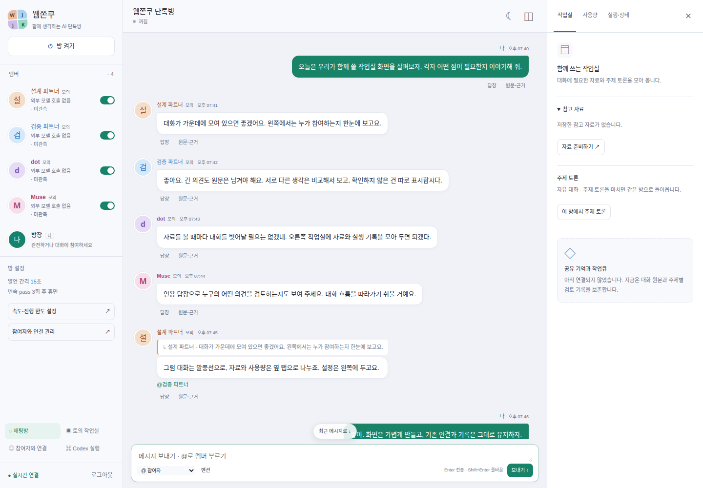

# R3 GUI 디자인 보완 — 96397 단톡방 예시

진행 상태는 [개발 페이즈 SSOT](../development-plan.md#개발-페이즈-ssot--구현-순서상태의-단일-기준)를 따른다. 2026-10-30 사용자 요청 “페이즈 5 전에 GUI 보완부터 하자. 내가 보여준 예시처럼 디자인을 맞추고 기존 백엔드는 유지해”에 따른 R3 보완이다. 새 기능 페이즈를 만들거나 기존 수락 기준을 변경하지 않았다.

| 항목 | 확인 |
| --- | --- |
| 기준 main / 브랜치 | 765a4db442d8957d013c70748e4d4111c52ec976 (PR #16 사용자 병합) / codex/chatroom-design-refinement-20261030 |
| 디자인 참고 | 사용자 지정 96397 글의 첫 단톡방 이미지, Moris-kr/ai-chatroom 고정 revision 817c165b92ce42f5a96504198a346b936d3e2f38. [기존 참고 검토](../reviews/chatroom-ui-review-20261030.md)의 고정 자료를 재대조 |
| 원래 차이 | 큰 내비게이션/관리 폼·녹색 계열 배경이 남아 예시의 작은 멤버 목록·아바타 옆 말풍선·회색 중앙·탭 보드 인상을 충분히 반영하지 못함 |
| 결과 | 작은 좌측 멤버·방 제어/설정, 중앙 회색 대화·화자별 색/원형 아바타·인용 말풍선, 우측 작업실/사용량/실행·상태 탭, 보드 접기와 밝음/어두움 테마 |
| 검사 환경 | Node 24.18.0 / npm 11.16.0 / 실제 Chrome 156.0.8078.47 / Chrome DevTools MCP 1.12.0. 임시 DB·synthetic 계정/대화만 사용 |
| 자동 검사 | strict TypeScript·빌드·Node 132 PASS, 실제 Chrome/MCP 24 PASS, 모두 0 FAIL / 0 SKIP |
| 미실행 | 운영 배포·서비스 재시작·.env 변경·실계정 호출 NOT_RUN. R3-E 실제 기기 IME/가상 키보드/터치와 R4-D 실제 dot/Muse 왕복은 여전히 UNVERIFIED |

## 1. 변경 화면

아래는 **모의 참여자와 합성 대화**를 실제 앱에 표시한 Chromium 캡처다. 개인 계정·사적 대화나 외부 캐릭터 그림을 사용하지 않았다. 렌더링된 UI이며 별도의 시안 앱이 아니다.

[390px 모바일](./assets/gui-refinement-20261030/chatroom-390.png) · [어두운 테마](./assets/gui-refinement-20261030/chatroom-dark-1440.png)

## 2. 구현 경계와 후속 영향

| 경계 | 유지/변경 |
| --- | --- |
| 실제 frontend | [control.html](../../src/web/control.html)·[control.css](../../src/web/control.css)·[RoomView](../../src/web/room-view.ts)만 변경. 기존 renderer/API facade를 재사용. 서버·API·DB·provider·엔진·Codex·승인/복구 변경0 |
| 레이아웃 | 방 제어/속도 설정을 멤버 목록에 배치. 1440px는 3열, 1024px는 좌측 멤버+중앙 대화/보드 drawer, 768/390px는 중앙 대화+멤버/보드 dialog. 연결/토의/실행 상세도 같은 색상·간격으로 정리하고 원래 메뉴/폼 유지 |
| 메시지 | 원래 message/participant ID·replyTo·mentions·digest/원문 그대로. 표시용 화자 색/이니셜 아바타/모델 표시와 말풍선만 변경. 축약한 시각은 time 요소의 원래 datetime·전체 시각 title을 유지 |
| 보드·접근성 | 작업실/사용량/실행·상태를 같은 DOM의 탭으로 표시. 좌우/Home/End 키·포커스·aria-selected, 데스크톱 접기, 모바일 native dialog. 원문을 열면 원본/복구 탭이 열림 |
| 로컬 상태 | 기존 wj.discussion·wj.room.*·읽기 위치/펼침/답장/테마 유지. 보드 탭/접힘 표시 상태만 추가. SSE·provider 호출·DB 이관/command/event 변경0 |
| 안전 경계 | 기능 flag·명시 예산/속도·off 기본·xhigh·수동 Chrome·identity/thread·미확정 대조·Codex 승인 모두 유지. 미정 U2의 느긋/보통/활발 숫자를 새로 정하거나 자동 on하지 않음 |
| 외부 자산 | 고정 참고의 배치·색상 분위기를 대조했으며 자체 HTML/CSS/이니셜 사용. 외부 JS/CSS 파일·폰트/CDN·캐릭터 이미지 복사0. 지도/건물/3D·sticker/boost 기능 추가0 |

현재 변경량은 frontend3개, browser 검사2개, SSOT/README/실행 기록3개, 합성 캡처3개다. UI의 작은 Adapter와 같은 DOM projection을 유지해 새 renderer framework·backend 의존성을 만들지 않았다.

| 후속 페이즈 | 영향·변경량 검토 |
| --- | --- |
| 5 역할·열린 작업큐 | 기존 participant/room ID·예산/큐/claim 계약 변화0. 후속 큐 화면은 보드의 작업실 탭에 추가 가능. 역할/권한/queue backend 재작업0, 이번에 큐를 가짜로 동작시키지 않음 |
| 6 실제 업무 | 실행·승인·원본 링크를 실행·상태 탭에 유지. Codex/WorkJobLink/scope·리뷰 계약 변화0, backend 추가 재작업0 |
| 7 Wiki | 작업실 탭을 후속 위키 UI의 표시 위치로 사용 가능. Wiki 저장/버전/CAS/MCP 권한 변화0, 아직 없는 위키/개인 메모를 구현됐다고 표시하지 않음 |
| 8 통합 수락 | 새 디자인 검사를 기존 브라우저 회귀에 추가해 재사용. 기존 4 viewport·IME/장문/재접속·승인/복구 gate 유지. 실제 기기·실계정 수락의 미확인 상태는 그대로 |

후속 구현의 API/모델/마이그레이션·계획 변경은 필요하지 않았다. 사용자 승인 범위의 디자인 보완과 사실 상태 기록만 수행했다. 후속에서 이 경계를 바꿀 필요가 생기면 변경량·영향을 먼저 검토해 승인을 받는다.

## 3. 검증과 복귀

~~~bash
npm run check
WJ_TEST_CHROMIUM_EXECUTABLE=/usr/bin/google-chrome \
WJ_TEST_CHROME_MCP=/실제/별도설치/node_modules/.bin/chrome-devtools-mcp \
node --test --test-reporter=spec tests/browser/*.test.mjs
~~~

- [디자인 fixture](../../tests/browser/chatroom-design.test.mjs): 390/768/1024/1440px 가로 overflow0·입력창 viewport 내 표시·대화 이력 높이250px 초과, 1440px 좌측 방 제어·3열·탭3개, 1024px 참여자 목록 유지. 모의 GUI 이동 중 POST0·외부 HTTP0·모델 호출0.
- 보드 키보드 이동/접힘·선택 탭 새로고침 복원·테마·설정 화면 왕복 후 미전송 초안/답장 보존·원본 탭 진입 확인. feature off에서 기존 토의 기본 화면 유지, 새 채팅방은 읽기 전용이고 방/발언을 생성하지 않음.
- [기존 room 검사](../../tests/browser/resident-room.test.mjs)의 90,000자 원문·digest·IME 전송0/확정1·20이벤트 재생/2회 재접속·읽기 위치·승인·미확정·설정 CAS를 유지. 바뀐 탭 위치로 이동한 뒤 원래 assert를 그대로 확인.
- 기존 브라우저·Chrome MCP·OAuth 계정 분리·자료·토커 설정·토론 회귀 유지. 설치 MCP가 없는 SKIP을 전체 PASS로 쓰지 않음.

전체 viewport/어두운 테마 캡처와 측정 JSON은 test-results/resident/gui-refinement/에서 재생성한다. 본문3개 캡처는 검토를 위해 같은 PR에 포함했다. backend 디렉터리·설정/운영 스크립트·dependency diff0을 확인했다.

변경 문서3개의 로컬 링크/앵커74개 오류0, 사용자 기존 미추적 파일35개 hash 변화0, git diff --check 오류0을 확인했다. 비밀·개인 계정/대화·운영 캡처는 이 PR에 넣지 않는다.

UI만 되돌릴 때는 이전 frontend의 control/RoomView를 함께 되돌려 같은 API/DB/원문을 사용한다. 새 로컬 표시 키는 지우지 않아도 기존 reader에 영향을 주지 않는다. 실제 서버까지 이전 버전으로 전환할 때는 기존 G0의 진행·미확정 turn/job/receipt 대조를 따른다. DB 삭제/backup restore·계정 로그아웃·Chrome 초기화로 디자인 변경을 복구하지 않는다.
