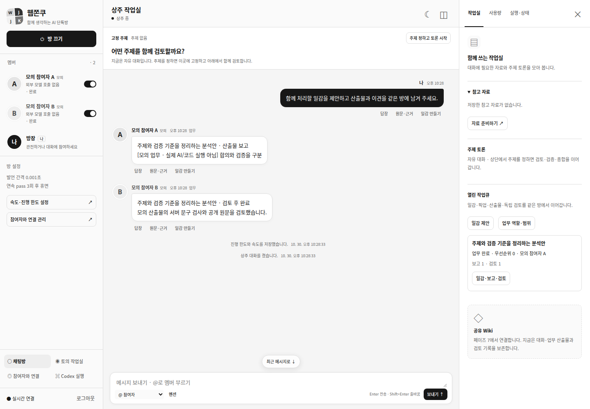

# 페이즈 5 / R5 — 역할·열린 작업큐 구현 기록

진행 상태는 [페이즈 SSOT](../development-plan.md#개발-페이즈-ssot--구현-순서상태의-단일-기준)를 따른다. 사용자 승인 “머지 완료. 페이즈 5 개발하자. 계획 변경이 필요하면 후속 페이즈 영향과 변경량부터 보고해”에 따라 구현했다. 기존 R5 범위·R5-A~F 수락 조건·R6~R8 순서를 변경하지 않았다.

| 항목 | 관측 |
| --- | --- |
| 코드 기준 | PR #19 병합 main `e9c41984f845c7ebb35eba08f8359af7786b56d0` |
| 작업 브랜치 | `codex/phase5-open-work-queue-20261030` |
| 자동 검사 | strict TypeScript·빌드·Node 156 PASS, 실제 Chrome/MCP browser29 PASS. 각각 FAIL0/SKIP0 |
| 도구 | Node 24.x / 실제 Chrome 156.0.8078.47 / Chrome DevTools MCP 1.12.0 |
| 실행 범위 | 임시 DB·모의 참여자·합성 원문/산출물. 실제 SIGKILL 복구·HTTP 경쟁·실제 Chrome UI 검사 |
| 미실행 | 운영 배포/서비스 재시작·운영 DB 이관·실계정 연결/모델 호출·업무 Codex 실행 NOT_RUN. 기존 R3-E 실기기·R4-D 실계정 및 R6 실실행 수락은 UNVERIFIED |

## 1. 사용자 흐름

대화의 **일감 만들기** 또는 오른쪽 보드의 **일감 제안**에서 공개 발언·수용 기준·허용 참여자/역할·범위·선행 일감을 선택한다. 갖춰지지 않은 제안은 사라지지 않고 대기 이유와 함께 남는다. 방이 켜져 있고 기존 예산·속도·가용 슬롯 조건을 만족하면 참여자가 일감을 픽업하고, 분석 산출물을 같은 방에 보고하며, 다른 참여자가 검토한다. 반려하면 원래 보고를 보존하고 새 attempt로 재작업한다.

업무 역할은 **업무 역할·범위**에서 소유자가 명시적으로 배정한다. 기존 Member.role 문구·계정·인증·Chrome thread는 바꾸지 않는다. 관리/관리보조/분야 담당/실행 담당/상태 알리미는 정책 예시이며 새 인원이나 실제 계정을 자동 생성하지 않는다. 미정 U1/U2/U3의 운영 값을 자동 채우거나 기존 방을 자동 on하지 않는다.

아래 캡처는 **모의 참여자·합성 업무**이며 실제 앱을 Chromium에서 조작한 결과다.

[산출물·독립 검토](./assets/phase5-20261030/report-1440.png) · [모바일](./assets/phase5-20261030/report-390.png)

수용 기준의 `text_includes`는 **지정 문구가 산출물에 포함됐는지** 서버가 원문을 검사하는 제한된 관측이다. 주장이나 실제 코드 실행의 성공 판정이 아니다. `manual`은 AI의 accept 문구만으로 통과하지 않고 다른 제출자인 소유자의 직접 확인을 기다린다. `execution`은 실제 실행 근거가 없어 not_run이다. 코드 업무는 R6 연결 전 대기하며 새 Codex job을 만들지 않는다.

## 2. 실제 파일·심볼과 기존 계약

| 경계 | 구현과 유지 사항 |
| --- | --- |
| 타입 | [work-model.ts](../../src/workspace/work-model.ts)의 WorkTask/WorkAttempt/SeatAssignment/WorkReportV1/WorkReviewV1. [resident-model.ts](../../src/workspace/resident-model.ts)에서 재노출하고 기존 배열에 저장. 기존 Discussion.Task·CodexJob 개명/대체0 |
| 순수 정책 | [work-policy.ts](../../src/workspace/work-policy.ts)의 역할/action·공개 원문·dependency DAG·scope·계정 슬롯·관측 검사·저장 상태 검증. 역할 문자열이나 자연어 지시를 권한으로 사용하지 않음 |
| 명령·상태 전이 | [WorkQueue](../../src/workspace/work-queue.ts)의 propose/claim/update/review/cancel/finishTurn. 모든 명령은 기존 Store.transact의 상태/event/command 원자성과 idempotency를 사용. 외부 호출을 transaction 안에서 하지 않음 |
| 전송 | 기존 [ResidentRunner](../../src/workspace/resident-runner.ts) prepared→dispatch→receipt→delta→확정/미확정 경로를 업무/검토에도 재사용. 별도 provider loop/호출기0. 공통 [DispatchCoordinator](../../src/workspace/dispatch.ts)의 workGuard는 새 work turn만 실제 전송 직전 재검사하고 guard가 없으면 전송0 |
| 결합 | [Workspace](../../src/workspace/runtime.ts)가 기존 Store/Dispatch/Runner에 WorkQueue를 주입. provider complete/HTTP/인증/OAuth·기존 topic 6단계·Codex submit/승인/격리·Host/Origin/SSE 계약 유지 |
| 제안 | 기존 ResidentReply envelope에 work_review를 추가하고 work_propose의 새 일감/관리 보완을 서버 정책으로 수락. actor는 원래 turn에서 읽고 task/정책/epoch/generation 불일치면 현재 action에 적용0. Wiki는 계속 미실행 |
| 모의 경로 | 기존 FakeResidentCompletion에서 등록된 fake 참여자의 업무/검토 envelope만 생성. 실제 provider 실패를 모의 응답으로 대체하지 않음 |
| UI/관측 | 기존 control/RoomView와 같은 API/SSE. 공개 발언→일감, 역할·범위, bounded 큐, 보고/재작업/직접 검토, 원래 요청 대조. 상태 카드는 실제 WorkTask/Attempt를 읽기 전용으로 투영. 흑백·상단 고정 주제·기존 연결/승인/복구 유지 |

새 서버·ORM·별도 DB·이벤트 버스·범용 파일 실행기를 만들지 않았다. 작은 정책 함수+명시 전이+기존 transaction과 driver 조합으로 경쟁 claim·stale action·회복을 같은 기록 경계에서 다뤘다. 이는 [개발 지침](../development-guidelines.md)의 Adapter/DI·단일 Coordinator·CAS 원칙을 적용한 것이다.

## 3. 모델·API·이관

WorkTask는 backlog/ready/claimed/running/review/rework/done/blocked/failed/cancelled를 구분한다. 생성·조건 변경·픽업·검토는 expectedVersion을 확인한다. proposalKey와 정규화한 원문/조건 digest로 같은 제안을 중복 제거하며, 없는/다른 방의 원문·의존성 및 순환은 거절한다. 같은 참여자/계정 슬롯에 활성 claim을 중복 생성하지 않는다.

WorkAttempt는 픽업 시점의 input snapshot/inputDigest와 taskVersion·seatVersion·scope·room epoch·context generation을 고정한다. `requestId=resident-work:<attemptId>`는 R6 업무 실행 연결에 사용할 안정된 ID이고, 실제 provider 전송은 별도 `providerTurnId`/providerPromptDigest와 기존 ResidentTurn의 prompt/receipt에 연결한다. 회복/timeout만으로 claim을 ready로 되돌리거나 다른 계정의 새 attempt를 만들지 않는다.

보고는 산출물 원문·당시 수용 기준 snapshot·검사·blocker·원문 refs·digest를 보존한다. 다른 제출자의 검토가 현재 reportDigest/taskVersion과 일치하고 수용 기준의 실제 관측/직접 확인이 갖춰져야 done이다. 조건을 바꾸더라도 이전 보고를 새 조건의 검사 결과로 다시 표시하지 않는다. 이미 확정된 보고는 작성자의 이후 context 인계 때문에 소급 폐기하지 않는다.

| owner API | 동작 |
| --- | --- |
| GET /api/rooms/:room/work?after=N&limit=N | 큐 요약·역할·다음 페이지. 기본50/최대100. 원문/보고 전체를 /api/state에 넣지 않음 |
| GET /api/rooms/:room/work/:task | 해당 방의 일감·원문 보고/검토·attempt 이력 |
| POST /api/rooms/:room/work | 소유자 일감 제안 |
| POST /api/rooms/:room/work/:task/claim | 소유자가 선택한 허용 참여자의 픽업. 자동 pickup과 같은 claim 정책 사용 |
| POST /api/rooms/:room/work/:task/update 또는 /cancel | 버전을 대조한 조건 보완/취소. 진행/미확정 attempt는 임의 덮어쓰지 않음 |
| POST /api/rooms/:room/work/:task/review | 소유자의 독립 검토·반려·직접 확인. 모델 actor는 인증 body로 지정할 수 없음 |
| POST /api/rooms/:room/seats | 기존 참여자의 명시 역할/종류/범위 배정. 표시된 seatVersion CAS |

기존 owner 인증·Host/Origin·idempotency를 그대로 통과한다. 모델 제안/보고는 원래 turn의 actor와 frozen policy/generation에서 같은 내부 명령·정책 함수를 사용하며, owner 키나 새 grant를 모델에 전달하지 않는다. 기존 MCP 도구/grant 의미는 바꾸지 않았다.

물리 SQLite user_version=1과 ResidentStateV1을 유지하고 optional workSchemaVersion=1만 idempotent marker로 추가한다. 기존 workItems/workAttempts 빈 배열을 사용하며 과거 토의 과제·발언·Codex job을 새 일감으로 승격하지 않는다. 미래/손상 상태와 receipt가 있는데 marker가 사라진 상태는 초기화하지 않고 fail closed한다. `.env`·대화/접속 키·vault·Chrome profile·기존 사용자 파일을 이관 대상으로 다시 쓰지 않았다.

## 4. R5 수락·실행 증거

| Gate | 판정 | 실제 증거 |
| --- | --- | --- |
| R5-A | PASS | 2소비자/100 concurrent HTTP claim → 200 1개/409 99개, WorkAttempt claim lease1·claim event1. provider lease는 기존 실제 전송 예약에서 별도 점유 |
| R5-B | PASS | proposal20회→일감1개. acceptance/source/담당/범위 미비 ready0. 공개 원문/없는 dep/순환 거절과 transaction rollback |
| R5-C | PASS | dependency blocked1을 두고 허용 일감2 처리, work+review4회·동시 provider 최대1·같은 Room ledger4. 같은 계정 별칭의 slot 중복0 |
| R5-D | PASS | 실제 SIGKILL claimed/prepared/running/reported 4지점. 준비/전송 중은 100 tick 추가 호출0, 원래 attempt/안정된 requestId/receipt·기존 보고1 보존. 미확정/멤버 off/시간 경과도 무단 재시도0 |
| R5-E | PASS | 다른 작성자의 검토, 근거 미관측/자기 검토의 done0, 반려1회→기존 보고 유지/새 work attempt1, 이전 digest 거절. 수용 기준 변경 후 원래 보고/기준/digest 불변 |
| R5-F | PASS | 5역할의 범위 밖 명령 수락0, 자연어 “상위 지시”/역할 문구 권한 확대0. 배정 변경 중 늦은 보고/제안 차단. 다른 탭의 seat 변경을 stale 폼으로 덮어쓰기0 |

[업무 검사](../../tests/resident-work-queue.test.mjs), [실제 crash 검사](../../tests/resident-work-crash.test.mjs), [브라우저 검사](../../tests/browser/work-queue.test.mjs)를 실행했다. 자동 scheduler도 후속 owner 명령 없이 모의 일감의 pickup→보고→독립 검토를 완료했다. 실계정의 자연어 역할 수행이나 실제 Codex 업무 성공을 검증했다는 뜻은 아니다.

~~~bash
npm run check
WJ_TEST_CHROMIUM_EXECUTABLE=/실제/Chrome \
WJ_TEST_CHROME_MCP=/실제/별도설치/node_modules/.bin/chrome-devtools-mcp \
node --test --test-reporter=spec tests/browser/*.test.mjs
~~~

## 5. 후속 페이즈·복귀

| 후속 | 유지·연결할 지점 |
| --- | --- |
| R6 실제 업무 | WorkTask/Attempt의 stable requestId·task/policy/epoch/generation·scope와 보고/review 이력을 사용. 예정 WorkExecutionBridge/WorkJobLink·start/늦은 승인/결과 guard를 다음 단계에서 연결. 기존 CodexExecutor 재작성0, 이번 code job 생성0 |
| R7 Wiki/MCP | 이미 확정된 보고의 snapshot/digest와 source message/turn refs를 인용. 예정 Wiki CAS·scoped actor/grant를 기존 명령/정책에 연결. 이번 새 Wiki 버전·범용 grant0 |
| R8 통합 수락 | 이번 경쟁/crash/역할/4 viewport fixture를 재사용. 실계정·실기기·실제 코드 scope gate·부하 검증은 별도로 유지. 기존 gate 완화/순서 변경0 |

기존 계획 대비 추가 페이즈나 이월·수락 완화는 없었다. 신규 model/policy/queue 모듈과 기존 runtime/driver/HTTP/UI의 최소 접점, 전용 실패·경쟁·crash 검사를 추가했다. 범위를 바꿔야 하는 사항이 생기면 해당 변경에 의존한 작업 전에 후속 영향과 총변경량을 보고하고 승인을 받는다.

변경량은 source15개(신규3개)·검사/fixture5개·문서5개·합성 캡처3개다. provider/연결·기존 Store/DiscussionEngine·CodexExecutor·인증/MCP·운영 스크립트·dependency diff0, 문서 로컬 링크/앵커99개 오류0, 기존 사용자 파일35개 hash 변화0과 git diff --check 오류0을 확인했다.

롤백은 기존 G0부터 수행한다. 방 off·주제 새 dispatch 중단 후 진행/미확정 provider와 job을 원래 ID로 대조하고, claimed/running/unconfirmed 업무를 무조건 ready로 돌리지 않는다. resident flag off에서 큐를 읽기 전용으로 두고 이전 버전으로 내릴 때 WorkTask/Attempt/보고·검토·명령 결과·소스 메시지를 삭제하지 않는다. 기존 토의/단독 Codex·계정·프로필은 원래 경로를 유지한다. DB 초기화/대화 삭제/인증 교체로 복구하지 않는다.
