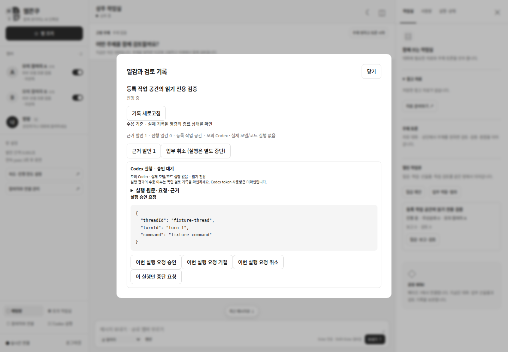

# 페이즈 6 / R6 — 기존 Codex 업무 실행·보고·결과 수락

[페이즈 SSOT](../development-plan.md#개발-페이즈-ssot--구현-순서상태의-단일-기준)의 R6를 구현했다. 사용자 지시 “머지 완료. 페이즈 6 개발하자. 계획 변경이 필요하면 후속 페이즈 영향과 변경량부터 보고해”에 따라 기존 R6 계약·수락 숫자·R7/R8 순서를 유지했다. 실세션/쓰기 미검증을 완료로 바꾸지 않았다.

| 항목 | 관측 |
| --- | --- |
| 기준 main | PR #20 병합 `f8eb38a51b660ba8c379dfa9dec47512250c8762` |
| 작업 기간 | 2026-10-30~31 KST. 브랜치/기록 파일의 날짜는 착수일 기준 |
| 작업 브랜치 | `codex/phase6-work-execution-20261030` |
| 개발 호스트/도구 | Ubuntu 개발 환경, Node 24.18.0 / npm 11.16.0 / Codex CLI 0.165.0 / Chrome 156.0.8078.47 / Chrome DevTools MCP 1.12.0 |
| 검사 | strict TypeScript·빌드·Node 190 PASS; 실제 Chrome/MCP browser 32 PASS. 각각 FAIL0/SKIP0 |
| 설치 계약 | 설치 CLI의 App Server 생성 schema PASS. 로그인/thread/model turn 시작 0 |
| 실행 구분 | 임시 SQLite·Git 저장소·명시 예산/역할·모의 참여자·RPC fixture. 실제 프로세스 SIGKILL·실제 Chromium DOM/HTTP/SSE 검사 |
| 미실행 | 실계정 호출·사용자 Codex thread 실행·운영 DB 이관/배포/서비스 재시작 NOT_RUN. 실제 repo secret/link/output 격리·쓰기 gate 및 R6-F는 UNVERIFIED |

## 1. 사용자 흐름과 실제 경계

기존 **일감 만들기**에서 Codex 읽기 전용 실행·등록 작업 공간·허용 참여자/역할·공개 원문·수용 기준을 선택한다. 소유자가 지정한 방 on/예산·실행 한도·가용 슬롯·선행 조건이 맞으면 픽업→입력 기록→기존 executor→실행 보고→다른 참여자의 검토를 이어간다. 실제 계정·thread·역할·예산을 자동 등록하지 않는다.

상세에서 실제 요청/turn/명령·exit 상태·오류·승인을 확인한다. 승인 시 현재 scope를 다시 검사하며, 방 off/업무 취소와 이미 시작한 job 중단을 구분한다. 미확정은 원래 job을 대조하며 새로고침/timeout·다른 담당자를 재전송 이유로 삼지 않는다. 반려하면 기존 보고·명령 근거와 반려 의견을 다음 attempt의 입력에 포함한다.

아래 화면은 **모의 참여자·RPC fixture**이며 실제 AI/Codex 코드 실행 성공의 증거가 아니다.

[실행 보고·독립 검토](./assets/phase6-20261030/report-1440.png) · [모바일](./assets/phase6-20261030/report-390.png)

R6의 큐는 읽기 전용 binding을 사용한다. 기존 실행기의 앱 state/Chrome profile 가림은 전체 저장소의 비밀·링크·출력 경계 검증이 아니다. `allowWrite` binding은 `work_write_safety_unverified`로 대기하고 job을 만들지 않는다. 환경 변수나 모델/owner JSON의 “검증됨” 문자열로 이 gate를 풀지 않는다. 기존 readOnly의 읽기 정책은 masked private state를 제외한 호스트 파일시스템이며, binding 대상 검사를 새 파일시스템 격리 보장으로 해석하지 않는다. 기존 단독/토의 job의 승인·격리 정책을 바꾼 것은 아니다. 실제 쓰기 gate를 완료한 보장은 R8에서 별도로 확인해야 한다.

## 2. 파일·심볼과 최소 변경 근거

| 경계 | 구현·유지 계약 |
| --- | --- |
| 실행 Adapter | [work-execution.ts](../../src/workspace/work-execution.ts)의 WorkExecutionBridge. 기존 ResidentRunner.evaluate가 tick을 호출하고 기존 CodexExecutor가 실제 RPC·canonical workspace 단일 writer를 소유. 새 provider loop/서버/실행기 0 |
| 모델 | [work-model.ts](../../src/workspace/work-model.ts)의 WorkJobLink/WorkExecutionEvidence와 WorkReport의 optional 실행 근거. 기존 Discussion.Task·CodexJob 상태/필드·submit 시그니처/반환 유지 |
| scope | Bridge.guard/scopeReason가 전송·늦은 승인·결과 수락에 room on/epoch·task/seat version·원문/의존성·binding/host/user/cwd/thread/branch·contextGeneration·입력 해시·한도 예약을 대조. prefix `resident-work:`는 guard/정확한 mapping 없으면 fail closed |
| 기존 executor 접점 | [codex.ts](../../src/execution/codex.ts)의 checkWorkScope/start/decide/completeFromTurn/reconcile 경로. untrusted/user reviewer·sandboxPolicy·bwrap·RPC는 그대로. 결과 거절 사유는 완료 transaction의 link에 저장하여 나중에 guard를 복구해도 현재 결과로 승격하지 않음 |
| journal 조회 | [Store.readCommand](../../src/workspace/store.ts)의 SELECT 6줄 추가. 기존 read/transact·command 결과/hash·event·물리 테이블/user_version·원자성은 불변. 영수증만 남고 job이 유실된 경우를 “미전송”으로 오판하지 않기 위한 최소 접점 |
| 큐/보고 | [WorkQueue](../../src/workspace/work-queue.ts)의 claimExecution/finishExecution/finishUnsent. 상태·원문/이견·보고/알림·idempotency 결과를 같은 transaction에 보존. 기존 claim/분석/독립 검토/CAS 재사용 |
| 결합·관측 | [runtime.ts](../../src/workspace/runtime.ts)의 초기 검증/DI/recovery와 [resident-status.ts](../../src/workspace/resident-status.ts)의 실제 link→job 상태 투영. 버전 조회/heartbeat로 작업 상태를 만들지 않음 |
| GUI | 기존 [room-view.ts](../../src/web/room-view.ts)·control 폼에 업무별 승인/별도 중단/원래 turn 대조·명령 근거를 연결. 기존 owner HTTP/API/SSE/연결·복구·흑백/상단 고정 주제 유지 |

작은 Adapter/DI·명시 상태 전이·기존 Unit of Work와 순수 scope 검사로 구현했다. 서버·DB·ORM·이벤트 버스·새 credential 저장소를 만들지 않았다. Store의 쓰기/명령 계약을 바꾸지 않고 이미 저장하는 영수증을 읽는 접점만 추가한 이유는 job 배열의 부재만으로 실제 미전송을 증명할 수 없기 때문이다. [개발 지침](../development-guidelines.md)에 따른 최소 변경이다.

## 3. 입력·복구·이관·보고

WorkAttempt가 픽업 시 고정한 task/seat/version·epoch/generation·source·수용 기준을 사용한다. WorkJobLink는 binding snapshot·전체 submit input·intentDigest·절대 deadline을 먼저 기록한다. requestId는 `resident-work:<attemptId>`이며 submit의 discussionId/taskId/revision은 null이다. 가짜 Discussion을 만들지 않는다. 실제 job의 최대 실행 시간은 원래 한도와 방 deadline 안으로만 줄일 수 있다.

job 생성 후 link 저장 전 중단되면 원래 requestId·binding·thread·promptDigest·전체 submit의 journal hash/결과 jobId를 함께 대조한다. 일치하는 job만 link하며 입력 충돌/유실·다중 job은 차단한다. job/영수증이 모두 없는 전송 전 scope 변경만 not_sent로 확정하고 입력·한도 예약·알림을 보존한다. 사용자가 일감을 보완한 뒤 새 attempt를 만들 수 있다. 영수증이 있는데 job이 없으면 재전송/미전송으로 추정하지 않는다.

기존 running/승인 대기 job은 기존 executor의 reconciling으로 복구한다. 결과를 잃었으면 원래 thread/turn·입력·시각·종료 기록을 명시 대조한다. 이미 시작한 job의 취소 요청을 실제 종료로 간주하지 않는다. 새 업무의 steer는 고정 입력을 덮어쓰지 않도록 거절하며, 사용자 변경은 대조·반려·새 attempt로 남긴다. 기존 단독/토의 steer는 그대로다.

종료 결과에는 job/binding/thread/turn·명령/exit/출력·파일 변경 보고·시각·원문 digest를 보존한다. 실행 기준의 observed_pass는 **실제 journal에 정수 exit 상태가 있는 완료 명령**의 제한된 관측이며 주장/업무의 타당성을 판정한 것이 아니다. completed 문구만 있으면 not_run, 미확인 exit/잘린 JSON은 unknown이다. 읽기 전용에서 파일 변경이 보고되면 원문을 보존하고 완료를 차단한다. 직접 확인 기준은 기존 독립 owner 확인을 기다린다. 리뷰 없는 done과 보고자의 자기 승인은 허용하지 않는다.

WorkReport와 RoomMessage·상태·명령 영수증은 한 transaction으로 한 번만 저장한다. off/회수/이전 버전 결과는 link의 owner 상세에 보존하고 공개 방에는 보관 상태만 알린다. 현재 업무 결과/후속 Wiki로 자동 수락하지 않는다. 이미 수락한 보고는 작성자 context 인계 후에도 같은 digest로 다른 참여자가 검토할 수 있다.

물리 SQLite user_version=1과 ResidentStateV1/workSchemaVersion=1은 유지하고 optional workExecutionSchemaVersion=1·기존 jobLinks 배열을 사용한다. 이관 명령은 `resident:work:execution:migration:v1`이며 과거 task/job을 새 업무로 승격하지 않는다. 미래/손상/유실 marker와 입력/hash 불일치는 초기화하지 않고 시작 단계에서 거절한다. `.env`·계정 인증·접속 키·Chrome profile·사용자 파일은 이관 대상이 아니다.

원문/재작업 prompt가 기존 30,000자 제한을 넘으면 잘라 보내지 않고 전송 전 차단한다. token usage는 수신 근거가 없으므로 미확인이다. Codex job은 기존 toolJobs 예약 한도를 사용하며 provider 호출은 기존 전체 동시 1/ledger 계약을 유지한다.

## 4. 수락·검사 증거

| Gate | 판정·관측 |
| --- | --- |
| R6-A | PASS · 실제 SIGKILL intent 전/후·submit/link 뒤·승인 대기·완료 뒤 6종. 원래 요청/job 1개, turn/start 각1·보고 각1·다른 담당자 리뷰. 승인 대기 복구는 같은 turn의 명시 외부 fixture 대조 후 진행 |
| R6-B | PASS · off/seat 회수/task version 변경 × queued/늦은 승인/늦은 결과 9종. queued 위반 start0, 늦은 승인 accept 응답0·pending 보존, stale 현재 report/done0 |
| R6-C | PASS · 같은 canonical workspace 2actor/2업무 writer 최대1. 같은 request ID의 다른 submit input 409. receipt/job 유실 대조 시 추가 start0 |
| R6-D | 차단 gate PASS · 쓰기 binding에 repo 비밀 sentinel/link를 둔 100tick에서 job/turn0·변화/공개0. 실제 쓰기/격리 성공은 UNVERIFIED |
| R6-E | PASS · command 없음/not_run, exit 미확인/unknown, nonzero·예상 밖 파일 변경 보고/차단. 독립 검토 이전 done0·반려 후 이전 산출물/근거 보존 |
| R6-F | 설치 schema PASS · Codex CLI 0.165.0. 실제 사용자 thread 읽기→승인→작은 브랜치 변경→보고/재작업은 NOT_RUN/UNVERIFIED |

[실행/경계 검사](../../tests/resident-work-execution.test.mjs)·[실제 crash 검사](../../tests/resident-work-execution-crash.test.mjs)·[browser 검사](../../tests/browser/work-execution.test.mjs)를 실행했다. 추가로 원래 receipt가 없는 미확정 100tick 재전송0·flag off queued start0·과대 입력 원문 보존/예약 누수0·tool 한도1→job1·결과 guard 사후 복구에 의한 승격0·보고 후 작성자 인계/타인 리뷰를 검사했다. browser는 4viewport·원래 승인·off 뒤 승인 거절/별도 중단·원래 실행 대조를 확인했다. 기존 Node/IME/90k/재접속/Chrome MCP 회귀를 유지했다.

~~~bash
npm run check
WJ_CODEX_BINARY=/실제/설치/codex npm run test:codex-contract
WJ_TEST_CHROMIUM_EXECUTABLE=/실제/Chrome \
WJ_TEST_CHROME_MCP=/실제/별도설치/node_modules/.bin/chrome-devtools-mcp \
node --test --test-reporter=spec tests/browser/*.test.mjs
~~~

## 5. 후속·복귀

R7는 확정 report의 원문/command ref·digest와 현재 접근 scope를 Wiki 인용에 사용한다. stale/미전송을 관측 성공으로 올리지 않는다. 신규 Wiki/CAS/resident MCP grant는 이번에 구현하지 않았고 기존 grant 권한 확대도 없다. R8는 이번 6crash/9scope·journal/GUI fixture를 재사용하며 실제 기기·계정·안전 경계·쓰기·부하 gate를 별도로 검증한다. 후속 순서·범위·수락 숫자 변경이나 미검증 이월을 정당화하는 계획 변경은 없다.

로컬 문서 링크/앵커 106개 오류0, 기존 사용자 파일35개 hash 변화0, git diff --check 오류0을 확인했다. 기존 provider/인증·DiscussionEngine·MCP/grant·운영 스크립트·dependency·환경 설정은 변경하지 않았다. 이번 Store 변경은 위의 읽기 전용 영수증 조회에 한정한다.

G0에 따라 방 off·topic 새 dispatch 중단 후 queued work job을 원래 ID로 명시 취소한다. running/blocked_approval/reconciling·미확정 attempt는 원래 receipt/원격 상태를 대조해 quiescent임을 확인한 뒤 flag off/이전 binary로 내린다. 기존 executor가 queued job을 다시 kick하므로 flag만 off한 rollback은 금지한다. intent/link/원문/영수증·폐기 scope/보고·검토와 한도 예약을 보존하며 state 삭제/backup restore/격리 해제로 문제를 숨기지 않는다.
