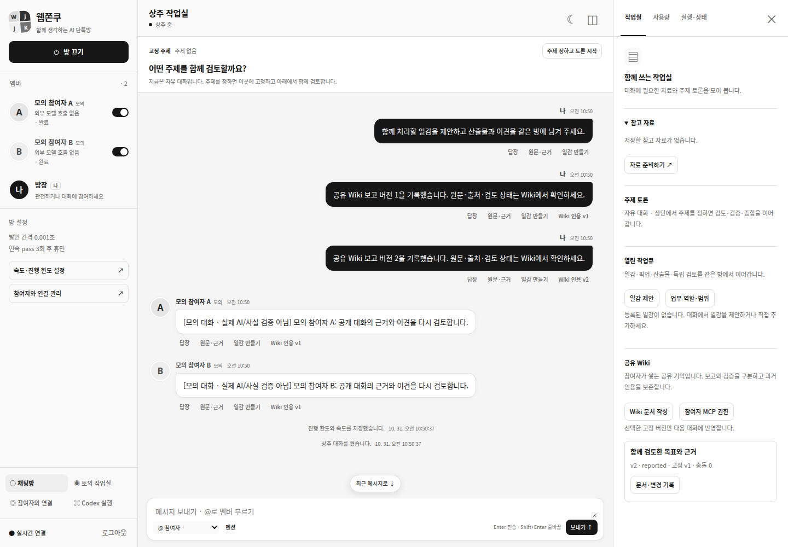

# 페이즈 7 / R7 — 공유 Wiki·고정 인용·별도 상주 MCP

[페이즈 SSOT](../development-plan.md#개발-페이즈-ssot--구현-순서상태의-단일-기준)의 R7을 구현했다. 사용자 지시 “머지 완료. 페이즈 7 개발하자. 계획 변경이 필요하면 후속 페이즈 영향과 변경량부터 보고해”에 따라 기존 R7 계약·7개 gate의 수락 숫자·R8 순서를 유지했다. 이번 문서 변경은 구현 대응·관측 결과·운영 절차의 기록이며 계획 범위 변경은 없다.

| 항목 | 관측 |
| --- | --- |
| 기준 main | PR #21 병합 `9aa8d2ce92d653cdeb1ebd39c2adef640be5119e` |
| 작업일/브랜치 | 2026-10-31 KST / `codex/phase7-shared-wiki-20261031` |
| 도구 | Ubuntu 개발 환경, Node 24.18.0 / npm 11.16.0 / Chrome 156.0.8078.47 / Chrome DevTools MCP 1.12.0 |
| 검사 | strict TypeScript·빌드·Node 222 PASS; 실제 Chrome/MCP browser 36 PASS. FAIL0/SKIP0 |
| 실행 구분 | 임시 SQLite·명시 예산/역할·모의 참여자/응답·실제 loopback HTTP/SSE·실제 Chrome DOM. 기존 실제 SIGKILL·모의 Codex RPC 회귀 포함 |
| 미실행 | 실계정 호출·기존 사용자 Codex thread 실행·운영 DB 이관·배포/서비스 재시작 NOT_RUN. 실제 장기 부하·다른 기기·실제 계정/터널·쓰기/R6-F·R8는 UNVERIFIED |

## 1. 사용자 흐름과 결과

채팅방 오른쪽 보드의 공유 Wiki에서 문서를 작성하고 출처·변경 이력·폐기·충돌을 확인한다. 허용 참여자의 구조화 `wiki_edit`는 현재 역할/범위·세대를 확인한 후 reported 버전으로 게시한다. 수락한 새 분석/Codex 업무 보고도 같은 transaction에서 Wiki로 한 번만 투영한다. 편집 전용 모델 호출이나 매 편집 인간 승인을 추가하지 않았다.

기본값은 허용 최신 Wiki를 다음 발언·업무·방 안 주제 입력에 자동 선택한다. owner가 버전을 고정하면 그 선택만 사용하며 명시 빈 선택은 Wiki 입력 없음이다. 자동 선택으로 복원할 수 있다. 다음 입력은 새 버전을 사용할 수 있지만 이미 준비/claim한 입력은 과거 page/version/digest/sourceRefs/본문 그대로다. 입력과 출력 메시지·WorkReport에 같은 출처 참조를 남긴다. 인용은 입력의 추적이며 사실 검증 성공 주장이 아니다.

같은 baseVersion의 두 편집은 하나만 게시하고 나머지 본문은 충돌 제안으로 보존한다. HTTP409 후 폼의 원문/expectedVersion은 유지된다. 현재 head와 충돌 원문을 읽고 명시 조정해 새 버전을 만든다. 폐기는 tombstone 버전이며 과거 원문·고정 인용을 삭제하지 않는다.

아래 화면은 비밀정보 없는 **모의 참여자·임시 DB fixture**다.

[PC 버전·출처·변경 기록](./assets/phase7-20261031/wiki-1440.png) · [모바일](./assets/phase7-20261031/wiki-390.png)

## 2. 코드 경계와 디자인 패턴

| 경계 | 실제 파일·심볼과 유지 계약 |
| --- | --- |
| 모델 | [wiki-model.ts](../../src/workspace/wiki-model.ts)의 WikiPage/WikiVersion/WikiSourceRef/WikiSnapshot/ResidentGrant. 기존 resident 배열을 타입화하고 room/turn/context·WorkAttempt/Report·Discussion/Turn에 optional 인용만 추가 |
| Wiki 서비스 | [wiki.ts](../../src/workspace/wiki.ts)의 Wiki.edit/editState/applyTurn/publishReport/get/history/pin. 기존 Store.transact가 state·event·명령 결과·알림을 함께 저장하며 새 SQL/Store 계약 없음 |
| 순수 정책 | [wiki-policy.ts](../../src/workspace/wiki-policy.ts)의 assertActor/resolveWikiSources/contextWiki/assertWikiSnapshots/wikiHistoryAllowed/visibleRoomMessages. 버전·범위·공개 출처·이전 Wiki history의 현재 접근을 검사하며 네트워크/파일 조회 없음 |
| 결합 | [runtime.ts](../../src/workspace/runtime.ts)가 Wiki/ResidentMcp를 주입. [WorkQueue](../../src/workspace/work-queue.ts)는 완료된 보고 투영과 구조화 편집을 같은 transaction에 결합. 복제된 저장소·실행 loop·새 승인 서비스 없음 |
| 입력 | [ResidentRunner](../../src/workspace/resident-runner.ts)·[WorkQueue.claimState](../../src/workspace/work-queue.ts)·[DiscussionEngine.create](../../src/workspace/engine.ts)가 고정 snapshot 생성. [dispatch.ts](../../src/workspace/dispatch.ts)·[WorkExecutionBridge](../../src/workspace/work-execution.ts)가 전송/승인/수락 시 현재 허용 범위를 재검사 |
| 공개/인계 | [resident-prompts.ts](../../src/workspace/resident-prompts.ts)·[resident-context.ts](../../src/workspace/resident-context.ts)는 허용된 공개 메시지와 Wiki만 사용. checkpoint는 본문 대신 버전/출처 참조, 권한 회수 후 과거 Wiki history는 안전 인계 전 새 전송 차단 |
| MCP Adapter | [resident-mcp.ts](../../src/workspace/resident-mcp.ts)의 ResidentMcp.createGrant/check/call/8개 residentTools. [http/mcp.ts](../../src/http/mcp.ts)는 새 grant 형식만 분기. 기존 discussion 도구/입출력·grant·Codex 승인 의미 유지 |
| owner API/UI | [http/workspace.ts](../../src/http/workspace.ts)의 인증된 Wiki·history·pin·grant 경로. [wiki-view.ts](../../src/web/wiki-view.ts)의 WikiView를 기존 RoomView에 결합. 기존 control/owner auth·SSE·흑백/고정 주제·승인/복구 화면 재사용 |

기존 Unit of Work에 작은 Wiki 서비스와 순수 정책을 추가하고, HTTP/MCP는 같은 서비스의 Adapter로 구현했다. provider complete 인터페이스·topic JSON parser/공개 라운드 장벽·Store 물리 스키마·OAuth/browser 인증·Codex RPC/승인/sandbox·상시 운영 스크립트·dependencies는 그대로다. frontend 분리가 backend 재작성으로 이어지지 않는다. [개발 지침](../development-guidelines.md)의 작은 DI/Adapter·명시 상태·경쟁/장애 검사 원칙을 따른다.

## 3. 저장·출처·한도·이관

WikiPage는 방/프로젝트 범위·slug·head를, WikiVersion은 원문·출처·작성자·baseVersion·게시/충돌·digest·generation·editId를 보존한다. version은 게시 시 정수, 충돌은 null과 conflictWith를 사용한다. reported만 자동 게시하며 본문의 verified 문구나 모델 check 주장을 검증 상태로 해석하지 않는다. 보고의 실제 command 관측은 sourceRefs.status의 observed/not_run/reported와 원래 WorkReport에서 구분한다.

출처는 같은 방 room_public 메시지, 같은 범위의 수락한 WorkReport, 같은/방 공통 범위의 특정 Wiki 버전이다. 보고 범위·제목은 현재 task를 재해석하지 않고 원래 WorkAttempt snapshot을 사용한다. 비공개 topic 초안·다른 방·계정 context·임의 URL/파일 source는 거절한다. Wiki 본문을 fetch/HTML/명령/도구 권한으로 실행하지 않는다. project Wiki 알림/인용 metadata도 허용 멤버로 제한하며 좁은 MCP grant는 참여자 seat가 더 넓어도 자기 scope만 읽는다. 이미 확정된 보고/인용은 작성자 인계 후에도 현재 접근 권한으로 읽을 수 있다.

기술 한도는 문서 본문 20,000자, 출처 1~20개, 선택 8개·직렬화 context 60,000자, 목록/이력 한 page 최대50개, Wiki 출처 사슬 깊이32다. 기존 room prompt/history 180,000자·Codex 입력 30,000자 제한도 유지한다. 초과는 선택/인계/차단이며 조용히 자르지 않는다. 큰 보고는 summary/reportId/digest/원문 길이와 원래 보고 참조만 Wiki에 기록하고 본문 미포함을 명시한다. 업무의 정확한 원문은 기존 보고에 남는다.

신규 자동 선택이 커져도 기존 claim의 입력을 다시 만들지 않는다. Wiki 조건이 맞지 않는 새 업무는 부분 claim 없이 해당 task만 blocked로 남기고 다른 허용 task는 진행한다. scope 회수로 이전 history를 읽을 수 없으면 새 전송을 차단하고 기존 인계 절차로 새 세대를 만든다. 예산·idempotency 기록·원래 history는 삭제/초기화하지 않는다.

물리 SQLite user_version=1과 ResidentStateV1/workSchemaVersion/workExecutionSchemaVersion은 유지한다. optional wikiSchemaVersion=1을 명령 `resident:wiki:migration:v1`로 한 번만 기록한다. 기존 빈 wikiPages/wikiVersions/residentGrants를 사용하며 과거 토의·개인 기억·credential을 이식하지 않는다. marker 유실/미래 버전·원문/digest 손상은 초기화로 숨기지 않고 시작을 거절한다. 세대 없는 과거 resident fixture grant는 legacy_generation_missing으로 폐기 보존한다. 기존 state.grants는 수정/승격하지 않는다.

## 4. 별도 resident MCP 계약

owner는 참여자·현재 scope·seatVersion/contextGeneration/epoch·도구·만료를 명시한다. 신규 키는 random token을 한 번만 반환하고 서버에는 hash만 저장한다. 목록·state·event·Wiki에는 원문 token이 없다. UI 닫기/취소/로그아웃/다른 방 이동 시 표시를 지우고, 닫은 뒤 다시 연 창에는 이전 요청의 늦은 키 응답을 표시하지 않는다. 최대 유효 기간은7일이며 자동 기본 도구/기한·발급/갱신은 없다.

매 목록/조회/변경 직전 현재 grant·만료/회수·방/멤버·seat/role·identity·epoch·contextGeneration을 재검사한다. 변경은 command cache 반환 전과 transaction 안에서도 검사하므로 옛 키로 과거 명령을 다시 성공시킬 수 없다. 기존 discussion grant는 이 새 형식으로 재해석하지 않는다.

도구는 resident_context_get/message_post/work_list/work_propose/work_claim/wiki_list/wiki_get/wiki_edit의 8개다. 실제 큐/역할·슬롯·상위 예산/범위·Store command를 재사용한다. resident grant로 task_get/codex_send/승인 등 기존 토의 도구를 호출할 수 없고 기존 토의 grant로 resident 도구도 호출할 수 없다. Wiki/메시지 본문이 권한을 생성하지 않는다. 실제 터널/Events/공식 Connector는 이번 단계에서 추가 실행하거나 검증하지 않았다.

## 5. 수락·실행 증거

| Gate | 판정·관측 |
| --- | --- |
| R7-A | PASS · 사용자/AI 같은 base 2편집→게시1/HTTP409 충돌1. 과거 본문·pin digest 동일. browser stale 폼 보존→충돌 원문 조회→명시 조정 v3 |
| R7-B | PASS · 같은 edit/report ID20회→버전/알림 각각1. 자기 verified 승격0. SQLite event insert 실패 시 Wiki/state/event/command/알림 rollback 후 재시도1 |
| R7-C | PASS · 비공개/타 방/타 계정/폐기 권한 자료·동작 수락0. broader seat+narrow grant에서도 project 본문/인용 metadata0. 이전 Wiki 권한 회수 후 새 dispatch0/안전 인계 |
| R7-D | PASS · 다음 2발언과 분석 attempt에 동일 pinned page/version/digest/sourceRefs·본문, 후속 edit가 과거 입력 변경0. topic 전원 같은 snapshot. 고정 없는 자동 업무 보고→다른 참여자 리뷰→다음 발언도 별도 owner 중계0 |
| R7-E | PASS · 기존 tools/list/task_get 등 scope·응답 의미 유지. 양 방향 tool not granted·owner 키/grant 혼용 거절. 기존 HTTP/provider/topic/Codex 회귀 PASS |
| R7-F | PASS · 실제 Chrome HTML/script/javascript 텍스트·보호/임의 URL source 4종: 코드/권한 확대/보호 fetch0. 위조 파일/context source0. 위험한 원문은 텍스트 그대로 조회 가능 |
| R7-G | PASS · 옛/누락 generation2×speech/claim/wiki_edit3=6종 HTTP와 held grant 모두 거절. 만료·회수·seat·멤버·identity·epoch 변경 후 조회/동작0. legacy grant 자동 확대0 |

[Wiki 검사](../../tests/resident-wiki.test.mjs)·[resident MCP 검사](../../tests/resident-mcp.test.mjs) 총32개를 추가했다. [기존 checkpoint 검사](../../tests/resident-context.test.mjs)는 이전의 미구현 placeholder 대신 실제 Wiki를 만들도록 준비 과정만 바꾸고 원래 권한/노출 단언을 유지했다. [browser 검사](../../tests/browser/resident-wiki.test.mjs)4개는 1440×1000 / 1024×768 / 768×1024 / 390×844·편집/이력·출처·pin/인용·HTTP409·안전 렌더·토큰 단회 표시/회수를 확인한다.

~~~bash
npm run check
WJ_TEST_CHROMIUM_EXECUTABLE=/usr/bin/google-chrome \
WJ_TEST_CHROME_MCP=/home/firewine/.local/share/webjjoku/tools/node_modules/.bin/chrome-devtools-mcp \
node --test --test-reporter=spec tests/browser/*.test.mjs
~~~

Node222/Chrome36 모두 FAIL0/SKIP0이며 실행 환경은 위 표와 같다. 기존 실제 SIGKILL/provider1/미확정 무재전송·긴 원문/IME/재접속·실제 Chrome MCP 왕복 회귀가 포함된다. R7 자체 crash 시점 전수 검사는 주장하지 않으며 원자성은 SQLite 실패 주입과 기존 Store journal 회귀로 확인했다. 설치 CLI schema와 모의 RPC는 사용자 thread의 실제 명령 실행/계정 추론 성공을 뜻하지 않는다.

로컬 문서 링크/앵커119개 오류0, 기존 사용자 파일35개 hash 변화0, git diff --check 오류0을 확인했다. 기존 src/connections·src/execution·Store SQL·scripts·dependencies·CI workflow·환경 예제 변경0이며 새 계정/환경/서비스 설정을 만들지 않았다.

## 6. 후속·한계·복귀

R8는 이번 Wiki/권한/인용 fixture를 이용해 3참여자→무인 작업 제안/픽업→반려/재작업→Wiki→다음 발언→topic 복귀를 통합 검증한다. 아직 그 전체 수락을 완료했다고 표시하지 않는다. 1,000메시지/100업무/100Wiki 부하·G0/re-enable·실제 기기·GPT2계정/DeepSeek/dot/Muse·실제 Codex/허용된 쓰기 gate는 R8의 원래 별도 검증으로 유지한다. 순서·수락 숫자·U1/U2/U3와 Human 승인·미확정 대조·예산 정책 변경0이다.

운영 적용은 이번에 수행하지 않았다. .env·서비스·포트·DB·접속 키·인증·Chrome profile을 바꾸지 않는다. 앱을 사용하려면 사용자 병합 후 기존 설치 경로에서 빌드하고 계획된 G0에 따라 서비스에 반영해야 한다. read-only 조회·SSE 재연결은 새 모델 호출/업무/Wiki 편집을 만들지 않는다.

복귀 시 신규 grant를 회수하고 새 Wiki 편집/상주 예약을 차단한 뒤 공통 G0를 수행한다. 진행/미확정 turn·queued/running/승인/대조 job을 원래 ID로 대조하고 quiescent가 되기 전 이전 binary로 내리지 않는다. flag off의 Wiki는 owner 읽기만 유지한다. Wiki/출처/버전/충돌/tombstone·command·인용·원래 job/보고를 보존하고 삭제·state 초기화·backup restore로 되돌리지 않는다. provider/topic/Codex의 기존 계약·서비스/전역 도구를 변경하지 않는 롤백이다.
