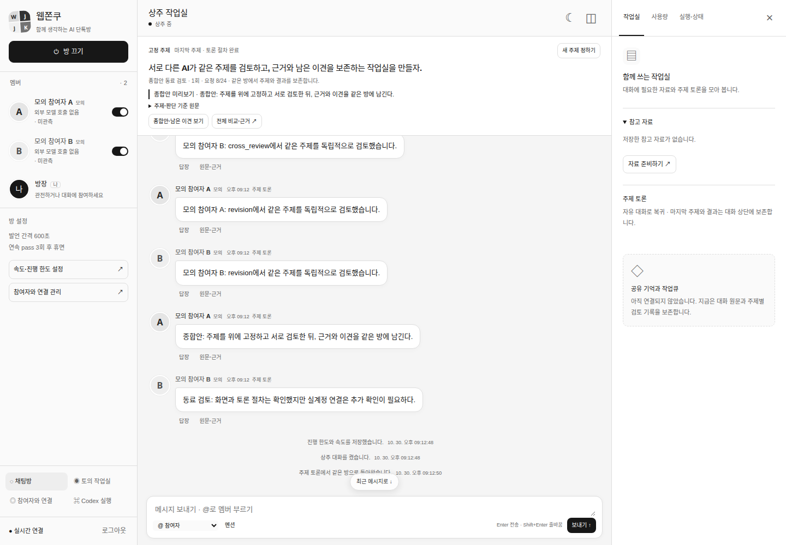

# R3 보완 — 상단 고정 주제와 같은 방의 종합안

진행 상태는 [페이즈 SSOT](../development-plan.md#개발-페이즈-ssot--구현-순서상태의-단일-기준)를 따른다. 사용자 첨부 예시의 “주제를 최상단에 두고 아래에서 서로 토론하고 결론을 내는” 요청을 기존 topic focus의 화면 보완으로 반영했다. 첨부 화면의 개인 대화·외부 캐릭터 자산은 복사하지 않았다.

| 항목 | 확인 |
| --- | --- |
| 기준 | PR #18 병합 main `82967b71b5b14139b206fb95785b53a316456b57` / `codex/pinned-topic-conclusions-20261030` |
| 원인 | `RoomView.renderPanels`는 주제를 오른쪽 보드에만 표시했다. `ResidentRunner.projectFocus`가 종료 후 topicLink를 비우면 그 표시도 사라졌고, 종합안/동료 검토는 별도 토의 화면에서 열어야 했다 |
| 결과 | 중앙 대화의 위에 주제·판단 기준·진행 단계·종합안 미리보기 고정. 주제를 제출하면 같은 방에서 진행. 종료/새로고침 뒤에도 마지막 주제·종합안·이견/불확실성 확인 가능 |
| 재사용 | 기존 Room/Discussion ID·focus/control·상태/메시지/토의 조회 API·SSE·6단계 엔진·공개 장벽·예산·승인·미확정 대조 |
| 서버 변경 | API/DB/마이그레이션/provider/엔진/실행기/dependency/설정 변경0 |
| 운영 | 서비스 재시작·운영 배포·실계정/실제 모델 호출 NOT_RUN. R3-E 실제 기기·R4-D 실계정 수락은 계속 UNVERIFIED |

## 화면과 동작

아래는 **임시 DB·모의 참여자·합성 주제/대화**를 실제 앱에 표시한 Chromium 캡처다.

[모바일](./assets/pinned-topic-20261030/room-completed-390.png) · [종합안·이견 결과 창](./assets/pinned-topic-20261030/results-1440.png)

- 상단의 주제는 실제 `Discussion.topic`, 판단 기준은 `criteria`다. 방을 켠 뒤 기존 주제 생성 폼을 사용하고, 성공하면 같은 채팅방으로 돌아와 기존 topic 발언을 읽는다. 대화 스크롤과 분리돼 주제가 계속 보인다.
- 진행 단계·요청 수와 결과는 기존 토의 기록에서 읽는다. 종합안은 공개가 확정된 `synthesis` 응답, 동료 검토는 `summary_review` 응답이다. 긴 원문은 결과 창에서 그대로 읽으며 이견·미확인·불확실성·원문 ID·수신 시각을 보존한다.
- 토의 종료 시 실제 roomId가 일치하는 마지막 연결 토의를 다시 표시한다. 이관된 standalone 토의나 다른 방의 주제를 현재 목표로 추정하지 않는다. 조회 실패 시 이전 결과를 현재 결과로 남기지 않고 연결 확인 상태를 표시한다.
- 미완성 라운드·형식 보완 대기·미확정/이전 revision/stale 응답은 종합안으로 공개하지 않는다. `completed`는 “토론 절차 완료”, `partial`은 “부분 완료”다. 모델의 동의·보고·출처 관측을 실제 검증 성공/목표 달성으로 바꾸지 않는다.
- 진행·조건 제어와 전체 비교·근거는 기존 토의 화면을 사용한다. 방 메시지와 주제 조건 변경을 혼동하지 않도록 현재 주제에 조건 변경 경로를 표시한다. 자유 대화와 기존 focus의 전송/문맥 계약은 유지한다.

## 파일·계약·후속 영향

| 파일/심볼 | 변경 |
| --- | --- |
| [control.html](../../src/web/control.html) | 상단 고정 주제·진행/결과 동작, native 결과 dialog. 기존 주제 생성 버튼은 상단으로 이동 |
| [control.css](../../src/web/control.css) | 기존 흑백 변수로 고정 영역·결과/이견 표시. 같은 flex 대화 영역 안에서 입력창·스크롤 유지 |
| [control.ts](../../src/web/control.ts) discussion-form | 기존 focus API 성공 후 같은 방으로 복귀. standalone 생성 경로 유지 |
| [RoomView / publishedTopicResults](../../src/web/room-view.ts) | 기존 토의 GET을 읽는 작은 view adapter·상태 투영. 기존 focus의 라운드 공개 경계를 사용하고 원문은 별도 결과 창에 표시. 데이터/명령을 새로 생성하지 않음 |

기존 backend 계약은 모두 유지했다. 새 Room/Task/결론 schema·핀 저장 테이블·모델 호출·SSE 연결·공유 grant를 만들지 않았다. client가 사용하는 event cursor는 원래 `/api/state`의 값이며 새 API 필드가 아니다.

| 후속 페이즈 | 영향·변경량 |
| --- | --- |
| 5 역할·열린 작업큐 | 기존 room/discussion/revision ID를 그대로 사용. 큐 모델·claim·권한 계약 변화0, backend 추가 재작업0 |
| 6 실제 업무 | 기존 실행·승인·복구/근거 링크 유지. 토론 절차 완료와 실제 업무 완료를 구분하며 실행 경계 변화0 |
| 7 Wiki | 원문 turn/claim/evidence 참조 유지. Wiki 저장·버전·CAS·권한 변화0 |
| 8 통합 수락 | 고정 주제→같은 방 토론→종합/동료 검토→재접속 fixture를 추가. 기존 4 viewport·장문·IME·SSE·안전 gate 유지 |

사용자가 요청한 R3 표시/동선 보완 안에서 처리했으므로 페이즈 범위·순서·기존 수락 기준 변경은 필요하지 않았다. 변경량은 frontend4개, 검사2개, SSOT/README/실행 기록3개, 합성 캡처3개다. 작은 view adapter와 순수 공개 결과 투영으로 기존 엔진/스토어 책임을 유지했다.

## 검증과 롤백

최종 소스에서 strict TypeScript·빌드·Node **135 PASS**, 실제 Chrome 156.0.8078.47/Chrome DevTools MCP 1.12.0의 browser **26 PASS**를 확인했다. 각각 FAIL0/SKIP0이다. 기존 90,000자·IME·SSE 재접속·자료/연결·승인·미확정 회귀를 유지했다.

backend/운영 스크립트/dependency diff0, 변경 문서의 로컬 링크/앵커76개 오류0, 사용자 기존 파일35개 hash 변화0, 흑백 CSS에 유채색 리터럴0, git diff --check 오류0을 확인했다.

~~~bash
npm run check
WJ_TEST_CHROMIUM_EXECUTABLE=/실제/Chrome \
WJ_TEST_CHROME_MCP=/실제/별도설치/node_modules/.bin/chrome-devtools-mcp \
node --test --test-reporter=spec tests/browser/*.test.mjs
~~~

[공개 결과 검사](../../tests/room-topic-results.test.mjs)는 전체 검토자·형식 보완의 확정, 미확정/이전 revision/stale 배제, 유효한 최종 보완 원문 선택을 확인한다. [실제 브라우저 흐름 검사](../../tests/browser/room-topic.test.mjs)는 모의 참여자2명/8회 발언의 실제 기존 엔진을 사용한다. 한 초기안만 완료된 시점 공개0, 미완성 동료 검토 노출0, focus 제출1, 종료 후 같은 방/주제 보존, 재접속/화면 이동의 추가 모델 호출0, 다른 토의 오연결0·부분 완료/조회 실패 표시를 확인한다. 390/768/1024/1440px에서 고정 영역 유지·입력창 접근·가로 overflow0을 검사한다.

흑백 GUI의 이전 frontend 네 파일로 함께 되돌리면 같은 API/DB/원문으로 기존 표시를 사용할 수 있다. 새 영속 데이터나 마이그레이션이 없어 DB/Chrome 초기화는 필요하지 않다. 서버 binary까지 바꾸는 운영 롤백은 기존 G0의 진행/미확정 turn·job 대조를 따른다.
