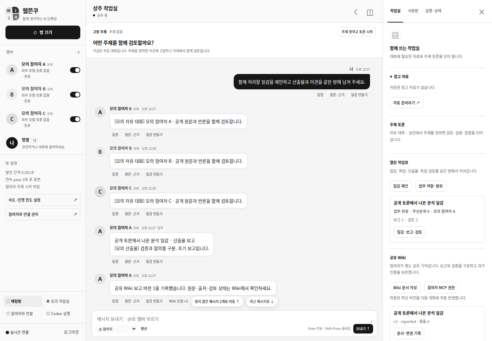

# 페이즈 8 / R8 — 통합 수락·복구·부하 검증

기준은 PR #22 병합 main `8f7866388823e46ade64446343d53351c7ef85e5`, 작업 브랜치는 `codex/phase8-resident-acceptance-20261031`, 검증일은 2026-10-31 KST다. [페이즈 SSOT](../development-plan.md#개발-페이즈-ssot--구현-순서상태의-단일-기준)와 원래 50개 gate 숫자를 유지한다. 최초 fixture 검토 뒤 사용자가 [R8-A B안](../reviews/r8-topic-transition-decision-20261031.md)의 자동 주제 추가를 승인했으며 계약/계획을 먼저 기록하고 구현했다.

**실운영 전체 수락은 미완료다.** [manifest](./resident-acceptance-manifest.json)는 fixture PASS46·UNVERIFIED3·NOT_RUN1이다. 미확인은 R3-E 실기기 IME/터치, R4-D 실제 dot/Muse, R6-F 실세션/쓰기, R8-D 혼합 실계정이다. 실제 쓰기 차단의 PASS는 격리 성공 증거가 아니다.

| 관측 | 결과 |
|---|---|
| 환경 | Ubuntu 개발 환경, Node24.18.0 / npm11.16.0 / Chrome156.0.8078.47 / Chrome DevTools MCP1.12.0 |
| Node 회귀 | strict TypeScript·빌드·270 PASS, FAIL/SKIP0 |
| 브라우저 회귀 | 실제 Chrome/MCP46 PASS, FAIL/SKIP0 |
| 구분 | 임시 DB·3모의 참여자·모의 provider/Codex RPC, 실제 Chrome/HTTP/SSE/자식 프로세스 SIGKILL |
| 미실행 | 운영 이관/배포·서비스 재시작·실계정 추론·사용자 Codex thread·실제 파일 쓰기 NOT_RUN |

## 1. 사용자 중계 없는 전체 흐름

owner가 off 상태에서 예산·속도·3멤버/역할과 자동 주제 허용을 명시하고 방을 한 번 켠다. 세 자유 발언→일감1 제안→기존 큐 픽업→보고1→다른 참여자의 반려1→이전 원문/반론으로 재작업→보고2·독립 수락→reported Wiki 문서1/v2→다음 발언에서 같은 버전/digest 인용→참여자의 `topic_propose`→기존 엔진의 3인 topic→같은 roomId 복귀1을 관측했다.

이 흐름의 추가 owner 메시지·수동 일감/리뷰/Wiki 중계·owner focus 요청은 **0**이다. 자동 업무/인용은8호출, topic 포함23호출, 동시 최대1·같은 requestId 재호출0이다. 분석 흐름의 Codex job은0이다. 별도 승인 검사는 기존 executor의 RPC fixture다. 실모델 호출로 주장하지 않는다.

[흐름 ID·digest](./assets/phase8-20261031/flow.json) · [2탭·읽기/재접속](./assets/phase8-20261031/browser-tabs.json) · [승인1회](./assets/phase8-20261031/browser-approval.json)

[390px 화면](./assets/phase8-20261031/chat-390.png)은 별도 읽기/재접속 fixture이며 실제 운영 계정·개인 대화가 아니다.

## 2. 계약과 안전 경계

`ResidentFocus.capture/pump`는 작은 Adapter로 기존 `DiscussionEngine.create`, Store transaction/command receipt와 provider dispatch를 재사용한다. 새 provider/토론 엔진/DB/승인 경로를 만들지 않는다. 기존 complete·topic parser·Codex RPC·MCP 도구/grant·공개 라운드 장벽은 유지한다. optional Room.autoTopic/ResidentTurn.topicPolicyDigest/resident.topicIntents를 추가하며 기존 방은 허용 false다. configure의 optional boolean만 확장한다. SQL migration·기존 데이터 재초기화는 없다.

확정 ambient say에서만 공개 sourceMessageIds·주제·기준·라운드를 검증한다. actor identity/generation·준비 당시 참여자/seat 정책·room epoch·생성 입력/digest·공개 자료/Wiki basis를 기록한다. 원래 발언/업무/Wiki/예산 settle과 intent 기록은 같은 transaction이다. task/job/승인/미확정/다른 root 중에는 시작을 보류한다. 현재 맥락/권한이 바뀐 오래된 제안은 원문과 거절 이유를 보존하고 새 제안을 기다린다. 자동 topic에는 새 자료 package·execution binding·도구 권한을 주지 않으며 검증 과제/도구 한도0, 나머지는 기존 방의 남은 요청/token/시간 이내다.

engine.create는 transaction 밖에서 원래 requestId/input으로 호출한다. 생성 후 중단되면 먼저 command receipt와 원래 discussion ID를 대조한다. 같은 intent20회에서 topic1·같은 방 복귀1을 확인했다. intent commit 뒤·create commit 전·create commit 뒤의 실제 SIGKILL3에서도 원래 엔진/command로 topic1·중복 생성0·모델/job0이다. 기존/신규 scope·off·예산·미확정 재전송 gate를 유지한다. 새 MCP 권한이나 기존 grant 자동 확대는 없다.

## 3. R8 수락

2026-10-31 추가 실측: 별도 승인된 GPT2+CoralBricks 토의의 [API 부분 검증](./phase8-real-api-20261031.md)은 6요청·완료5/실패1이다. 실제 초기3응답과 GPT 상호 검토2·기록/dispatch/HTTPS는 확인했지만 DeepSeek 재검토에서 중단됐다. 실패 이후의 검증/수정/종합과 dot/Muse/Codex를 포함한 원래 R8-D 전체는 실행하지 않았다. 아래 gate의 원문/전체 판정은 완화하지 않고 부분 증거를 분리한다.

| Gate | 결과·검증 방법 |
|---|---|
| R8-A | PASS(fixture) · `resident-e2e.test.mjs`의 원래 3인 전체 무인 흐름, owner focus0·topic1·복귀1 |
| R8-B | PASS(negative fixture) · 기존 전송/인계/업무/실행 crash·off/budget/scope 회귀. Wiki SIGKILL3·topic SIGKILL3, 중복20회, 구세대/identity/역할/멤버/허용 회수·기본off·만료/예산·공개 자료 변경의 생성0 |
| R8-C | PASS(Chrome fixture) · 1440/1024/768/390px×2탭, 같은 큐/Wiki/예산·읽기 위치/장문·새로고침2/SSE 재접속·overflow0. 늦은 승인409·원래 job/link/turn-start1. 자동 주제 체크 기본off·명시 저장/재열기·on 중 변경 거절 |
| R8-D | NOT_RUN · 실제 GPT2계정+DeepSeek/dot/Muse·사용자 Codex thread/쓰기. 사용자 직접 인증·별도 호출 허용 필요 |
| R8-E | PASS(fixture) · G0→flag off/legacy paused→재활성화, 원문/Wiki/commands/receipt/event 보존·각100tick 재전송0 |
| R8-F | PASS(fixture) · 원문1,000+Wiki 알림100/업무100/Wiki100, 요청 page50 이내·모든 원문/digest 보존·state raw 노출0·12 transaction 비용 |
| R8-G | PASS(fixture) · actor 인계1+중복 명령2/멤버 등록2, ready/review·확정 report/Wiki·ID/예산/역할 유지, 다른 리뷰 가능·옛 grant 거절·job 재전송/새 권한0 |

기존 main v1/R1→R7 이관 fixture는 원문/roomId/commands를 유지하며 과거 개인 기억을 Wiki로 가져오지 않는다. 새 허용 boolean 누락은 false, 잘못된 boolean/intent는 fail closed다. 숫자·원래 수락 문구는 바꾸지 않았다.

## 4. 부하 측정

[부하 JSON](./assets/phase8-20261031/load.json)은 1,000원문/100업무/100Wiki를 만들고 인증 HTTP로 전 원문을 다시 대조한 결과다. 알림 포함1,100메시지·요청 page50, 기존 메시지/업무 API 최대100 계약은 유지한다. 전체 SQLite state 2,386,813바이트, `/api/state`1,345바이트, no-op callback의 실제 전체 transaction12회 중앙값13.96ms·p95/최대22.21ms·heap74,275,368바이트다. 이는 해당 실행의 측정이며 장기 호스트 용량/속도 임계값 보장은 UNVERIFIED다. 원문은 측정 전후 동일하며 기록 삭제/DB 교체는 없다.

## 5. 실행과 운영 적용

~~~bash
npm run check
WJ_TEST_CHROMIUM_EXECUTABLE=/usr/bin/google-chrome \
WJ_TEST_CHROME_MCP=/home/firewine/.local/share/webjjoku/tools/node_modules/.bin/chrome-devtools-mcp \
npm run test:browser
~~~

빌드 폴더를 공유하는 두 명령은 순차 실행한다. MCP SKIP을 전체 통과로 쓰지 않는다. Codex 설치 schema는 별도 `WJ_CODEX_BINARY=/설치/codex npm run test:codex-contract`이며 로그인/사용자 thread/turn은 시작하지 않는다. 최종 head/CI는 R8 PR의 실제 결과를 따른다. 새 검사 파일은 resident-e2e/load/wiki-crash/focus 및 browser/resident-e2e와 해당 fixture다. DI·기존 transaction·명시 상태 전이/정책 hash를 사용하며 범용 새 workflow layer는 만들지 않는다.

초기 운영 metadata는 OAuth auth_required/모델0·browser1·DeepSeek/Codex 미등록·상주 flag off/미이관이었다. 이번 R8-D 완료 증거가 아니다. 로그인 오류는 별도 수정 PR에서 다루며 연결 준비 후 실제 receipt/목록/후속 맥락/stream/usage·원래 thread·승인/명령 결과를 관측해야 한다. 비밀/개인 대화·승인 주소는 공개 증거에 넣지 않는다.

## 6. 복귀와 미확인

[G0](../resident-implementation-plan.md#2-공통-롤백-g0--모든-단계의-선행-조건)로 예약을 막고 원래 turn/job/receipt를 대조한다. off 상태에서 autoTopic=false와 flag off로 신규 자동 시작을 막되 intent·원문·discussion·Wiki/충돌·commands를 보존한다. 시작/미확정 토론을 삭제·재전송하거나 옛 DB로 덮어쓰지 않는다. 이전 빌드 복귀 전 topic/job을 기존 절차로 대조한다. fixture rollback을 실제 호스트 복구 성공으로 표시하지 않는다.

U1/U2 기본 예산/속도, U3 실제 계정/역할/범위와 별도 실계정 허용은 유지한다. B안 추가 승인으로 원래 R8-A를 구현했고, 수락 문구를 완화하거나 후속 페이즈를 만들지 않았다. 사용자 파일35개 hash·로컬 링크/원래 gate 문구·diff 검사는 최종 제출 전에 확인한다. 병합은 사용자 담당이다.

최종 통합에는 일반 GPT 로그인 표시/필수 이메일/진행 복구, CoralBricks·River와 승인된 Codex 기기 코드 연결도 포함했다. [기기 코드 증거](./codex-device-login-20261031.md)의 15 Node/2 browser와 기존 연결 검사를 모두 결합했다. 연결 준비 fixture의 성공은 원래 R8-D 실계정 gate를 대체하지 않는다.

최종 제출 점검: 원래50 gate 문구/숫자 변경0, 사용자 파일35개 hash 변화0, 상대 문서 링크143개 누락0, 설치 Codex0.165.0 App Server schema PASS(로그인/thread/turn0), git diff --check 오류0.
