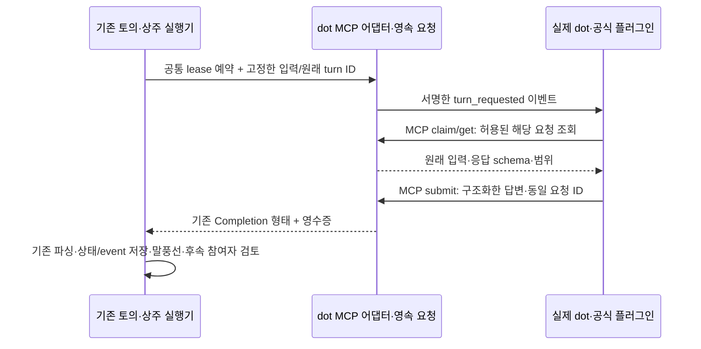

# dot 공식 플러그인·MCP Events 전환 영향 검토

> **기본안 승인 / 2026-11-01 KST.** 사용자가 “계획 개정·개발 승인. Muse 연결은 유지하고 D0부터 진행하자. 추가 OAuth 등 범위가 늘어나면 영향과 변경량부터 보고해”라고 지시했다. 아래는 승인 전 정적 영향 검토의 본문이며, 이후 실행 순서/상태는 [SSOT](../development-plan.md)·[D0 기록](../implementation/dot-mcp-events-d0-20261101.md)이 관리한다. 기본안 승인에 추가 OAuth/공개 ingress/timeout 확대 승인을 포함하지 않는다. [개발 지침 §5](../development-guidelines.md#5-계획-변경-사전-승인과-후속-페이즈-영향-검토)의 사전 영향 보고 절차를 유지한다.

## 1. 먼저 볼 요약

**추천:** dot을 일반 ChatGPT 웹 대화로 간주하는 경로를 공식 dot 플러그인 연결로 분리한다. 기존 토의/상주 실행기가 dot의 차례를 예약하면 MCP Events로 알리고, dot이 MCP 도구로 해당 입력을 읽고 답변을 제출하도록 한다. 답변은 기존 검증·기록·말풍선·후속 참여자 분석 경로를 통과한다. **Muse는 현재 Chrome 대화 연결을 그대로 사용한다.**

- 구현 순서는 **D0~D5, 6단계**다. R9를 신설하지 않고 기존 R1/R2/R3/R4/R8의 연결 보완으로 편입한다. R5/R6/R7은 기존 업무·실행·Wiki 서비스를 재사용하며 권한·회귀를 보강한다.
- 기본안 예상 합계는 **고유 40~52파일, 변경 2,700~4,200줄**이다. 신규 12~17파일·기존 수정 28~35파일을 예상한다. 테스트·플러그인 설정·운영/계획 문서를 포함한 정적 추정이며 실제 diff는 아니다. 단계별 파일 수에는 중복이 있어 합산하지 않는다.
- **첫 관문은 실제 대상 dot에서 비공개 플러그인 + Secure MCP Tunnel + 인증 + Events가 함께 동작하는지 확인하는 것**이다. 공식 기능의 존재와 사용자 계정에서의 사용 가능 여부는 다르다. 현재 조합 검증은 **UNVERIFIED**다.
- 현행 scoped Bearer를 대상 dot에서 지원하지 않아 별도 OAuth 연결이 필요하면 **추가 고유 6~10파일·600~1,000줄**, 기본안과 합쳐 **46~62파일·3,300~5,200줄**을 예상한다. 외부 IdP/계정 설정 비용은 코드 줄 수에 포함되지 않는다. 이 확대는 자동 착수하지 않고 D0 결과로 재보고한다.
- 현행 수락 기준의 dot “기존 thread” 전제는 **공식 dot의 이벤트 수신→도구 조회→응답 제출 증거**로 정정해야 한다. Muse의 기존 thread 수락, 전체 50 gate, 사실/합의 구분과 미확정 대조 기준을 낮추지 않는다.

가장 큰 리스크 3개:

1. **계정·인증·전달 경로:** 사용자의 dot에서 비공개 플러그인/Events가 허용되는지, Tunnel 조직·워크스페이스 연결과 인증이 맞는지 미확인이다. D0를 통과하기 전에 전체 구현에 들어가지 않는다.
2. **비동기 응답·중복·재시작:** 이벤트 수신 성공은 답변 완료가 아니다. 지연/중복/역순/재시작 때 새 요청을 만들거나 같은 발언을 두 번 게시하지 않도록 원래 turn과 durable outbox/mailbox를 연결해야 한다. 외부 dot의 내부 계산까지 정확히 한 번이라고 보장할 수는 없다.
3. **dot의 정체성·권한:** 일반 GPT OAuth 계정이나 `/c/...` URL은 native dot을 입증하지 않는다. 앱의 grant는 웹쫀쿠 도구 권한만 제한한다. dot에 별도로 연결된 다른 앱·컴퓨터 권한까지 통제하거나 그 실행을 웹쫀쿠 Codex의 검증된 실행으로 간주하지 않는다.

## 2. 검토 기준과 코드 근거

현재 작업 HEAD는 `54f4844575b1f13b6fe0dd6f263ae9ed84ed9e33`, 브랜치는 `codex/password-min-six-20261101`이다. 확인한 `origin/main`은 PR #35 병합 `ce8d9717ca34a77f458f47a8eb2f98cc793b2fcf`이며 두 소스 tree는 `2c5c6dc785801248ab68f08556e8a592e7682f81`로 같다. 이후 구현 착수 때 main을 다시 대조한다. 과거 핸드오프의 `8f81d86` 등은 이번 구현 근거가 아니다.

아래는 소스 정적 확인이다. 실계정 로그인·모델 호출·터널 실행·실제 dot 수신·Muse 왕복은 이번에 수행하지 않았다.

| ID | 확인한 파일·심볼 | 판정과 영향 |
| --- | --- | --- |
| D-E1 | `src/workspace/runtime.ts::Workspace.confirmBrowser` | `target=dot`에 `chatgpt.com/c/...`를 요구한다. native dot 연결의 근거로 부적절하므로 공식 연결과 분리해야 한다. |
| D-E2 | `src/web/control.ts::connectionMode/updateConnections`, dot 연결 버튼; `control.html` browser discovery 폼 | dot 선택을 기존 ChatGPT 대화/Chrome 탐지로 연결한다. 공식 연결·구독 상태를 보여주는 전용 설정으로 바꿔야 한다. |
| D-E3 | `src/connections/browser-presets/chatgpt-v1.json`; `browser-discovery.ts`; `browser.ts::BrowserBridge.complete/probe` | ChatGPT DOM 관측은 native dot 식별 계약이 아니다. Muse의 profile/thread/draft/busy/receipt/수동 제어 검사는 재사용·보존한다. |
| D-E4 | `src/http/mcp.ts::McpEndpoint.handle` | `initialize`의 `2025-06-18`·tools만 구현. Events capability·list/subscribe/unsubscribe·전달 worker가 없다. |
| D-E5 | 같은 파일 `McpEndpoint.call::result_submit` | `provider_report` 근거를 저장하고 `review_required`를 반환한다. provider 완료·방 말풍선 게시가 아니다. 의미를 바꾸지 않고 전용 응답 도구를 추가한다. |
| D-E6 | `src/connections/providers.ts::CompletionInput/Completion/Hooks/Providers.complete` | Promise 기반 공통 계약을 유지한 채 dot 어댑터를 넣을 수 있다. 연결 kind의 additive 추가와 기존 kind 분기 점검은 필요하다. |
| D-E7 | `src/workspace/dispatch.ts::DispatchCoordinator/performCompletion/classifyFailure` | 공통 예약·lease와 실제/가능 전송 후 미확정 경계가 있다. dot도 같은 논리적 provider 슬롯을 사용한다. |
| D-E8 | `engine.ts::DiscussionEngine.turn/recover`; `resident-runner.ts::ResidentRunner.recover` | 준비/전송 전 기록·세대/revision·응답 파싱·재시작 대조를 유지해야 한다. MCP 결과를 직접 공개 메시지로 우회 게시하면 이 계약을 깨므로 금지한다. |
| D-E9 | `src/workspace/store.ts::Store.transact`; `vault.ts::Vault.put/get/remove` | SQLite 상태/event/command transaction과 AES-GCM credential 저장을 재사용한다. DB와 vault 파일 사이까지 원자적이라고 가정하지 않는다. |
| D-E10 | `resident-mcp.ts::ResidentMcp.authenticate/check/call`; `wiki-policy.ts`; `work-queue.ts::WorkQueue` | room/participant/scope/version/epoch/generation grant·업무·Wiki CAS 재사용. 기존 무예약 `resident_message_post`를 dot 완료 경로로 쓰지 않는다. |
| D-E11 | `api-usage.ts::meteredApi/participantWait`; `resident-context.ts::prepareCheckpoint/rotateResidentContext`; `resident-status.ts::projectResidentStatus` | API 한도는 DeepSeek/Anthropic만 유지한다. dot의 구독 준비 상태·외부 문맥 보존·관측 투영을 보완해야 한다. |
| D-E12 | `src/http/workspace.ts`의 `/mcp` 경로; `scripts/mcp-stdio.mjs`; `operations-runbook.md §5` | 현재 MCP grant와 owner 로그인은 별개다. stdio 전달기는 private grant 파일로 HTTP POST한다. 기존 전달기 존재를 Events HTTP/Tunnel 왕복 성공으로 볼 수 없다. |

## 3. 공식 규격으로 확인한 것과 남은 확인

| 근거 | 확인 내용 | 이번 계획의 해석 |
| --- | --- | --- |
| [MCP Events 공식 문서](https://developers.openai.com/plugins/build/mcp-events) | dot 지원, Streamable HTTP Events, callback 검증·서명·구독 수명·중복/역순 처리가 명시돼 있다. `2xx`는 webhook 수신이며 비동기로 처리된다. | 서버가 dot을 직접 호출하는 모델 API가 아니다. 알림/입력 조회/답변 제출을 분리하고 수신 완료를 추론 완료로 표시하지 않는다. |
| [dot의 컴퓨터·앱 연결](https://learn.chatgpt.com/docs/dots/computers-and-apps) | dot은 계정에서 설치·활성화한 지원 플러그인을 사용하며 클라우드 환경과 사용자 로컬 Chrome은 별개다. | 공식 연결에는 일반 ChatGPT `/c/...` ID를 요구하지 않는다. 기억을 OAuth로 가져왔다고 주장하지 않으며 native 문맥과 앱이 제공하는 범위별 입력을 구분한다. |
| [플러그인 연결·검사](https://developers.openai.com/plugins/deploy/connect-chatgpt) | 비공개 MCP 검사에 Secure MCP Tunnel을 사용할 수 있으며 Create as a plugin 경로가 있다. | 사용자 한 명의 비공개 플러그인이 기본안이다. 공개 디렉터리 배포를 포함하지 않는다. |
| [Secure MCP Tunnel](https://developers.openai.com/api/docs/guides/secure-mcp-tunnels) | 외부 inbound 없이 stdio/HTTP MCP 연결, 별도 runtime key·조직 권한·workspace association이 필요하다. OAuth 서버를 자동으로 터널링하지 않는다. | 기존 Tailscale private 접속은 유지한다. Tunnel은 도구의 전송 통로이며 native dot 사용 권한·도구 인증을 대신하지 않는다. MCP 응답을 모델 답변까지 장시간 붙들지 않는다. |
| [플러그인 패키징](https://developers.openai.com/plugins/build/plugins) | 고정 Bearer는 `auth.type=api_key`, `headerScheme=bearer`로 선언하지만 공개 submission 폼에서 지원하지 않는다. | 현재 grant 재사용 후보일 뿐 대상 dot의 Cloud/custom Tunnel 연결에서 지원된다는 증거가 아니다. manifest에 credential을 넣지 않는다. |
| [플러그인 인증](https://developers.openai.com/plugins/build/auth) | OAuth discovery·PKCE·resource/audience/scope 검증을 설명하며 ChatGPT 인증 제약을 별도로 둔다. | 패키지 스키마 지원을 모든 제품의 인증 지원으로 확대하지 않는다. D0에서 고정 grant의 실제 지원 여부를 확인하고, 필요하면 검증된 IdP와 기존 grant를 매핑하는 OAuth 보완안을 별도 승인받는다. 자체 OAuth 인증 서버를 새로 만들지 않는다. |
| [워크스페이스 플러그인 관리](https://learn.chatgpt.com/docs/enterprise/plugin-management) | MCP 선언을 포함한 GitHub import는 원격 URL이어도 Desktop only가 될 수 있다. `.app.json` 참조도 접근 권한을 만들지 않는다. | GitHub에 manifest를 올리면 cloud dot에 자동 설치된다고 계획하지 않는다. 먼저 계정에서 만든 실제 custom plugin/app를 검증하고 필요할 때 그 등록 ID를 패키지에 참조한다. |

**UNVERIFIED:** 사용자의 정확한 dot/계정에서 private custom plugin·이벤트 태스크·Tunnel이 함께 허용되는지, 지원 인증 방식, native actor 식별 metadata, 최초 설치 뒤 요청별 추가 확인 없이 응답 도구가 동작하는지, 이벤트 지연/배칭, 기존 turn timeout 안에서의 왕복. 이 항목들은 D0/D5의 실환경 증거로만 PASS 처리한다. Business 설정의 기기 코드 허용이나 일반 GPT 로그인 성공만으로 대체하지 않는다.

## 4. 대안 비교와 바꿀 결정

| 대안 | 기존 backend와의 관계 | 결론 |
| --- | --- | --- |
| 일반 ChatGPT 대화에 dot 라벨을 붙여 Chrome으로 입력 | DOM 어댑터는 재사용하지만 native dot 연결을 입증하지 못한다. | **기각.** 일반 GPT browser 연결과 native dot을 같은 것으로 표시하지 않는다. |
| dot 화면의 DOM 자동화를 추가 조사 | 별도 UI/selector/맥락·receipt 계약이 필요하고 공식 plugin/event 연동 목표를 충족하지 않는다. | **기각.** 이번 전환의 fallback으로 개발하지 않는다. |
| 공식 도구를 수동 호출하고 사용자가 답변을 복사 | 일부 MCP 재사용 가능, 상주 자동 참여 불충족. | D0 진단까지만 사용 가능. 최종 수락으로 인정하지 않는다. |
| 공식 private plugin + Events + 요청별 응답 도구 | 공통 provider·Store·엔진·큐·Wiki를 재사용하고 새 transport만 추가한다. | **추천.** 먼저 실제 계정 capability와 인증을 확인한다. |
| 공개 HTTPS 플러그인 + OAuth | 별도 공개 ingress·IdP/운영·보안 범위가 생긴다. | 기본안 밖. private 경로가 막혀도 자동 공개 전환하지 않고 영향·승인을 다시 받는다. |

| 기존 결정/계획 | 판정 | 개정할 내용 |
| --- | --- | --- |
| R4의 dot/Muse 공통 browser discovery | 수정 | Muse·일반 browser에는 유지, native dot은 공식 plugin/Events로 분리한다. |
| Providers.complete·공통 dispatch·전송 전 기록 | 유지 | 새 dot adapter와 durable mailbox로 결합한다. |
| 주제 JSON·상주 reply 검증·동일 라운드 비공개 장벽 | 유지 | dot도 같은 frozen input과 기존 parser를 사용한다. |
| 기존 MCP `result_submit`·resident 도구 의미 | 유지 | 전용 dot 응답 도구를 추가해 의미/권한을 섞지 않는다. |
| native dot을 기존 `/c/...` 식별자로 확인 | 기각 | owner가 실제 dot에서 연결을 확인하고 인증된 principal·grant와 논리적 참여자를 명시 결합한다. |
| dot/Muse의 기존 native 문맥 보호 | 유지/분리 | Muse profile/thread 보호 유지. dot은 native 기억을 이전/초기화하지 않고 앱 scope/generation만 fencing한다. |
| R8-D의 dot/Muse 각각 기존 thread | 수정 | dot은 공식 이벤트 왕복, Muse는 원래 thread 왕복을 각각 확인한다. 참여·후속 맥락·실행 근거의 요구 수준은 유지한다. |
| MCP Events 미구현/비활성 표기 | 수정 예정 | 승인 뒤 구현 상태·fixture·실환경 결과를 별도 기록하며, 전부 검증 전에는 완료 표기하지 않는다. |
| Muse 공식 Connector | 유지 | 이번 범위 밖이며 현재 browser 연결을 계속 사용한다. |

## 5. 최소 변경 구조와 계약

아래 `dot-mcp` 타입·파일·도구·이벤트 이름은 모두 **제안**이다.

### 5.1 연결·정체성·인증

`ProviderKind/Connection/Member`에 `dot-mcp`를 additive 추가한다. 일반 GPT·API·Muse는 기존 kind를 유지한다. owner의 연결 화면에서 대상 방/참여자와 허용 도구를 정하고 실제 dot에서 pairing을 확인한다. caller가 보낸 이메일/별칭/`dotId`만 믿지 않는다. 검증된 native actor ID가 공식 transport에서 제공되는지는 UNVERIFIED이며, 미제공 시 **owner가 확인한 연결**과 **암호학적으로 확인한 계정/principal**을 구별해서 표시한다.

기존 scoped grant를 인증 경계로 재사용하는 것이 최소안이다. 대상 dot의 공식 연결이 이 방식을 지원하는지 D0에서 먼저 확인한다. 지원하지 않으면 기존 owner 비밀번호를 외부에 전달하거나 no-auth로 공개하지 않는다. 필요한 OAuth resource adapter는 기존 IdP의 토큰 검증·resource/audience/scope와 owner가 부여한 grant 매핑으로 한정하고 별도 확대 승인을 받는다.

논리적인 native dot 선택 항목을 제공하되 실제 API 모델 목록이나 Extra high 지원을 만들어 표시하지 않는다. 모델/사고 설정은 native 서비스에서 확인한 제어만 안내한다. dot 사용량은 보고가 없으면 `null/알 수 없음`이며 기존 API 일일 한도에 포함하지 않는다. 기존 방 전체 채팅 한도도 되살리지 않는다. 도구 한도·승인·속도·미확정 경계는 유지한다.

### 5.2 Events와 전송

기존 HTTP MCP 경계에 인증된 `events/list`, `events/subscribe`, `events/unsubscribe`를 추가하고 공식적으로 지원되는 Streamable HTTP `initialize` 경로를 우선 사용한다. MCP 2.0 전체 재작성은 계획하지 않는다. 현재 POST 구현과 새 capability가 실제 transport 규격을 충족하는지 검사하고, 필요한 negotiation/HTTP 처리만 `http/mcp.ts`·`workspace.ts`에 보강한다.

구독은 principal + callback + event name + canonical arguments로 식별하며 재구독은 동일 ID를 갱신한다. room/participant/connection grant를 넘는 필터는 거절한다. callback 서명 키는 vault에만 보관한다. signed challenge 검증 뒤 active로 만들고, 유한 만료·회수·secret 교체·cursor를 관리한다. callback 검증/전달 모두 HTTPS·접속 시 DNS public address 확인·검사한 IP에 연결·TLS 원래 hostname 검증·redirect 금지를 적용한다. 기존 `sources.ts::publicAddress`를 재사용하되 redirect를 허용하는 `fetchSource` 자체를 webhook POST에 재사용하지 않는다.

방의 모든 발언을 무조건 wakeup으로 보내지 않는다. **기존 scheduler가 dot 차례를 예약한 경우만** 작은 `webjjoku.turn_requested` 이벤트를 만든다. event에는 ID/상태 참조를 넣고 긴 원문·실행 지시를 붙이지 않는다. dot의 최초 설치 지침은 해당 이벤트에서 지정된 도구로 입력을 읽고 답변하라는 사용자 동의로 설정한다. 원래 입력은 MCP에서 권한·세대·초안 가시성을 확인해 읽는다.

outbox에는 발송 전 durable intent·고정 eventId·본문 digest·시도 시각·전달 결과를 남긴다. 일시적 전송 실패만 동일 eventId로 제한된 재시도를 하며 signing timestamp는 새로 만든다. `410/413`은 재시도하지 않는다. 이는 동일 알림의 transport 재시도이며 새 provider turn/새 추론 요청을 생성하는 재시도가 아니다. 외부 플랫폼의 이벤트 배칭/중복 처리 때문에 dot 내부 계산의 exactly-once를 약속하지 않는다. 앱의 claim·답변 수락·공개·action은 각각 한 번으로 제한한다.

### 5.3 답변·단일 실행·복구

**2026-11-02 D3 추가 승인:** D1 `DotMcp.check`의 grant epoch/contextGeneration 고정은 `ResidentStore.control`의 on/off와 `DiscussionEngine.create`의 focus epoch 증가 시 정상 연결도 무효화한다. `DotMcp.checkAuthority`로 연결 권한과 요청 검사를 분리한다. 같은 방·참여자·연결 identity·owner 확인·허용 도구·grant version·만료/회수는 계속 확인하고, 원래 grant epoch/generation은 이력으로 보존한다. 새 `DotRequest`마다 고정한 epoch/contextGeneration/revision/lease/입력 digest를 get/claim/submit/전달/최종 공개에서 확인한다. off/구세대/취소/회수 뒤 새 실행0·현재 적용0, 미확정 자동 재시작0을 유지한다. 이는 정상 방 전환마다 재등록을 요구하지 않기 위한 승인 변경이며 권한 확대가 아니다.

D4는 정상 on/focus 전환에는 연결을 유지하고, 만료·회수·identity 변경에는 재연결을 안내한다. D5는 방 off→on 및 자유 발화→주제→복귀의 새 요청/옛 요청 분리를 추가 대조한다. 추가4~6파일·150~250줄, D3 합계14~18파일·850~1,250줄 예상이며 R1~R8/50 gate/Muse/Codex/timeout 계약은 그대로다. optional requests/mailbox 이관만 추가하고, rollback은 dot off·미확정 대조·이전 바이너리 호환성 확인 후 진행한다.

기존 `Providers.complete(CompletionInput): Promise<Completion>`은 유지한다. 제안 `DotMcpAdapter.complete`는 원래 requestId·participant snapshot·prompt/history digest·revision/generation·room epoch·grant version·lease fencing을 저장하고 해당 요청의 결과를 기다린다. worker·process의 메모리 Promise만으로 상태를 관리하지 않는다. 최초 외부 전달 가능 경계 앞에서 기존 `hooks.dispatched()`와 영속 상태를 연결하며, 그 뒤에는 timeout/프로세스 종료를 “미전송”으로 단정하지 않는다.

제안 도구 `dot_turn_get`, `dot_turn_claim`, `dot_turn_submit`은 이 요청만 다룬다. claim은 서버 발급 attempt token으로 한 실행 주체에게만 입력을 부여하고, 동일 command 재전송은 기존 결과를 돌려준다. 다른 claim과 충돌하는 payload는 거절한다. submit은 원래 turn/claim/grant·범위를 검사하고 digest와 결과·이벤트·중복 command 결과를 같은 Store transaction에 저장한다. raw reply는 보존하고 기존 topic `parseReply` 또는 resident validator를 거친 뒤 같은 공개 경로에 반영한다. `format_retry`가 필요해도 기존 횟수·슬롯·새 요청 기록을 따르며 이벤트 중복을 형식 재시도 사유로 삼지 않는다.

기존 `result_submit`은 검토용 근거 제출로 남긴다. 기본 dot transport grant에는 일반 `resident_message_post`를 중복 게시 경로로 주지 않는다. Wiki/업무 도구가 필요한 경우 별도 기존 scoped 권한으로 연결하며 무조건 부여하지 않는다.

구독 부재/회수/만료는 후보 선택 전에 `participantWait` 계열 준비 상태로 처리하여 다른 준비된 GPT/API/Muse가 진행할 수 있게 한다. 발송 가능 상태가 된 뒤 응답이 불확실하면 기존 미확정 lease를 유지하고 원래 ID로 대조한다. TTL만으로 lease를 풀거나 browser/GPT로 자동 대체하지 않는다. 기존 turn timeout과 토의/도구 deadline은 유지한다. D0/D5에서 실제 지연을 측정하고 기존 범위를 벗어나면 별도 dot 대기시간 정책의 필요성과 후속 영향을 다시 보고한다.

재시작의 “결과 수락 후 기존 turn 최종 commit 전” 구간도 다룬다. 저장된 mailbox를 원래 turn의 대조 근거로 연결하며, 원래 `recover`의 prepared/running→unconfirmed 원칙을 유지한다. 그 turn에 묶인 outbox도 보류하고 재구독/cursor 재생이 보류를 우회하지 못하게 한다. 재시작만으로 외부 발송이나 결과 공개를 재개하지 않는다. 사용자의 대조/수락 시 정확한 원래 turn을 기존 정산·공개 경로로 한 번만 확정한다. room off/cancel/세대 교체/권한 회수 뒤 늦게 온 결과는 원문·영수증을 격리 보존하고 현재 action에 적용하지 않는다. off는 외부 dot의 이미 시작한 작업을 중단했다는 증거가 아니다.

### 5.4 영속 모델·이관·패턴

`WorkspaceState.dotMcp?`의 선택적 새 namespace에 제안 `schemaVersion`, connections/bindings, subscriptions, outbox, requests/mailbox를 둔다. 이 중 연결 kind/참여자 snapshot은 기존 모델에 additive 반영한다. 민감한 callback secret·grant 원문·claim credential은 DB/event/UI 로그에 넣지 않고 vault 참조/해시만 저장한다. 조회용 진단은 callback URL/token을 가린 상태를 투영한다.

미존재 namespace는 empty/off로 한 번만 이관한다. 기존 DB·state/Chrome profile·credential·대화/참여자/turn ID를 바꾸지 않는다. `browser.discovery.target=dot`이 있다고 native dot으로 자동 승격하지 않는다. 잘못된 표시를 “일반 웹 연결·공식 dot 확인 필요”로 구별하고 과거 snapshot/원문은 보존한다. 운영 바인딩의 수정·대체는 owner의 명시 선택과 idle 대조 후 한다. Muse는 이 이관 대상이 아니다.

DB와 vault의 두 저장소는 기존 삭제/cleanup 패턴처럼 intent→파일 저장→DB 활성화 순서를 기록하고 orphan 복구를 검증한다. 새 namespace를 이해하지 못하는 과거 바이너리로 무조건 downgrade하지 않는다. dot off·미확정 대조 후 호환성 검사를 거쳐 보존 모드로 내려야 한다.

패턴은 기존 지침을 그대로 적용한다. **Adapter/Composition**으로 transport를 추가하고, **Store.transact + durable outbox/mailbox**로 외부 부작용 경계를 잇는다. **명시적 상태 전이·CAS/fencing·idempotency**로 중복/늦은 결과를 막고 기존 이벤트 projection으로 화면을 갱신한다. 새 DB·message broker·범용 workflow framework·DI container·provider 전면 재작성은 필요하지 않다.

## 6. 단계별 대상·변경량·수락·복귀

신규 경로·심볼은 모두 **제안**이다. 단계별 추정은 변경 줄 수(additions+deletions)이며 테스트/문서를 포함한다. 실제 계정·서비스 동작은 별도 허용과 사용자 직접 인증 후에만 수행한다.

| 단계 | 대상 파일·심볼 / 모델·이관 / 계약 | 예상량 | 단계 수락 방법·증거 | 롤백 |
| --- | --- | --- | --- | --- |
| **D0: 계정·공식 전송 경로 관문** | 기존 `http/mcp.ts::McpEndpoint.handle`, `scripts/mcp-stdio.mjs` 계약을 대조. 제안 Events 최소 fixture·`tests/mcp-events.test.mjs`, 운영/검증 문서. 운영 이관 0. | 4~6파일·150~250줄 | 승인된 격리 fixture에서 HTTP 초기화/도구/Events 왕복; 대상 dot에서 실제 custom plugin 설치 가능·지원 인증·구독 challenge·이벤트1→도구1→응답1을 확인. `tunnel-client doctor --profile <전용 profile> --explain`, 가린 RPC/event/도구 로그와 UI로 판정. dot에서 실행된 사실이 없는 ChatGPT 일반 대화 fixture는 대체 불가. latency/추가 승인 요구를 기록. 현재 **UNVERIFIED**. | 전용 fixture/profile/구독만 중지·회수. 앱/Muse/기존 서비스·Serve 변경 없음. 인증/권한이 막히면 D1 이후를 종속 진행하지 않고 해결 조건·확대안을 보고. |
| **D1: 공식 연결·identity·영속 경계** | 기존 `model.ts::ProviderKind/Connection/Member/WorkspaceState`, `store.ts` validator, `runtime.ts::Workspace` 결합/삭제·grant 경로. 제안 `workspace/dot-mcp-model.ts`, `workspace/dot-mcp.ts`. Vault 인터페이스 유지. 새 namespace empty/off, 이전 browser/dot 자동 변환 0. | 6~8파일·300~450줄 | `npm run check`와 제안 state/grant fixture. 과거 상태2종을 각2회 이관→기존 IDs/digests 동일·새 on0; 잘못된 actor/scope/grant 10종→조회/변경0; vault/DB 경계3crash→secret 로그0·잘못된 active0. | dot 연결 off·grant 회수·진행 대조. 새 namespace/원문/credential 보존, compatibility 검사 후 기존 경로 사용. |
| **D2: Events·안전한 outbox** | 기존 `http/mcp.ts::handle`, `http/workspace.ts`의 `/mcp`, `connections/sources.ts::publicAddress` 재사용. 제안 `http/mcp-events.ts`, `connections/mcp-webhook.ts`와 D1 저장 서비스. 필요 시 검증된 Standard Webhooks 의존성·lockfile. 구독/전달 상태와 cursor 추가. 기존 owner auth/Host/Origin 유지. | 7~10파일·650~950줄 | 제안 `node --test tests/mcp-events.test.mjs`. 동일 구독20회→ID1; challenge·서명·secret rotation·회수/만료 확인. private/DNS rebinding/redirect 등10종→애플리케이션 정보 전달0; retry eventId 동일·410/413 retry0; 재시작 뒤 ID/cursor 보존. 실제 callback은 D0/D5 별도. | feature off·전달 중지/구독 회수. outbox/attempt/미확정 기록 보존, 잘못된 이벤트를 새 turn으로 재발행하지 않음. |
| **D3: 기존 provider·토의·상주 루프에 결합** | 기존 `providers.ts::Providers.models/complete`, `runtime.ts::Workspace.start/close`, `dispatch.ts::DispatchCoordinator`, `engine.ts::turn/recover`, `resident-runner.ts::recover/loop`, `api-usage.ts::participantWait`, `resident-context.ts`, `settings.ts`. 제안 `connections/dot-mcp.ts::DotMcpAdapter`, dot 요청 도구/대조. complete/JSON/단일 lease/transaction 유지, 새로운 ready 판단·mailbox 대조만 결합. | 14~18파일·850~1,250줄 (11/02 보완 승인) | 제안 `node --test tests/dot-mcp.test.mjs tests/dot-mcp-restart.test.mjs` 및 기존 dispatch/restart fixture. dot/주제/업무100후보→활성 앱 provider 슬롯 최대1; 같은 submit20회→결과/말풍선/action 각1. 6crash 지점→새 turn/자동 재발송0; off/구세대/회수3종→현재 적용0. 3참여자·2검토 라운드에서 기존 공개 장벽 유지. 구독 없음100tick→dot 전송0·다른 준비된 참여자 진행; API 소진 뒤 dot 후보는 API 한도로 차단0. | 새 dot 발화 off. 기존 엔진/상주 실행기로 복귀하고 미확정 lease는 기존 대조로 해소. Muse/API/GPT 자동 대체 전송 금지. |
| **D4: 연결 UI·private plugin·운영 절차** | 기존 `web/control.html/control.ts::connectionMode/updateConnections`, `room-view.ts`, `topic-chat-view.ts`, `resident-status.ts::projectResidentStatus`, `scripts/ops.mjs` 진단/정리. 제안 `scripts/dot-mcp-ops.mjs`, `plugins/webjjoku-dot/plugin.json`, 검증된 기존 app 참조용 `.app.json`/설정·선택 onboarding 지침. 실제 manifest는 D0에서 확인한 설치 surface만 사용. | 11~15파일·450~750줄 | 제안 `node --test tests/browser/dot-connection.test.mjs`. 390/768/1440px에서 연결·구독·요청 전달·답변 대기·미확정/해제 상태 구별. 재조회/탭 전환/새로고침20회→모델 요청0. Muse 연결/profile/thread 동일. `npm run doctor`는 secret 없이 기능/차단 이유를 표시. `mcp.json` 선언만으로 cloud 설치 성공 표기0. | 새 dot 설정/토글만 off; 예전 browser dot을 native로 재표시하지 않음. 다른 연결·사용자 UI 위치·이력 보존. 전용 Tunnel service만 중지하며 기존 webjjoku/desktop·Serve 설정은 초기화하지 않음. |
| **D5: 기존 흐름 통합·실계정 수락** | 기존 `tests/resident-mcp.test.mjs`, dispatch/restart/topic·browser 회귀, `work-queue.ts::WorkQueue`, `work-execution.ts::WorkExecutionBridge`, `resident-mcp.ts::check/call`, Wiki 정책. 필요한 최소 grant/새 kind 보완과 제안 통합 fixture·실환경 기록. 큐/Codex/Wiki 데이터 모델·RPC·CAS 재작성 0. | 9~13파일·500~800줄 | `npm run check`, 설치된 Chrome MCP를 지정한 `npm run test:browser`에서 SKIP 구별. 원래50 gate 유지+추가 dot gate. 허가된 실제 dot 자유 발화1·주제 응답/후속 검토2회 이상, Muse 원래 thread 왕복/유지, GPT/API와 같은 방 결과 반영·후속 참여자 분석 확인. 업무 pickup/보고·Wiki 인용·Codex 승인·실행 근거 경계 fixture 및 별도 실계정 허용 범위만 검증. 미실행은 NOT_RUN. | dot off·신규 구독 회수 후 원문/ID/receipt/미확정/기존 방 보존. Muse/GPT/API를 새로 로그인시키거나 DB를 되돌려 검증 흔적을 지우지 않음. |

**합계:** 단계 간 같은 파일의 반복 수정을 제외한 고유 40~52파일·2,700~4,200줄. 현재 source의 작은 어댑터만 세고 구독/복구/권한·후속 테스트 비용을 제외한 수치가 아니다. D0의 지원 인증/HTTP 계약이나 측정 지연이 전제와 다르면 확대분을 먼저 보고한다. 배포/실제 dot 모델 응답·Muse 전송·Codex 실행 허용은 이 추정만으로 부여되지 않는다.

## 7. R1~R8 및 계획 문서에 미치는 전체 영향

R8가 마지막 확정 페이즈이므로 별도 후속 페이즈는 없다. 이미 구현한 각 단계가 새 연결을 소비하는 간접 영향까지 아래에서 추적한다.

| 기존 단계 | 영향/기존 계약 | 필요한 보완·재검증 |
| --- | --- | --- |
| R1 Store·방·이관 | **있음, additive.** 기존 transaction과 Room/원문 ID 유지. | dot namespace·kind/snapshot validator·grant/secret 참조·두 저장소 복구·old browser 표시 정정. 이전 데이터를 변환해 native dot이라고 주장하지 않음. |
| R2 dispatch·상주·topic | **있음, 핵심 변경.** complete와 논리적 단일 provider 슬롯 유지. | 비동기 mailbox·준비 상태·원래 request 대조·native 문맥 보호. 기존 라운드 장벽·format_retry·off/timeout/세대/미확정 회귀. API 전용 일일 한도 유지. |
| R3 단톡방 GUI | **있음, 부분 보완.** 흑백 주제별 shell/API·SSE 유지. | dot 공식 연결과 Muse browser 연결 분리. 구독/전달/조회/응답/미확정 표시 및 재연결·해제. 초기 `/c/...` 요구 제거. GUI 재제작은 없음. |
| R4 browser 연결 | **있음, 잘못된 전제 수정.** Muse 브라우저 계약 유지. | dot은 native 공식 연결 검증으로 이동. ChatGPT preset을 dot identity로 쓰지 않음. Muse DOM/profile/thread/초안/receipt·noVNC mutex 회귀. |
| R5 열린 업무 큐 | **소비 영향 있음, 큐 재작성 없음.** WorkQueue pickup/상태/lease/보고 유지. | dot이 분석 참여하거나 작업 도구를 호출할 때 같은 claim·scope·중복 보고 규칙 적용. dot 결과 제출이 작업 자동 완료/검증으로 직결되지 않음. |
| R6 Codex 환류 | **소비 영향 있음, RPC/승인 계약 변경 없음.** 기존 실행 경로 유지. | dot에 shell/승인 우회 권한을 주지 않음. 새 kind의 작업 actor snapshot·늦은 결과·실제 실행 receipt 회귀. dot 자체 외부 작업의 보고를 앱 실행 성공으로 오인하지 않음. |
| R7 Wiki·scoped MCP | **있음, 권한 접점 보완.** Wiki CAS·버전·인용 계약 유지. | Events/turn 도구와 기존 도구 grant 분리. room/scope/epoch/generation filter·2편집 충돌·private 초안 미노출·같은 결과 중복 게시0 검사. |
| R8 전체 수락 | **있음, dot 증거 경로 정정/추가.** 원래50 gate의 수준 유지. | R8-D dot 기존 thread 전제를 native event 왕복으로 정정하고 Muse thread 조건 유지. fixture/실제 계정/blocked 구별. 실제 혼합 방·topic·업무·Wiki·Codex 전체 실수락이 남았다는 현황을 숨기지 않음. |

승인 후 바꿀 계획/운영 문서:

- `docs/development-plan.md` 맨 위 SSOT: 승인 범위·D0~D5 순서·native dot/Muse 구분·총량/상태.
- `docs/resident-implementation-plan.md` R1~R4/R7/R8 및 R5/R6 소비 영향: 위 계약·이관·회귀·수락·복귀.
- `docs/participant-connections.md`: 공식 dot 연결/인증/관측/해제, Muse browser 경로 분리.
- `docs/discussion-plan.md`: 기존 turn을 통한 callback 완료·독립 초안·후속 검토/미확정 규칙.
- `docs/implementation-sequence.md`: 기존 WJ-006/013·MCP Events의 구현/실환경 상태와 의존성.
- `docs/webjjoku_living_design.md`: dot 공식 참여·native 기억 경계·Muse·큐/Wiki 연계.
- `docs/operations-runbook.md`: private plugin/Tunnel 설정·키 구별·doctor·회수/복구·공개 전환 금지.
- 제안 `docs/implementation/dot-mcp-events-20261101.md`: commit/도구 버전·실험·가린 ID/시각/상태·남은 차단 조건. 기존 지침의 Adapter/transaction/fencing 원칙은 그대로 사용한다.

현재 이 문서 외 승인된 문서는 변경하지 않았다. 위 목록의 문서 수정량은 기본안 추정에 포함돼 있다.

## 8. 승인 범위와 사용자 결정 필요 항목

**요청할 기본 승인:** 위 D0~D5의 공식 dot 연결 보완으로 계획을 개정하고 구현한다. Muse 연결 유지, private custom plugin/Tunnel 우선, 기존 provider/Store/큐/Wiki/Codex·owner 인증·API 한도·단일 dispatch·미확정 계약을 유지한다. D0는 실제 사용자의 지원 인증/Events 확인이 선행 관문이며 권한 부재를 sandbox/auth 해제로 우회하지 않는다.

**사용자 결정 필요 / 구현으로 임의 확정하지 않을 항목:**

1. **실제로 연결할 dot·계정/workspace:** 실제 설정 때 사용자가 선택/로그인한다. 이메일·요금제만으로 추정하지 않는다. 대화/비밀번호/토큰을 검토 문서에 넣지 않는다.
2. **D0 실환경 실행 허용:** 별도 요청 시 전용 private Tunnel/custom plugin 설정과 검증 이벤트/최소 dot 응답 횟수를 구체화한다. 승인된 테스트라도 로그인·관리자 권한 부여는 사용자가 직접 한다. 이번 정적 검토에서는 수행하지 않았다.
3. **OAuth가 필요한 경우:** 대상 dot에서 scoped 고정 grant가 지원되지 않으면 IdP/계정 연결·추가 6~10파일·600~1,000줄과 운영 의존성을 재검토·승인받는다. owner 비밀번호를 외부 앱 인증으로 재사용하지 않는다.
4. **private 연결이 불가능한 경우:** 공개 HTTPS ingress/공개 배포 또는 다른 운영 방안은 별도 선택이다. Tailscale Serve/Funnel·포트3000·기존 서비스 설정을 임의 변경하지 않는다.
5. **dot의 응답 지연이 기존 timeout을 넘는 경우:** 관측 증거와 토의/상주/업무에 미치는 영향을 보고한 뒤 대기시간 정책을 결정한다. 현재 계약을 조용히 늘리거나 미확정을 자동 재시도로 바꾸지 않는다.

이번 검토로 기능 완료·실계정 PASS를 표시하지 않는다. 코드 구현·계획 개정·commit/push/PR·배포는 수행하지 않았으며, 이후 PR을 만들더라도 병합은 사용자가 한다.
